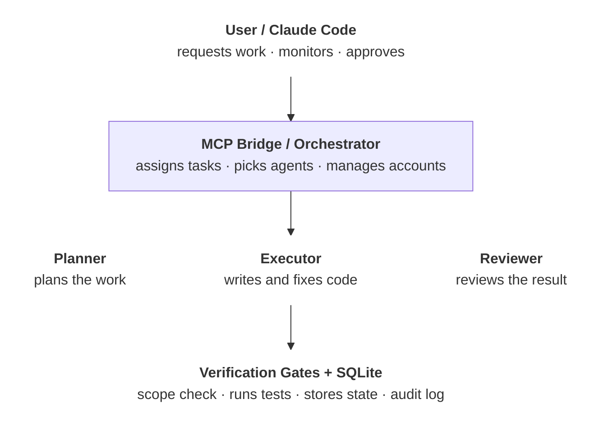
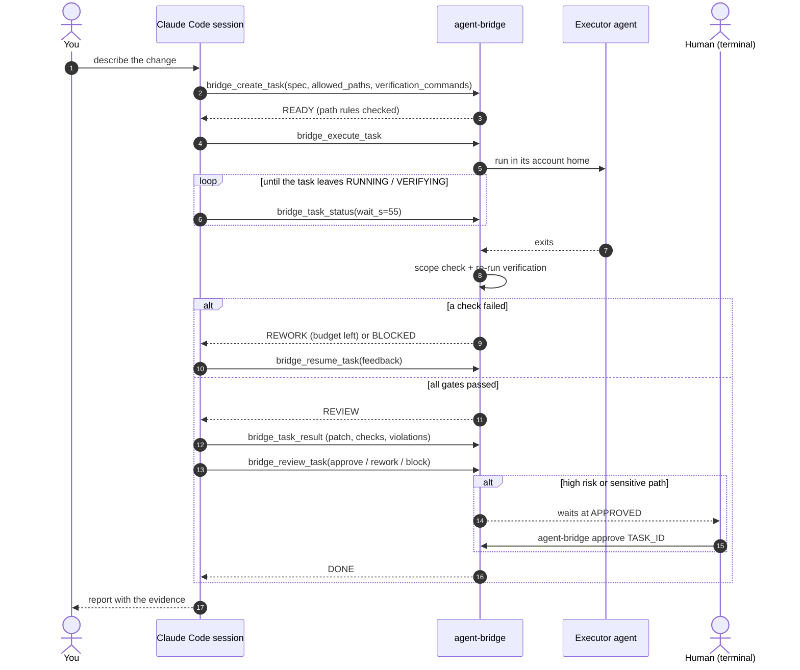

<h1 align="center">agent-orchestration-kit</h1>

<p align="center">
  Run planner, executor and reviewer AI agents on separate CLIs and accounts,<br>
  with a local MCP server that checks their work instead of trusting it.
</p>

<p align="center">
  <b>English</b> · <a href="README.vi.md">Tiếng Việt</a>
</p>

<p align="center">
  
  
  
  <a href="LICENSE"></a>
  
</p>

<p align="center">
  
</p>

When one AI agent both writes the code and judges it, nobody checks the work: "done" means
whatever the agent says, even if the tests never ran or it edited files outside its assignment.

`agent-orchestration-kit` separates those jobs. A small MCP server, `agent-bridge`, runs inside
your project: it hands each task to an executor agent (Codex CLI or Claude Code), confines the
files that agent may change, re-runs the verification commands itself and only then lets a
reviewer approve. An agent's own report is never treated as evidence, and irreversible steps
stay with a human.

It is for developers who already use Claude Code and Codex CLI with subscription logins and
want a repeatable, auditable delegation loop in one repository.

## Contents

- [Key features](#key-features)
- [Architecture](#architecture)
- [Requirements](#requirements)
- [Installation](#installation)
- [Quick start](#quick-start)
- [Configuration](#configuration)
- [Roles, adapters and providers](#roles-adapters-and-providers)
- [Workflow lifecycle](#workflow-lifecycle)
- [Security model and limitations](#security-model-and-limitations)
- [Monitoring](#monitoring)
- [Troubleshooting](#troubleshooting)
- [Development and testing](#development-and-testing)
- [Further documentation](#further-documentation)
- [Contributing and license](#contributing-and-license)

## Key features

- **Roles, agents and accounts are separate.** `planner`, `executor` and `reviewer` map to
  agents; each agent uses one adapter (`codex-cli`, `claude-cli`, `client`, or the read-only
  `opencode-cli` / `agy-cli`) and one isolated account.
- **The bridge decides pass or fail.** After every run it checks every changed file against the
  task's `allowed_paths`, confirms `HEAD` did not move and re-runs the verification commands.
- **Bounded work.** Each task has an attempt budget; failures go to `REWORK` and then
  `BLOCKED` with a diagnosis.
- **Human gates.** High-risk tasks and changes to sensitive paths (migrations, auth, deploy, CI,
  secrets) wait for `agent-bridge approve` in an interactive terminal.
- **Isolated accounts.** Each account has its own auth home (`CODEX_HOME`, `CLAUDE_CONFIG_DIR`,
  or a whole `HOME` for agy), concurrency limit and quota tracking. Optional quota fallback moves
  work to another account.
- **Planner workflows.** A planner agent can split an objective into validated tasks that run in
  dependency order.
- **Monitoring.** A terminal dashboard, table/JSON CLI views and a read-only localhost web
  dashboard.
- **Project-scoped setup.** `agent-bridge init` writes only project files; it never edits
  `~/.claude`, `~/.codex` or global MCP configuration.

## Architecture

The Claude Code session talks to the bridge only through MCP tools; the bridge starts every
other agent and gates their results.



| Component | Where it lives |
|---|---|
| MCP server and CLI (`agent-bridge`) | Installed tool; `.mcp.json` runs `agent-bridge serve` |
| Project setup | `.mcp.json`, `.claude/settings.json`, `.claude/rules/`, `.claude/skills/agent-orchestration/`, a block in `CLAUDE.md`, `.ai/` |
| Task state, logs, audit events | `~/.agent-bridge/projects/<project>/worktrees/<worktree>/bridge.db` (`AGENT_BRIDGE_HOME` overrides), outside the worktree so agents cannot write it |
| Machine-wide accounts and locks | `~/.agent-bridge/` (`accounts.json`, `accounts.db`, `homes/`, `locks/`) |

Without `.ai/orchestrator.yaml` the kit uses the **legacy setup**: the Claude Code session plans
and reviews, and Codex executes.

## Requirements

- macOS or Linux. Windows code paths exist but have not been tested on a real Windows machine.
- `git`, and [uv](https://docs.astral.sh/uv/) (uv fetches Python 3.12 or newer).
- The target project must be a git repository.
- [Claude Code](https://docs.anthropic.com/en/docs/claude-code) for the interactive session.
- At least one agent CLI logged in with its own subscription; no API key is needed:
  - Codex CLI (verified with 0.163.0; check with `codex login status`), and/or
  - Claude Code headless (verified with 2.1.306; check with `claude auth status`).
  - Optional read-only planners/reviewers: opencode, agy.

## Installation

```bash
git clone https://github.com/leetuanbmt/agent-orchestration-kit.git ~/tools/agent-orchestration-kit
uv tool install --editable ~/tools/agent-orchestration-kit   # puts `agent-bridge` on PATH
uv tool update-shell                                          # once, if ~/.local/bin is not on PATH
```

Open a new shell after `update-shell`, then check with `agent-bridge --help`.

The install is editable: the tool runs from the checkout, so the rules and skill that `init`
copies always match the installed version. Keep the checkout where it is.

- **Update:** `git -C ~/tools/agent-orchestration-kit pull`. The tool picks up the new code at
  once. Rules and the skill already copied into a project stay as they were; to refresh them,
  run `agent-bridge init --force` in that project. `--force` overwrites local edits to those
  files, after backing them up to `.ai/backup-<UTC timestamp>/`.
- **Uninstall from a project:** `agent-bridge uninstall` removes only what `init` added and keeps
  files you edited since (with a warning); `--purge` also deletes `.ai/`. Task history stays
  under `~/.agent-bridge`.
- **Uninstall the tool:** `uv tool uninstall agent-orchestration-kit`, then delete the checkout.

Without installing the tool, `scripts/setup.sh <dir> [--force]` and
`scripts/uninstall.sh <dir> [--purge]` do the same from a checkout. The `.mcp.json` they write
runs `uv run --project <kit> agent-bridge serve`, an absolute path that breaks if the kit moves.

## Quick start

**1. Set up a project.**

```bash
cd /path/to/project          # a git repository
agent-bridge init            # .mcp.json, .claude/settings.json, rules, skill, CLAUDE.md block, .ai/
claude                       # once: trust the folder so the agent-bridge server can connect
claude mcp list              # expect: agent-bridge ... Connected
```

What `init` does:

- `.mcp.json` gets `{"command": "agent-bridge", "args": ["serve"]}` with no machine-specific path,
  so it can be committed. Claude Code must find `agent-bridge` on its `PATH`.
- Existing `.mcp.json` and `.claude/settings.json` are merged key by key; other servers and deny
  rules stay. `CLAUDE.md` gets a marked block (`<!-- agent-bridge:start/end -->`).
- Every file it changes is first copied to `.ai/backup-<UTC timestamp>/`.
- A different file already at a destination, or a different `agent-bridge` server, stops `init`
  unless `--force` is given.
- The install manifest is kept in `<git-dir>/agent-bridge/install-manifest.json`, outside any
  agent's reach.
- Projects set up by the older `codex-bridge` kit are upgraded: its server, settings entries,
  `CLAUDE.md` block and state directory are replaced, and unedited `codex-*` rule and skill files
  are removed (edited ones are kept with a warning). Permission rules you wrote for
  `mcp__codex-bridge__*` tools must be renamed by hand.

**2. Choose a setup (optional).** Skip this to use the legacy setup (Claude Code plans and
reviews, Codex executes on its global login).

```bash
agent-bridge config-init orchestrator   # writes .ai/orchestrator.yaml; never overwrites
agent-bridge config-check               # validate
agent-bridge agents                     # who plans, executes and reviews; who is available
```

**3. Check health.**

```bash
agent-bridge health          # adapters, logins, quota, task counts; exits 1 when not OK
```

**4. Ask Claude Code for a change.** The installed `agent-orchestration` skill drives one of two
flows:

```text
you plan:     bridge_create_task → bridge_execute_task → bridge_task_status(wait_s)
                → bridge_task_result → bridge_review_task (→ bridge_resume_task for rework)
agent plans:  bridge_plan → bridge_workflow_status(wait_s) → bridge_run_workflow
                → bridge_workflow_status (DONE / INCOMPLETE / WAITING)
```

**5. Follow progress** with `agent-bridge` (terminal dashboard) or `agent-bridge web`. See
[Monitoring](#monitoring).

## Configuration

Two optional files in the project's `.ai/` directory:

| File | Purpose |
|---|---|
| `.ai/orchestrator.yaml` | Accounts, agents, roles, routing, workflow stages. Git-ignored (it names machine-specific homes). |
| `.ai/config.json` | Bridge settings: sandbox, timeouts, path rules, verification allowlist. Tracked. |

```yaml
version: 1
accounts:
  codex-work:  {provider: openai,    home: ~/.codex-accounts/homes/work}
  claude-main: {provider: anthropic, home: ~/.claude-accounts/main, max_concurrency: 1}
agents:
  claude:          {adapter: client}                         # the MCP caller
  claude-headless: {adapter: claude-cli, account: claude-main, model: sonnet}
  codex-a:         {adapter: codex-cli,  account: codex-work}
roles:
  planner: claude-headless
  executor: {agents: [codex-a], strategy: ordered}
  reviewer: claude                                           # you review via bridge_review_task
routing:
  quota_fallback: {enabled: false, min_remaining_pct: 10}
workflow:
  stages: [plan, execute, test, review]
  max_rework: 2
```

Shipped examples (`agent-bridge config-init <name>`):

| Example | Planner | Executor | Reviewer |
|---|---|---|---|
| *(no file, legacy)* | Claude Code session | Codex | Claude Code session |
| [`orchestrator`](examples/orchestrator.yaml) | Claude headless | Codex on two accounts, fallback order | Claude headless |
| [`claude-executor`](examples/claude-executor.yaml) | Codex | Claude headless (`allow_write`) | Codex |
| [`single-agent`](examples/single-agent.yaml) | Codex | Codex | Codex |
| [`gates-only`](examples/gates-only.yaml) | — | Codex | None: deterministic gates only |
| [`other-reviewers`](examples/other-reviewers.yaml) | agy | Codex | opencode |

Accounts are logged in by a human, either per project (`agent-bridge account-login <name>`) or
machine-wide (`agent-bridge account-add <name> --provider …`). Quota fallback is off by
default; enabling it authorises the bridge to move a task to another account when quota runs
low (never on AUTH failures).

Full reference: every key and default, accounts, quota, quota fallback and state storage are in
[docs/configuration.md](docs/configuration.md).

## Roles, adapters and providers

| Adapter | Provider | Can write | Isolation | Account home |
|---|---|---|---|---|
| `codex-cli` | `openai` | Yes (default) | Codex OS sandbox (`workspace-write` / `read-only`), no network | `CODEX_HOME` |
| `claude-cli` | `anthropic` | Only with `allow_write: true` | CLI permission rules; no OS sandbox | `CLAUDE_CONFIG_DIR` |
| `client` | — | No | The MCP caller itself; never started by the bridge | — |
| `opencode-cli` | `opencode` | No (refused by config) | Tool permissions denied via config; no OS sandbox | Global login only |
| `agy-cli` | `google` | No (refused by config) | `--mode plan --sandbox`; no OS sandbox | A whole `HOME` |

- `executor` must be able to write, so it is `codex-cli` or `claude-cli` with `allow_write`.
- `planner` and `reviewer` need only read access; `client` means you, through
  `bridge_review_task`.
- **Routing.** A task pinned with `agent` or `account` runs there. Otherwise the bridge picks
  the role's `default`, then the first eligible agent in role order, when the task first starts.
  An account whose slots are all held by other bridge processes on the machine is not eligible.
  The task keeps that agent and session for retries.

## Workflow lifecycle

One task, from request to report:



States: `BACKLOG → READY → RUNNING → VERIFYING → REVIEW → APPROVED → DONE`, plus `REWORK`,
`FAILED`, `PAUSED`, `BLOCKED` and `CANCELLED`. `DONE`, `CANCELLED` and `BLOCKED` are terminal.

| Move | Who | Trigger |
|---|---|---|
| `BACKLOG → READY` | Bridge | Every `depends_on` task is `DONE` |
| `READY` / `REWORK` / `FAILED` / `PAUSED` → `RUNNING` | Client or workflow driver | `bridge_execute_task`, `bridge_resume_task`, `bridge_run_workflow` |
| `RUNNING → VERIFYING` | Bridge | The agent exited cleanly |
| `RUNNING → FAILED` | Bridge | Timeout or crash (`BLOCKED` when the attempt budget is spent) |
| `RUNNING` / `VERIFYING → PAUSED` | Bridge | Quota, auth, network, missing CLI or interrupted runner (a stop signal or a dead runner); does not use the attempt budget |
| `VERIFYING → REVIEW` | Bridge | Scope clean, every verification command passed, agent reported `completed` |
| `VERIFYING → REWORK` | Bridge | Any check failed (`BLOCKED` when the budget is spent); an agent that reports `blocked` and changed nothing skips the checks (`verification.skipped`) |
| `REVIEW → APPROVED` / `REWORK` / `BLOCKED` | Client or reviewer agent | `bridge_review_task` or reviewer run |
| `REVIEW → APPROVED` | Bridge | No `review` stage and every gate passed |
| `APPROVED → DONE` | Bridge, or a human for high risk | Quality gates re-checked |
| Any non-terminal → `CANCELLED` | Client | `bridge_cancel_task` |

A task runs at most `max_rework + 1` times (default 3). A runner that dies mid-run is detected on
the next bridge start: the task becomes `PAUSED` (`INTERRUPTED`) and `bridge_resume_task`
continues the same session. A runner that is stopped by SIGTERM, SIGINT, SIGHUP or SIGALRM (for
example a caller's timeout on `execute`, `resume`, `plan` or `run-workflow`) parks its task the
same way before it exits with 128 + the signal number, and gives the attempt back; `serve` shuts
down the same way. Only SIGKILL leaves the task `RUNNING` until the next start.

## Security model and limitations

The kit reduces what an agent can do and verifies what it did. It is not a complete sandbox for
untrusted code.

**Enforced by the bridge, for every adapter:**

- **Paths.** Checked at task creation (absolute paths, `..`, `~`, symlink escape, protected
  paths, over-broad globs) and after each run (hash snapshot, full worktree diff, `HEAD` must not
  move). Protected paths (`.env*`, keys, `.git/`, `.ai/`, `.mcp.json`, `.claude/settings*.json`)
  can never be allowed. The after-run check sees the files `git status` lists, so git-ignored
  output (a build directory, `tools/bin/…`) is neither a scope violation nor part of the patch.
  Top-level protected files and `.ai/config.json` / `.ai/orchestrator.yaml` are checked even
  when ignored; an output path that is not ignored counts as an out-of-scope change.
- **Verification.** Re-run by the bridge with argv lists only (no shell), allowlisted
  executables and a timeout.
- **Approval.** Executors cannot approve. The client or a reviewer agent approves; the bridge
  approves only when the workflow has no `review` stage. High-risk or sensitive-path tasks need a
  human at an interactive terminal.
- **Processes.** Agents and verification commands start from argv lists in their own process
  group; timeout or cancel sends SIGTERM, then SIGKILL. The runner polls for a cancel every
  second, in any process (a CLI `execute` too): it kills the agent or the running check, skips
  the remaining checks and frees the account, and `cancel` waits for that before it returns. Orphaned groups from a dead runner are killed on the next start,
  only if the PID is a `codex`, `claude`, `opencode` or `agy` process.
- **Environment and output.** Credential-shaped variables (`*_API_KEY`, `*_TOKEN`, `*_SECRET*`,
  `*PASSWORD*`, `AWS_*`) are removed before an agent or verification command starts. Stored output
  passes through secret redaction.
- **Recursion guard.** Every agent process gets `AGENT_BRIDGE_AGENT=1`; the server and CLI refuse
  to start under it.
- **Audit.** Every transition, attempt, routing decision, review, account change and workflow
  state is an event in `bridge.db`.

**Per adapter:**

- **Codex CLI** runs in its OS sandbox (`workspace-write` or `read-only`; `danger-full-access`
  cannot be configured), without network, with `/tmp` and `$TMPDIR` not writable and
  `~/.codex/config.toml` ignored. Planner and reviewer runs are `read-only`.
- **Claude CLI** has no OS sandbox. The bridge runs it with `--strict-mcp-config` (no MCP
  servers), `--setting-sources ""` (no user or project settings, allow rules or hooks),
  `--permission-mode dontAsk` and an allowlist of Read/Glob/Grep. With `allow_write: true` it also
  gets Edit/Write scoped to the task's `allowed_paths`, with excluded and protected paths denied.
  Read tools can still read anything your user can, and `allow_bash: true` is not path-confined.
  Prefer Codex as the executor and never combine `allow_bash` with untrusted work.
- **opencode and agy** are read-only. opencode runs with edit, bash, webfetch and external
  directories denied through `OPENCODE_CONFIG_CONTENT`; agy runs with `--mode plan --sandbox` and
  keeps browser tools the CLI cannot disable. Probes wrote no files with either; neither has an
  OS sandbox.
- **Optional `claude_hook_settings`** in `.ai/config.json` passes a hooks-only settings file to
  every Claude run. These hooks are trusted code running unsandboxed; the option is off by
  default.

**Credentials.** Each account uses its own auth home, created by a fresh login, never by copying
another profile's tokens. The bridge reads only Codex `rate_limits` events from
`<home>/sessions/**/rollout-*.jsonl`; it never reads `auth.json` or other credential files.

**Known limitations:**

- Deny rules in `.claude/settings.json` guide Claude Code; they are not a security boundary. The
  interactive-terminal check for human-only commands can be defeated by an agent that allocates
  a pseudo-terminal.
- Verification commands run outside the Codex sandbox, with your permissions.
- The post-run snapshot covers tracked, modified and top-level protected files; a change to a
  nested, git-ignored secret file is not detected.
- Codex and Claude still write their own session files (`~/.codex/sessions`, `~/.claude.json`).
- Files under `.ai/` other than `config.json` are git-ignored and writable by Codex; treat them
  as convenience copies, not trusted input.
- One writer per worktree; the workflow driver runs tasks one at a time. Parallel writes need
  separate worktrees.
- Claude quota is known only after the account's first run through the bridge; Codex quota is a
  snapshot from the latest session, not a live query.
- The Codex sandbox behaviour was verified on macOS only.
- Not supported: opencode or agy as executors, routing strategies beyond "first eligible",
  multi-reviewer voting, and stages for custom roles. Another CLI needs a new `Adapter` subclass.

More detail: [docs/REPORT.md](docs/REPORT.md) (verified CLI versions, probes and the full
limitation list).

## Monitoring

### Terminal dashboard

Run `agent-bridge` (or `agent-bridge tui`) in the project. It refreshes every 3 seconds and never
starts an agent: runs belong to the MCP server process.

- **Search**, **Agents** and **Accounts** on the left. Accounts lists every account the machine
  knows: project and machine-wide accounts, codex-switch homes not yet added, codex-switch and
  claude-switch profiles (marked not usable) and installed CLIs without an account.
- **Needs you** (tasks in `APPROVED`, `REVIEW`, `PAUSED`, `FAILED`, `BLOCKED`) and **Tasks** in
  the middle.
- **Detail** on the right: a task's objective, checks, diff stat and reviews, or an account's
  provider, login, state, quota, home and last error.

Press **Enter** on a row for the actions that fit it; the footer shows only keys valid for the
focused row.


| Key | Action |
|---|---|
| `Tab` / `Shift+Tab`, `↑` `↓` | Move between panels and rows (the mouse works too) |
| `Enter` | Actions for the selected task or account |
| `/` | Search tasks by id, state, agent or objective |
| `p` / `a` / `v` | Patch / approve a task waiting for a human / review a task in `REVIEW` |
| `c` / `m` | Cancel a task / move it to another agent (new session) |
| `l` / `u` / `x` / `d` | On an account: log in / open a shell as it (agy: shows the `eval` line) / mark available / remove |
| `n` | Add a machine-wide account (on a codex-switch home row: add that home) |
| `s` | Settings; `e` there edits `.ai/orchestrator.yaml` (or `config.json`) in `$EDITOR` |
| `?` / `q` | Keys / quit |

### CLI views

These print tables in a terminal and JSON with `--json` or when piped:

```bash
agent-bridge health        # adapters, quota per account, task counts
agent-bridge agents        # roles, agents and availability
agent-bridge account-list  # accounts and login state; --all adds profiles and unused CLIs
agent-bridge list          # tasks of this project, newest first
agent-bridge tasks         # tasks of every project and worktree on this machine
```


The screenshots come from an end-to-end run of the installed tool on invented data (fake agent
CLIs, a fresh `HOME`, a demo project). Regenerate them with
`"$(uv tool dir)/agent-orchestration-kit/bin/python" scripts/screenshots.py docs/images`.

### Web dashboard

`agent-bridge web [--port N] [--open]` serves a browser dashboard on `127.0.0.1` (default port
8765; `--port 0` picks a free one; Ctrl+C stops it). The printed URL carries a per-launch secret
token that every API request needs; do not share it.

It covers every project agent-bridge knows on this machine and their git worktrees: pending
approvals with the exact command, blocked, failed and paused tasks, tasks waiting for review,
running tasks with elapsed time versus timeout, overall progress, activity over the last 24 hours
and a requests table with a detail drawer (no patch). The interface switches between Vietnamese
and English.

The web dashboard is read-only: it opens each `bridge.db` with SQLite `mode=ro`, starts no agent
and performs no human action. It listens on `127.0.0.1` only and rejects other `Host` headers.

## Troubleshooting

| Symptom | Cause and fix |
|---|---|
| `agent-bridge: command not found` | Run `uv tool update-shell` and open a new shell. |
| `not a git repository` or `Target must be a git work tree` | The bridge only runs inside a git repository; run `git init` or change directory. |
| `claude mcp list` shows `agent-bridge: ⏸ Pending approval` | Open `claude` in the folder once and trust it. |
| `config-check` error | The message names the field; fix `.ai/orchestrator.yaml`. |
| `health` reports NOT OK | An adapter CLI is missing or not logged in; a human logs in. |
| `no eligible executor agent (…)` | Every executor is disabled, busy or unavailable; the reasons are listed per agent. |
| Task `PAUSED` with `QUOTA` or `AUTH` | Wait for the quota window to reset, or fix the login; then `agent-bridge account-clear <name>` if the mark remains, and resume. With quota fallback enabled, resume may move the task to another account. |
| Task `PAUSED` with `INTERRUPTED` | The runner was stopped by a signal or died; `bridge_resume_task` continues the session, `cancel` drops it. |
| `agent_review_failed` event | The reviewer agent errored; the task waits in `REVIEW` for `bridge_review_task`. |
| Workflow `WAITING` | `detail.waiting` and the task states say what needs attention; run `bridge_run_workflow` again afterwards. |
| `ConflictError … already writing` | One writer per worktree; wait, or use another worktree. |
| `account … busy in another bridge process` | The account's concurrency slots are in use elsewhere. Unpinned tasks route around it; a task pinned to it stays `READY` with no attempt spent, so start it again once a slot is free. |
| `REWORK` with `outside allowed paths` | The executor changed files outside the task; read the patch and rework. |
| `health` warns about legacy storage | Migrate with `agent-bridge storage status`, then `storage migrate --apply` ([details](docs/configuration.md#migrating-and-maintaining-state)). |

## Development and testing

```bash
uv sync                          # project-local .venv with Python 3.12+
scripts/check.sh                 # full test suite with fake CLIs (deterministic, no quota used)
scripts/check.sh --with-health   # also requires `agent-bridge health` to report OK
```

Opt-in smoke tests against the real CLIs use your quota:

```bash
CODEX_SMOKE=1 uv run pytest -m real_codex                                        # two real Codex runs
CLAUDE_SMOKE=1 uv run pytest tests/e2e/test_real_claude_smoke.py                 # one real Claude review
OPENCODE_SMOKE=1 AGY_SMOKE=1 uv run pytest tests/e2e/test_real_other_smoke.py    # real opencode / agy reviews
```

The fake CLIs in `tests/fakes/` (`codex`, `claude`, `opencode`, `agy`) speak the real JSONL and
stream-json protocols. The suite covers the shipped configurations, routing, pinning, affinity,
quota fallback, bounded rework, reviewer failure, config validation, account isolation,
concurrency slots, legacy mapping, schema upgrades, storage migration, machine-wide accounts and
the dashboards.

## Further documentation

| Document | Content |
|---|---|
| [docs/configuration.md](docs/configuration.md) | Every `orchestrator.yaml` and `config.json` key, accounts, quota, quota fallback, state storage and migration |
| [docs/cli-reference.md](docs/cli-reference.md) | MCP tools with parameters, every CLI command and human-only commands |
| [docs/REPORT.md](docs/REPORT.md) | Build report: verified CLI versions, security probes, known limitations |
| [CHANGELOG.md](CHANGELOG.md) | Release history |

## Contributing and license

Before opening a pull request, run `scripts/check.sh`, add a `CHANGELOG.md` entry under
*Unreleased*, and keep this README and [README.vi.md](README.vi.md) in sync.

Released under the [MIT License](LICENSE) © leetuanbmt.
