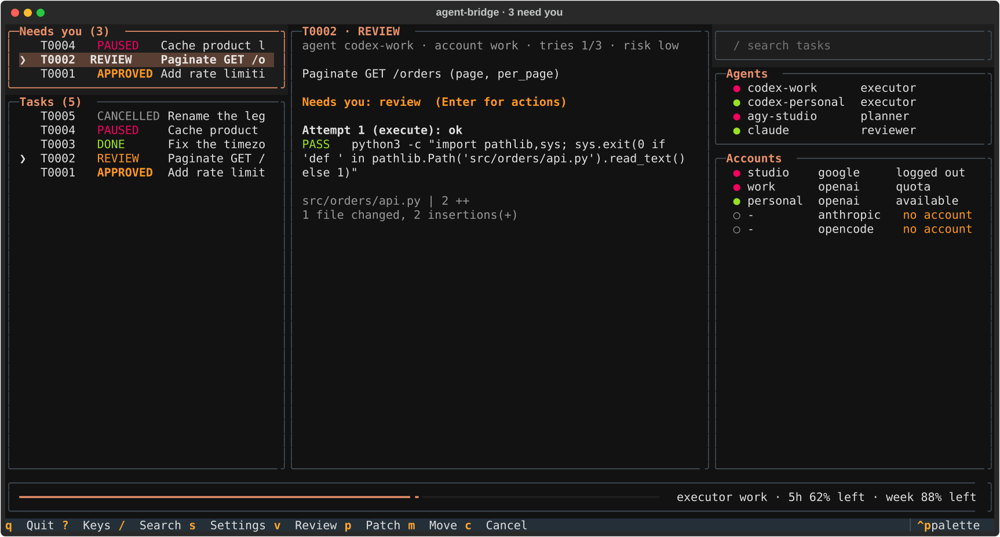
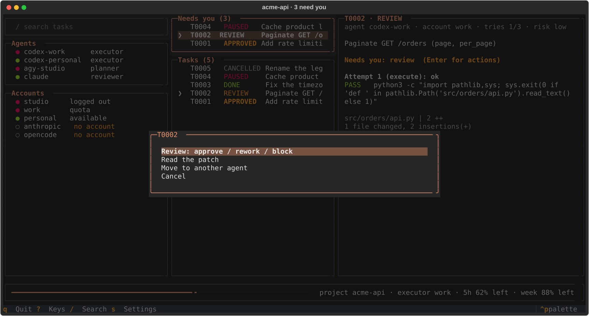
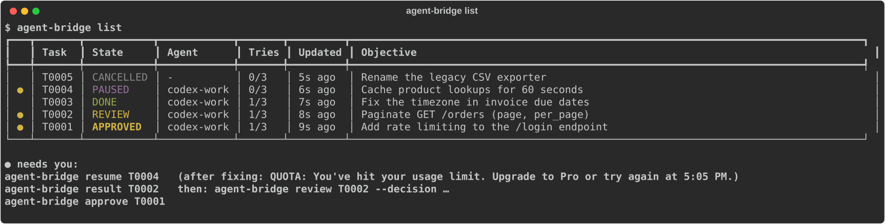
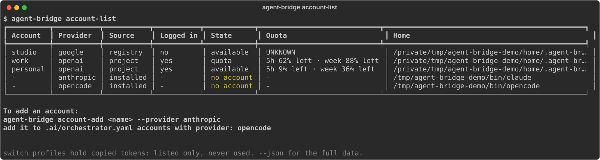

<h1 align="center">agent-orchestration-kit</h1>

<p align="center">
  A project-local, provider-agnostic harness for <b>multi-agent coding workflows</b>.<br>
  Roles (planner, executor, reviewer) map to agents; agents run on CLIs (Codex, Claude Code) with isolated accounts.<br>
  A small MCP server (<code>agent-bridge</code>) owns task state, runs agents safely and re-verifies their work.<br>
  Everything lives in the repository; no global configuration is touched.
</p>

<p align="center">
  <b>English</b> · <a href="README.vi.md">Tiếng Việt</a>
</p>

<p align="center">
  
  
  
  
</p>

<p align="center">
  
</p>

---

When one AI agent both writes the code and judges it, nobody checks the work: "done" means
whatever the agent says, even if the tests never ran or it edited files outside its assignment.

`agent-orchestration-kit` separates the jobs and lets you choose who does each one:

- **Roles**: `planner` splits work into tasks, `executor` implements one task at a time,
  `reviewer` decides approve / rework / block. Custom roles can be added.
- **Agents**: an adapter (`codex-cli`, `claude-cli`, `client` = the MCP caller itself, or the
  read-only `opencode-cli` / `agy-cli` for planning and review), one account, an optional model,
  read/write capabilities.
- **Accounts**: isolated logins (`CODEX_HOME`, `CLAUDE_CONFIG_DIR`, a whole `HOME` for agy),
  each with its own concurrency limit and quota. Machine-wide accounts are created and switched
  with `agent-bridge` itself; no other switcher is needed.
- **`agent-bridge`**: keeps task state in SQLite, routes tasks to agents, runs them with the
  narrowest permissions, checks which files changed and re-runs the verification commands
  itself. An agent's own report is never treated as evidence.

```
user ─▶ MCP client (Claude Code) ──MCP stdio──▶ agent-bridge ──argv, own process group──▶ codex exec --json
          (plan, review, or just drive)          (roles → agents → accounts,              claude -p --output-format stream-json
                                                  scope check, verification, audit log)   (plan / implement / review)
```

Without `.ai/orchestrator.yaml` the kit behaves exactly as 0.1: the Claude Code session plans
and reviews, Codex executes, accounts come from `.ai/config.json`.

Everything is project-local: `.mcp.json`, `.claude/`, `CLAUDE.md`, `.ai/`, and runtime state in
the repository's git directory (`.git/agent-bridge/`). Nothing under `~/.claude`, `~/.codex` or
global MCP config is modified.

---

## Installation

**Requirements:**
- macOS or Linux, git, [uv](https://docs.astral.sh/uv/) (Python 3.12 is fetched by uv).
- At least one agent CLI, logged in with its own subscription: Codex CLI (tested 0.163.0,
  `codex login status`) and/or Claude Code (tested 2.1.306, `claude auth status`). No API key
  needed.

```bash
git clone https://github.com/leetuanbmt/agent-orchestration-kit.git ~/tools/agent-orchestration-kit
uv tool install --editable ~/tools/agent-orchestration-kit   # puts `agent-bridge` on your PATH
uv tool update-shell                                          # once, if ~/.local/bin is not on PATH
```

The install is editable: the tool runs from the checkout, so `git pull` there updates it and the
rules and skill `init` copies always come from the same version. Keep the checkout where it is.

### Set up a project

Run `init` in the folder that should use the bridge; its settings stay in that folder.

```bash
cd /path/to/project
agent-bridge init            # .mcp.json, .claude/settings.json, rules, skill, CLAUDE.md block, .ai/
claude                       # once: trust the folder → agent-bridge connects
claude mcp list              # agent-bridge: ✔ Connected
agent-bridge                 # the dashboard for this project
```

- `.mcp.json` gets `{"command": "agent-bridge", "args": ["serve"]}`, with no machine-specific
  path, so it can be committed. Claude Code must find `agent-bridge` on its `PATH`.
- Existing `.mcp.json` and `.claude/settings.json` are merged key by key (other servers, deny
  rules and settings stay); `CLAUDE.md` gets a marked block (`<!-- agent-bridge:start/end -->`).
  Every file `init` changes is first copied to `.ai/backup-<UTC timestamp>/`.
- Rules are installed as `.claude/rules/{orchestration,delegation,security}.md` and the skill as
  `.claude/skills/agent-orchestration/`. A different file already at a destination, or a
  different `agent-bridge` server, stops `init` unless `--force` is given.
- Upgrading an install made by an older kit: its `codex-bridge` server, settings entries,
  `CLAUDE.md` block and state directory are replaced by the `agent-bridge` ones, and unedited
  `codex-*` rule and skill files are removed (kept with a warning when edited). Permission rules
  you wrote yourself for `mcp__codex-bridge__*` tools need renaming by hand.
- The install manifest is kept in `<git-dir>/agent-bridge/install-manifest.json`, out of any
  agent's reach. `agent-bridge uninstall [--purge]` removes only what `init` added and keeps
  files you edited since (with a warning); `--purge` also deletes `.ai/`, including its config.
- Without the tool, `scripts/setup.sh <dir> [--force]` and `scripts/uninstall.sh <dir> [--purge]`
  do the same from a checkout; that `.mcp.json` then runs `uv run --project <kit> agent-bridge
  serve`, an absolute path that breaks if the kit moves.

Working on the kit itself: `uv sync`, then `scripts/check.sh --with-health`.

---

## Quick start

### 1. Pick a setup

Copy one of the examples to `.ai/orchestrator.yaml` (or keep none for the legacy setup), then:

```bash
agent-bridge config-check   # schema check with descriptive errors
agent-bridge agents         # who plans, executes, reviews; who is available now
```

| Example | Planner | Executor | Reviewer |
|---|---|---|---|
| *(no file, legacy)* | Claude Code session | Codex (per `config.json` account) | Claude Code session |
| [`examples/orchestrator.yaml`](examples/orchestrator.yaml) | Claude headless | Codex on two accounts (fallback order) | Claude headless |
| [`examples/claude-executor.yaml`](examples/claude-executor.yaml) | Codex | Claude headless (`allow_write`) | Codex |
| [`examples/single-agent.yaml`](examples/single-agent.yaml) | Codex | Codex | Codex |
| [`examples/gates-only.yaml`](examples/gates-only.yaml) | — | Codex | none: deterministic gates only |

### 2. Ask Claude Code for the change

The `agent-orchestration` skill drives either flow:

```
you plan:      bridge_create_task → bridge_execute_task → bridge_task_status(wait_s)
                 → bridge_task_result → bridge_review_task (→ bridge_resume_task for rework)
agent plans:   bridge_plan → bridge_workflow_status(wait_s) → bridge_run_workflow
                 → bridge_workflow_status (DONE / INCOMPLETE / WAITING)
```

### 3. Follow it in the dashboard

Run `agent-bridge` in the project. One screen, refreshed every 3 seconds:

- **Needs you** (left, top): tasks waiting for you (APPROVED, REVIEW, PAUSED, FAILED, BLOCKED).
  **Tasks** below it: every task.
- **Detail** (middle): the selected task's objective, checks (PASS / FAIL), diff stat, reviews.
- **Search**, **Agents** and **Accounts** (right). Accounts lists every account the machine
  knows about: project and machine-wide accounts, codex-switch homes not added yet,
  codex-switch and claude-switch profiles (marked not usable: they hold copied tokens) and
  installed agent CLIs without an account.
- The bottom bar shows the executor account's remaining quota.

Press **Enter** on any row for the actions that fit it, so no key has to be remembered. The
footer shows only the keys that work on the focused row.



| Key | Action |
|---|---|
| `Tab` / `Shift+Tab`, `↑` `↓` | Move between panels / rows (the mouse works too) |
| `Enter` | Actions for the selected task or account |
| `/` | Search tasks by id, state, agent or objective |
| `p` / `a` / `v` | Patch / approve a task waiting for a human / review a task in `REVIEW` |
| `c` / `m` | Cancel a task / move it to another agent (new session) |
| `l` / `u` / `x` / `d` | On an account: log in / open a shell as it (agy: shows the `eval` line) / mark available / remove |
| `n` | Add a machine-wide account (on a codex-switch home row: add that home) |
| `s` | Settings; `e` there edits `.ai/orchestrator.yaml` (or `config.json`) in `$EDITOR` |
| `?` / `q` | Keys / quit |

The dashboard never starts an agent: a run belongs to the process that started it (the MCP
server), and quitting the dashboard would interrupt it. The same data is available as tables
in a terminal (JSON with `--json` or through a pipe):

```bash
agent-bridge health        # adapters, remaining quota per account, task counts
agent-bridge account-list  # accounts, login state, codex-switch / claude-switch, unused CLIs
agent-bridge list          # tasks, newest first
```




The screenshots come from an end-to-end run of the installed tool on invented data (fake agent
CLIs, a fresh `HOME`, a demo project under `/tmp/agent-bridge-demo`). Regenerate them with
`"$(uv tool dir)/agent-orchestration-kit/bin/python" scripts/screenshots.py docs/images`.

---

## Roles and agents (`.ai/orchestrator.yaml`)

```yaml
version: 1
accounts:
  codex-work:  {provider: openai,    home: ~/.codex-accounts/homes/work}
  claude-main: {provider: anthropic, home: ~/.claude-accounts/main, max_concurrency: 1}
agents:
  claude:          {adapter: client}                         # the MCP caller
  claude-headless: {adapter: claude-cli, account: claude-main, model: sonnet}
  codex-a:         {adapter: codex-cli,  account: codex-work}
roles:
  planner: claude-headless
  executor: {agents: [codex-a], strategy: ordered}
  reviewer: claude                                           # you review via bridge_review_task
routing:
  quota_fallback: {enabled: false, min_remaining_pct: 10}
workflow:
  stages: [plan, execute, test, review]
  max_rework: 2
```

| Section | Keys |
|---|---|
| `accounts.<id>` | `provider` (`openai` \| `anthropic` \| `google` \| `opencode`; opencode has no `home`), `home` (isolated auth home; omit for the inherited global login, used read-only), `max_concurrency` (1–8) |
| `agents.<id>` | `adapter` (`codex-cli` \| `claude-cli` \| `client` \| `opencode-cli` \| `agy-cli`; the last two are read-only), `account`, `model`, `capabilities` (`[read, write]` subset), `allow_write` (claude-cli only writes when true), `allow_bash` (claude-cli), `timeout_s`, `enabled` |
| `roles.<name>` | an agent id, or `{agents: [...], strategy: ordered \| explicit, requires: read \| write}`. `executor` is required and must be able to write; `planner`/`reviewer` need read |
| `routing.quota_fallback` | `enabled`, `min_remaining_pct`, `agents` (candidates in order; default: the executor role) |
| `workflow` | `stages` (ordered subset of `plan, execute, test, review`; needs `execute` and at least one gate), `max_rework` (0–4) |

Unknown keys, unknown ids, a provider/adapter mismatch, two accounts sharing one home, or a role
no listed agent can play are rejected with the field path in the message.

- **Routing.** A task pinned by `agent` (or `account`) runs there. Otherwise the first eligible
  executor in role order is chosen when it first starts (enabled, CLI installed, can write,
  account available and under `max_concurrency`), logged as `agent_routed`; the task then keeps
  that agent and session. `strategy: explicit` requires every task to name its agent.
- **Review stage.** A `client` reviewer is the MCP caller. A reviewer agent runs read-only after
  the bridge's checks pass; its decision is recorded with `reviewer: <agent>`. If it fails, the
  task stays in REVIEW and the caller decides. Without a `review` stage the bridge approves work
  that passed every gate (`reviewer: bridge`); high-risk work still waits for a human.
- **Plan stage.** `bridge_plan` runs the planner agent read-only; the bridge validates every
  planned task (paths, commands, dependencies) before creating any, then `bridge_run_workflow`
  executes them in dependency order, one at a time.

---

## Task lifecycle

States: `BACKLOG → READY → RUNNING → VERIFYING → REVIEW → APPROVED → DONE`, plus `REWORK`,
`FAILED`, `PAUSED`, `BLOCKED`, `CANCELLED`.

| Move | Who | Trigger |
|---|---|---|
| `RUNNING → VERIFYING` | bridge | the agent exited cleanly |
| `VERIFYING → REVIEW` / `REWORK` | bridge | scope clean and every verification command passed / any check failed |
| `RUNNING → PAUSED` | bridge | quota, auth, network, missing CLI, interrupted runner (does not consume the attempt budget) |
| `REVIEW → APPROVED` / `REWORK` / `BLOCKED` | client or reviewer agent | `bridge_review_task` / reviewer run |
| `REVIEW → APPROVED` | bridge | no review stage and every gate passed |
| `APPROVED → DONE` | bridge, or a **human** for high risk | quality gates re-checked |

A task with `risk_level: high`, or a change under a sensitive path (migrations, auth, deploy, CI,
secrets), stops at `APPROVED` until a human runs `agent-bridge approve <id>` in a terminal.

---

## Command reference

### MCP tools

| Tool | Description |
|---|---|
| `bridge_health` | Adapters (path/version), Codex login, active tasks, remaining quota % per account |
| `bridge_list_agents` | Agents, roles, capabilities, availability, stages, quota fallback |
| `bridge_list_accounts` | Accounts, login state, quota snapshot (5h / 7d windows), codex-switch homes/profiles (no credentials) |
| `bridge_create_task` | Validated task contract (paths, criteria, verification, deps, risk, agent/account) |
| `bridge_execute_task` | Start the executor agent in the background |
| `bridge_task_status` | Compact state; `wait_s ≤ 55` long-poll |
| `bridge_task_result` | Spec, attempts, agent final JSON, diff stat + patch, bridge checks, reviews |
| `bridge_review_task` | approve / rework / block by the client (also overrides a failed reviewer agent) |
| `bridge_resume_task` | Rework or recover, same session and agent |
| `bridge_cancel_task` | Kill the run's process group and cancel |
| `bridge_list_tasks` | Newest first, optional state filter |
| `bridge_plan` | Run the planner agent; creates a workflow |
| `bridge_workflow_status` | Workflow state and tasks; `wait_s ≤ 55` long-poll |
| `bridge_run_workflow` | Drive a workflow until DONE / INCOMPLETE / WAITING |

### CLI (`agent-bridge <cmd>`)

| Command | Description |
|---|---|
| *(none)* / `tui` | Dashboard for the project in the current directory |
| `init [dir] [--force]` / `uninstall [dir] [--purge]` | Install into / remove from a project |
| `serve` | MCP stdio server (what `.mcp.json` runs) |
| `config-check` | Validate `.ai/orchestrator.yaml` (or the legacy config) |
| `agents [--json]` | Roles → agents, then a table of agents with capabilities and availability |
| `health [--json]` | OK / NOT OK, adapters, quota, task counts and what to fix; exits 1 when not OK |
| `create <spec.json>` | Create a task from a spec file |
| `execute` / `status` / `result` | Run a task, read its state, read its result |
| `review` / `resume` / `cancel` | Review, continue or cancel a task |
| `plan "<objective>"` / `run-workflow <W…>` / `workflow-status <W…>` | Planner-agent workflows |
| `list [--json]` | Tasks with state, tries and age; tasks that need you are marked `●` with the next command |
| `account-list [--json]` | Every account: project and machine-wide accounts, codex-switch / claude-switch, installed CLIs without an account, with the command to add each |

In a terminal these four print tables; with `--json`, or when the output is piped, they print
the same JSON the MCP tools return.
| `account-use <name> [--shell]` | Print `export`/function lines for `eval "$(…)"`, or open a subshell, so your interactive CLI uses that account |
| `account-clear <name>` | Clear an account's unavailable flag after the user confirms |

**Human-only** (need an interactive terminal and a typed confirmation, or the dashboard):

| Command | Description |
|---|---|
| `approve <id>` | Approve a high-risk / sensitive-path task |
| `reassign <id> <agent\|account>` | Move a task to another agent (new session) |
| `account-login <name>` | Fresh login into the account's own home (`codex login`, `claude auth login`, `agy`, `opencode auth login`) |
| `account-add <name> --provider openai\|anthropic\|google [--home DIR]` | Create a machine-wide account (fresh home under `~/.agent-bridge/homes/` unless `--home`), then log in |
| `account-remove <name>` | Forget a machine-wide account; deletes its home only if `account-add` created it |

---

## Bridge configuration (`.ai/config.json`, optional)

See `.ai/config.example.json`. Unknown keys are rejected.

| Key | Default | Meaning |
|---|---|---|
| `sandbox` | `workspace-write` | or `read-only`; `danger-full-access` is not accepted |
| `codex_bin` / `claude_bin` / `opencode_bin` / `agy_bin` | `codex` / `claude` / `opencode` / `agy` | CLI executables |
| `default_timeout_s` / `max_timeout_s` | 1800 / 7200 | per-run limits |
| `max_attempts` | 3 | legacy setup only; with `orchestrator.yaml` use `workflow.max_rework` |
| `network_retries` / `retry_backoff_s` | 1 / 10 | bounded retry for network errors only |
| `verify_timeout_s` | 900 | per verification command |
| `verify_allowlist` | pytest, uv, python, … | executables verification may start |
| `protected_paths` | `.env*`, keys, `.git/**`, `.ai/**`, … | never writable by a task |
| `sensitive_paths` | migrations, auth, deploy, CI, secrets | change ⇒ human approval |
| `env_deny` / `env_allow` | `*_API_KEY`, `*_TOKEN`, … | scrubbed from agent/verify env |
| `accounts` / `default_account` / `auto_switch` | — | legacy setup only; with `orchestrator.yaml`, `accounts` or an enabled `auto_switch` here is an error |
| `lock_dir` | system temp | cross-process account locks |

### State and files

| Path | Tracked | Content |
|---|---|---|
| `.ai/config.json` | yes | bridge config; any change by an agent is a scope violation |
| `.ai/orchestrator.yaml` | no (machine-specific homes) | roles, agents, accounts, workflow |
| `$(git rev-parse --absolute-git-dir)/agent-bridge/` | never | `bridge.db` (tasks, attempts, workflows, quota snapshots, audit log), per-run temp files, `install-manifest.json` (setup) |

State lives in the git directory because Codex's `workspace-write` sandbox can write anywhere in
the worktree, including git-ignored files, but not under `.git/` (verified on codex-cli 0.163).
Older databases gain the new columns and tables on the first start.

---

## Accounts

An account without `home` uses the CLI's inherited global login (`~/.codex`, `~/.claude`),
read-only from the bridge's point of view. An account with `home` is a separate login: the
bridge sets `CODEX_HOME` or `CLAUDE_CONFIG_DIR` for every run on it. Homes must be absolute,
outside the project and outside the global homes, and never shared by two accounts.

`agent-bridge account-login <name>` (human) logs a fresh session into that home; for Codex it
fails loudly if the global `~/.codex/auth.json` changes during login. `codex-switch home add`
homes work as Codex accounts; `codex-switch` snapshot profiles are listed but never used, because
using them would mean copying refresh tokens.

### Machine-wide accounts and switching

`agent-bridge account-add work --provider openai` (human) creates `~/.agent-bridge/homes/work`
(mode 0700), records it in `~/.agent-bridge/accounts.json` and runs the provider's own login
inside it: a fresh session, never a copy of another login. `--home DIR` registers an existing
home instead, e.g. a `codex-switch home add` home. Every project sees these accounts by name;
an account the project declares itself wins.

To use an account in your own terminal:

```bash
eval "$(agent-bridge account-use work)"   # export CODEX_HOME=… / CLAUDE_CONFIG_DIR=…
agent-bridge account-use work --shell     # or a subshell; exit to return
```

`~/.codex` and `~/.claude` are never overwritten. For agy the account home is a whole `HOME`,
so `account-use` defines an `agy` shell function instead of changing `HOME`. opencode has one
global login (`opencode auth login`); its accounts take no `home`.

- A task stays on its agent and account. Retries and resumes use the same home and session. A
  human moves it with `agent-bridge reassign <id> <agent>` (new session), or the bridge does when
  quota fallback is enabled (below).
- QUOTA or AUTH marks the account unavailable. New runs on it are refused until
  `agent-bridge account-clear <name>` after the user confirms.
- Quota: for Codex, the latest `rate_limits` event in the home's session rollouts
  (`<home>/sessions/**/rollout-*.jsonl`; nothing else is opened); for Claude, the
  `rate_limit_event` the CLI reported on its last run through the bridge. Remaining =
  `100 − max(5h used %, 7d used %)`; `UNKNOWN` for an account that has never reported.
- Concurrency: `max_concurrency` agent processes per account (cross-process `flock` slots in
  `lock_dir`) and one `workspace-write` task per worktree; read-only runs (planning, reviewing,
  `read-only` tasks) may run alongside.

### Quota fallback (opt-in)

```yaml
routing:
  quota_fallback: {enabled: true, min_remaining_pct: 15, agents: [codex-b, codex-a]}
```

Before a task starts or restarts, the bridge checks its account. When the account is in QUOTA
state or below `min_remaining_pct`, the task moves to the first candidate agent on another
account that is available, logged in, under its concurrency limit and at or above the threshold
(or `UNKNOWN`). The move drops the session (the task restarts with the full prompt plus review
feedback), is logged as `account_auto_switched`, and is never triggered by AUTH. Enabling it is
the user's authorisation; the legacy `auto_switch` block in `config.json` maps onto it.

---

## How it works & Security

1. **Codex CLI:** OS sandbox `workspace-write` or `read-only`, no network, `/tmp` and `$TMPDIR` not
   writable, user `~/.codex/config.toml` ignored, prompt on stdin. Planner and reviewer runs are
   `read-only`.
2. **Claude CLI:** no OS sandbox, so the bridge narrows it: `--strict-mcp-config` (no MCP servers,
   so no recursive orchestration), `--setting-sources project` (no user hooks), `--permission-mode
   dontAsk` with a tool allowlist: Read/Glob/Grep; with `allow_write: true`, Edit/Write scoped to
   the task's `allowed_paths` (`Edit(./src/**)`) while excluded and protected paths are denied.
   A probe showed unscoped Write reaching files outside the worktree and scoped rules refusing
   them. **This is still weaker isolation than Codex**: read tools can read anything the user
   can, and Bash (`allow_bash: true`) is not path-confined at all. Prefer Codex as executor;
   never combine `allow_bash` with untrusted work.
3. **opencode and agy:** read-only only (planner / reviewer); config refuses `allow_write`.
   opencode runs with `OPENCODE_CONFIG_CONTENT` denying edit, bash, webfetch and external
   directories, and project config disabled; a probe wrote nothing. A path-scoped edit rule
   also wrote nothing, so writing stays off until scoping is proven. agy runs in `--mode plan
   --sandbox`, which wrote no files in probes; it keeps browser tools that the CLI cannot turn
   off. Neither has an OS sandbox like Codex.
4. **Recursion guard:** every agent process gets `AGENT_BRIDGE_AGENT=1`; the server and CLI refuse
   to start under it.
5. **Processes:** argv lists, no shell; own process group, SIGTERM then SIGKILL on timeout or
   cancel; orphaned agent groups from a dead runner are killed on the next start (only if the
   PID is a `codex`, `claude`, `opencode` or `agy` process).
6. **Environment:** credential-shaped variables (`*_API_KEY`, `*_TOKEN`, `*_SECRET*`, …) are removed.
7. **Paths:** checked at creation (absolute, `..`, `~`, symlink escape, protected, over-broad) and
   after each run for every adapter (hash snapshot, full worktree diff, `HEAD` must not move).
8. **Verification:** re-run by the bridge, argv only, allowlisted executables, timeout.
9. **Approval:** executors cannot approve. The client or a reviewer agent approves; the bridge
   approves only in gates-only workflows. High-risk or sensitive-path tasks need a human at an
   interactive terminal. `.claude/settings.json` also denies these commands, account logins,
   `sqlite3` and edits under `.ai/` to Claude Code.
10. **Audit:** every transition, attempt, routing decision, review (with reviewer), account change
   and workflow state is an event in `bridge.db`. Stored output passes through secret redaction.

---

## Testing

```bash
scripts/check.sh                                   # full suite (fake codex + fake claude: deterministic)
CODEX_SMOKE=1 uv run pytest -m real_codex          # two real Codex runs (task + single-agent workflow), opt-in, uses your quota
CLAUDE_SMOKE=1 uv run pytest tests/e2e/test_real_claude_smoke.py   # one real Claude review (haiku)
OPENCODE_SMOKE=1 AGY_SMOKE=1 uv run pytest tests/e2e/test_real_other_smoke.py  # real opencode / agy reviews
```

Result:
```console
166 passed, 5 skipped
```

`tests/fakes/codex`, `claude`, `opencode` and `agy` speak the real JSONL / stream-json protocols and
answer by output schema (executor, reviewer, planner). The suite covers configurations A–E
(Claude→Codex→Claude, Codex→Claude→Codex, two Codex executor accounts, single agent, gates
only), routing, pinning, affinity, quota fallback, bounded rework, reviewer failure, config
validation, account isolation, concurrency slots, legacy mapping, schema upgrade, machine-wide accounts and the dashboard.

---

## Implemented and not supported

| Implemented | Not supported (yet) |
|---|---|
| Adapters `codex-cli`, `claude-cli`, `client`; read-only `opencode-cli`, `agy-cli` | opencode / agy as executors (path-scoped writes not proven); other CLIs: add an `Adapter` subclass |
| Roles planner / executor / reviewer + custom roles in config | Custom roles have no stage of their own; `tester` is the bridge's `test` stage |
| Ordered and explicit routing, pinning, affinity, per-account limits | Load-balancing strategies beyond "first eligible" |
| Opt-in quota fallback across agents | Fallback on AUTH (by design: never) |
| Planner agent → workflow → sequential driver | Parallel writing tasks in one worktree (use separate worktrees) |
| Reviewer agent with client override; gates-only workflows | Multi-reviewer voting |
| Claude quota from `rate_limit_event` | Claude quota before the account's first run through the bridge |

---

## Troubleshooting

| Symptom | Cause / fix |
|---|---|
| `agent-bridge: ⏸ Pending approval` | open `claude` in the folder once and trust it |
| `config-check` error | the message names the field; fix `.ai/orchestrator.yaml` |
| `health.ok = false` | an adapter CLI missing, or `codex` not logged in: log in (human) |
| `no eligible executor agent (…)` | every executor is disabled, busy or unavailable; the reasons are listed per agent |
| task PAUSED `QUOTA` / `AUTH` | wait or re-login, then `agent-bridge account-clear <name>` and resume; with quota fallback on, resuming a QUOTA pause moves it |
| `agent_review_failed` event | the reviewer agent errored; the task waits in REVIEW for `bridge_review_task` |
| workflow `WAITING` | `detail.waiting` and task states say what needs attention; run `bridge_run_workflow` again after |
| task PAUSED `INTERRUPTED` | the runner died; `bridge_resume_task` continues the session |
| `ConflictError … already writing` | one writer per worktree; wait or use another worktree |
| `account … busy in another bridge process` | the account's slots are in use elsewhere |
| REWORK `outside allowed paths` | the executor touched files outside the spec; read the patch, rework |

---

## Uninstall

In a project: `agent-bridge uninstall` (add `--purge` to drop `.ai/`). The bridge database in
`.git/agent-bridge/` can be deleted by hand. The tool: `uv tool uninstall agent-orchestration-kit`,
then delete the checkout; nothing outside it (and account homes you created yourself) is used.

## Known limitations

See `docs/REPORT.md` → *Limitations*.

## Changelog

See [CHANGELOG.md](CHANGELOG.md).
