<h1 align="center">agent-orchestration-kit</h1>

<p align="center">
  <b>Multi-agent orchestration for Claude Code and Codex CLI, with evidence instead of trust.</b><br>
  A local MCP server routes planner, executor and reviewer roles to agents on isolated accounts,<br>
  confines what they may change and re-runs your tests itself before anything is approved.
</p>

<p align="center">
  <a href="https://github.com/leetuanbmt/agent-orchestration-kit/actions/workflows/ci.yml"></a>
  
  
  
  <a href="LICENSE"></a>
  
</p>

<p align="center">
  <a href="#quick-start"><b>Quick start</b></a> ·
  <a href="docs/configuration.md">Configuration</a> ·
  <a href="docs/cli-reference.md">CLI and MCP reference</a> ·
  <a href="CONTRIBUTING.md">Contributing</a> ·
  <b>English</b> · <a href="README.vi.md">Tiếng Việt</a>
</p>

<p align="center">
  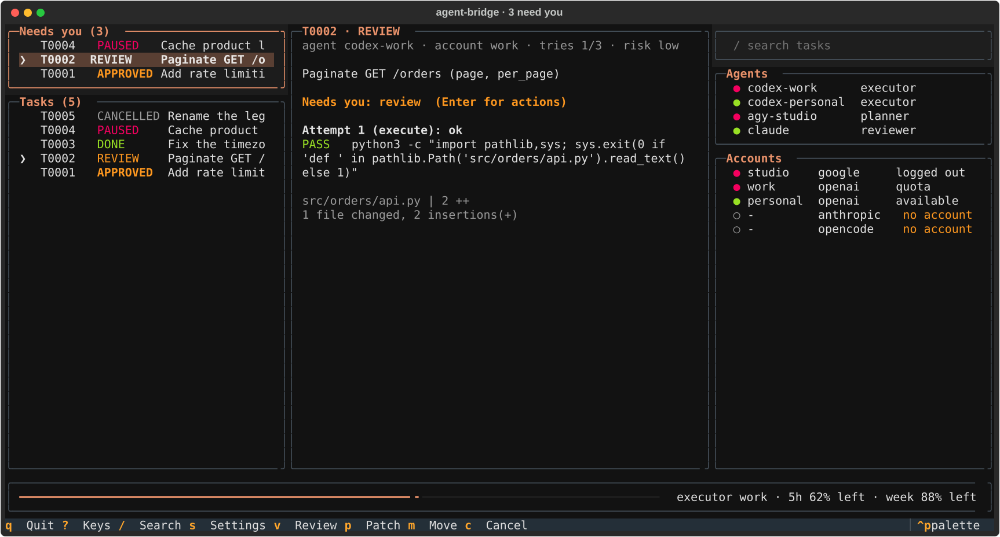
</p>

When one AI agent both writes the code and judges it, nobody checks the work: "done" means
whatever the agent says, even if the tests never ran or it edited files outside its assignment.
Spread that over several CLIs and subscription accounts and you also juggle logins, quota
windows and which agent is doing what.

`agent-orchestration-kit` separates those jobs. A small MCP server, `agent-bridge`, runs inside
your repository. It hands each task to an executor agent (Codex CLI or Claude Code), confines
the files that agent may change, re-runs the verification commands itself and only then lets a
reviewer approve. Each agent runs on its own account with its own concurrency and quota limits,
and irreversible steps stay with a human.

It is for developers who already use Claude Code and Codex CLI with subscription logins and want
a repeatable, auditable delegation loop in one repository, without a hosted service.

## Contents

- [Key features](#key-features)
- [How it compares](#how-it-compares)
- [Architecture](#architecture)
- [Requirements](#requirements)
- [Installation](#installation)
- [Quick start](#quick-start)
- [Configuration](#configuration)
- [Roles, adapters and providers](#roles-adapters-and-providers)
- [Workflow lifecycle](#workflow-lifecycle)
- [Security model and limitations](#security-model-and-limitations)
- [Monitoring](#monitoring)
- [Troubleshooting](#troubleshooting)
- [FAQ](#faq)
- [Roadmap](#roadmap)
- [Development and testing](#development-and-testing)
- [Further documentation](#further-documentation)
- [Contributing and license](#contributing-and-license)

## Key features

**Orchestration**

- **Roles, agents and accounts are separate.** `planner`, `executor` and `reviewer` map to
  agents; each agent uses one adapter (`codex-cli`, `claude-cli`, `client`, or the read-only
  `opencode-cli` / `agy-cli`) and one isolated account.
- **Planner workflows.** A planner agent can split an objective into validated tasks that run in
  dependency order.
- **Reviewer of your choice.** You review in the Claude Code session, a reviewer agent reviews
  read-only, or deterministic gates alone decide.
- **Bounded work.** Each task has an attempt budget; failures go to `REWORK` and then
  `BLOCKED` with a diagnosis.

**Accounts, concurrency and quota**

- **Isolated accounts.** Each account has its own auth home (`CODEX_HOME`, `CLAUDE_CONFIG_DIR`,
  or a whole `HOME` for agy) and a `max_concurrency` enforced across every bridge process on the
  machine.
- **Per-account limits.** Optional 5-hour, weekly and USD budget limits per account, enforced
  before every run and reserved atomically across bridges; `agent-bridge usage` shows what is
  used and when it resets.
- **Quota failover.** A quota pause does not spend an attempt. With `routing.quota_fallback`
  enabled, the bridge moves the task to the next eligible agent (never on an AUTH failure).
- **Quota-aware routing.** `strategy: quota` on a role sends each new task to the eligible agent
  whose account has the most quota left; an account with unknown quota ranks last.
- **Waiting for a busy slot.** When a workflow's next task finds its account slots held by
  another bridge process, the workflow retries with backoff for up to `routing.slot_wait_s`
  (default 30 minutes) instead of stopping.

**Verification and safety**

- **The bridge decides pass or fail.** After every run it checks every changed file against the
  task's `allowed_paths`, confirms `HEAD` did not move and re-runs the verification commands.
- **Human gates.** High-risk tasks and changes to sensitive paths (migrations, auth, deploy, CI,
  secrets) wait for `agent-bridge approve` in an interactive terminal.
- **Audit trail.** Every transition, attempt, routing decision and review is an event in SQLite.

**Monitoring and setup**

- **Dashboards.** A terminal dashboard, table/JSON CLI views and a localhost web dashboard
  covering every project on the machine, where you can also review, run, resume and cancel tasks.
- **Project-scoped setup.** `agent-bridge init` writes only project files; it never edits
  `~/.claude`, `~/.codex` or global MCP configuration.

## How it compares

| | One agent that writes and reports on its own work | agent-orchestration-kit |
|---|---|---|
| Who says the work is done | The agent's own summary | The bridge re-runs your verification commands |
| Which files may change | Whatever the agent touches | Every changed file is checked against `allowed_paths`; `HEAD` must not move |
| Accounts | One login per CLI | One isolated auth home per agent, with concurrency slots and limits |
| Quota runs out | The session stops | The task is `PAUSED` without spending an attempt; optional failover to another account |
| Irreversible steps | Up to the agent | A human runs `agent-bridge approve` in a terminal |
| History | Chat scrollback | Every state change is an event in `bridge.db` |

What it is not: a hosted service, a desktop app or a general sandbox for untrusted code. It is a
local CLI and MCP server for one repository at a time; parallel writing tasks need separate
worktrees (see [Roadmap](#roadmap)).

**Typical uses**

- Claude Code plans and reviews, Codex implements: the default when no
  `.ai/orchestrator.yaml` exists.
- Spread work over several Codex or Claude subscriptions, each with its own limits and failover
  order.
- A gates-only pipeline where tests and the scope check decide, with no LLM reviewer.
- A second model (opencode or agy) as a read-only planner or reviewer.

## Architecture

Claude Code talks to the bridge only through MCP tools. The bridge starts every other agent in
its own account home, gates the result and records everything.

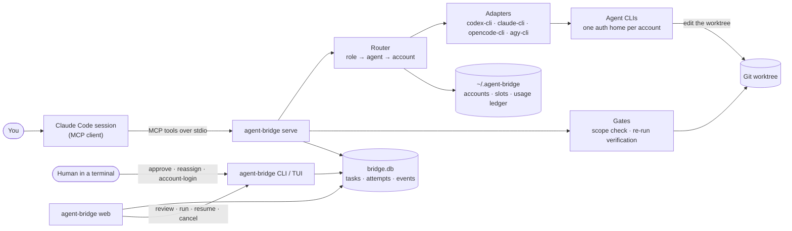

| Component | Where it lives |
|---|---|
| MCP server and CLI (`agent-bridge`) | Installed tool; `.mcp.json` runs `agent-bridge serve` |
| Project setup | `.mcp.json`, `.claude/settings.json`, `.claude/rules/`, `.claude/skills/agent-orchestration/`, a block in `CLAUDE.md`, `.ai/` |
| Task state, logs, audit events | `~/.agent-bridge/projects/<project>/worktrees/<worktree>/bridge.db` (`AGENT_BRIDGE_HOME` overrides), outside the worktree so agents cannot write it |
| Machine-wide accounts and locks | `~/.agent-bridge/` (`accounts.json`, `accounts.db`, `homes/`, `locks/`) |

Without `.ai/orchestrator.yaml` the kit uses the **legacy setup**: the Claude Code session plans
and reviews, and Codex executes.

## Requirements

- macOS or Linux. Windows code paths exist but have not been tested on a real Windows machine.
- `git`, and [uv](https://docs.astral.sh/uv/) (uv fetches Python 3.12 or newer).
- The target project must be a git repository.
- [Claude Code](https://docs.anthropic.com/en/docs/claude-code) for the interactive session.
- At least one agent CLI logged in with its own subscription; no API key is needed:
  - Codex CLI (verified with 0.163.0; check with `codex login status`), and/or
  - Claude Code headless (verified with 2.1.306; check with `claude auth status`).
  - Optional read-only planners/reviewers: opencode, agy.

## Installation

```bash
git clone https://github.com/leetuanbmt/agent-orchestration-kit.git ~/tools/agent-orchestration-kit
uv tool install --editable ~/tools/agent-orchestration-kit   # puts `agent-bridge` on PATH
uv tool update-shell                                          # once, if ~/.local/bin is not on PATH
```

Open a new shell after `update-shell`, then check with `agent-bridge --help`.

The install is editable: the tool runs from the checkout, so the rules and skill that `init`
copies always match the installed version. Keep the checkout where it is.

- **Update:** `git -C ~/tools/agent-orchestration-kit pull`. The tool picks up the new code at
  once. Rules and the skill already copied into a project stay as they were; to refresh them,
  run `agent-bridge init --force` in that project. `--force` overwrites local edits to those
  files, after backing them up to `.ai/backup-<UTC timestamp>/`.
- **Uninstall from a project:** `agent-bridge uninstall` removes only what `init` added and keeps
  files you edited since (with a warning); `--purge` also deletes `.ai/`. Task history stays
  under `~/.agent-bridge`.
- **Uninstall the tool:** `uv tool uninstall agent-orchestration-kit`, then delete the checkout.

Without installing the tool, `scripts/setup.sh <dir> [--force]` and
`scripts/uninstall.sh <dir> [--purge]` do the same from a checkout. The `.mcp.json` they write
runs `uv run --project <kit> agent-bridge serve`, an absolute path that breaks if the kit moves.

## Quick start

Four commands set up a project; the fifth step is asking Claude Code for a change.

Measured on macOS as a new user with an empty uv cache: cloning, `uv tool install`, `init`,
`config-check` and `health` took 18.5 s together. Logging in to an agent CLI and trusting the
folder in Claude Code are interactive and come on top; until then `health` names the missing
login and the command that fixes it.

**1. Set up a project.**

```bash
cd /path/to/project          # a git repository
agent-bridge init            # .mcp.json, .claude/settings.json, rules, skill, CLAUDE.md block, .ai/
claude                       # once: trust the folder so the agent-bridge server can connect
claude mcp list              # expect: agent-bridge ... Connected
```

What `init` does:

- `.mcp.json` gets `{"command": "agent-bridge", "args": ["serve"]}` with no machine-specific path,
  so it can be committed. Claude Code must find `agent-bridge` on its `PATH`.
- Existing `.mcp.json` and `.claude/settings.json` are merged key by key; other servers and deny
  rules stay. `CLAUDE.md` gets a marked block (`<!-- agent-bridge:start/end -->`).
- Every file it changes is first copied to `.ai/backup-<UTC timestamp>/`.
- A different file already at a destination, or a different `agent-bridge` server, stops `init`
  unless `--force` is given.
- The install manifest is kept in `<git-dir>/agent-bridge/install-manifest.json`, outside any
  agent's reach.
- Projects set up by the older `codex-bridge` kit are upgraded: its server, settings entries,
  `CLAUDE.md` block and state directory are replaced, and unedited `codex-*` rule and skill files
  are removed (edited ones are kept with a warning). Permission rules you wrote for
  `mcp__codex-bridge__*` tools must be renamed by hand.

**2. Choose a setup (optional).** Skip this to use the legacy setup (Claude Code plans and
reviews, Codex executes on its global login). Run these in your own terminal: `config-init
<name>` writes `.ai/`, which only a human may change, and refuses to run without one.

```bash
agent-bridge config-init                # list the shipped examples
agent-bridge config-init orchestrator   # writes .ai/orchestrator.yaml; never overwrites
agent-bridge config-check               # validate
agent-bridge agents                     # who plans, executes and reviews; who is available
```

**3. Check health.**

```bash
agent-bridge health          # adapters, logins, quota, task counts; exits 1 when not OK
```

**4. Ask Claude Code for a change.** For example: *"Add input validation to the signup handler
and a test for it."* The installed `agent-orchestration` skill drives one of two flows:

```text
you plan:     bridge_create_task → bridge_execute_task → bridge_task_status(wait_s)
                → bridge_task_result → bridge_review_task (→ bridge_resume_task for rework)
agent plans:  bridge_plan → bridge_workflow_status(wait_s) → bridge_run_workflow
                → bridge_workflow_status (DONE / INCOMPLETE / WAITING)
```

**5. Follow progress** with `agent-bridge` (terminal dashboard) or `agent-bridge web`. See
[Monitoring](#monitoring).

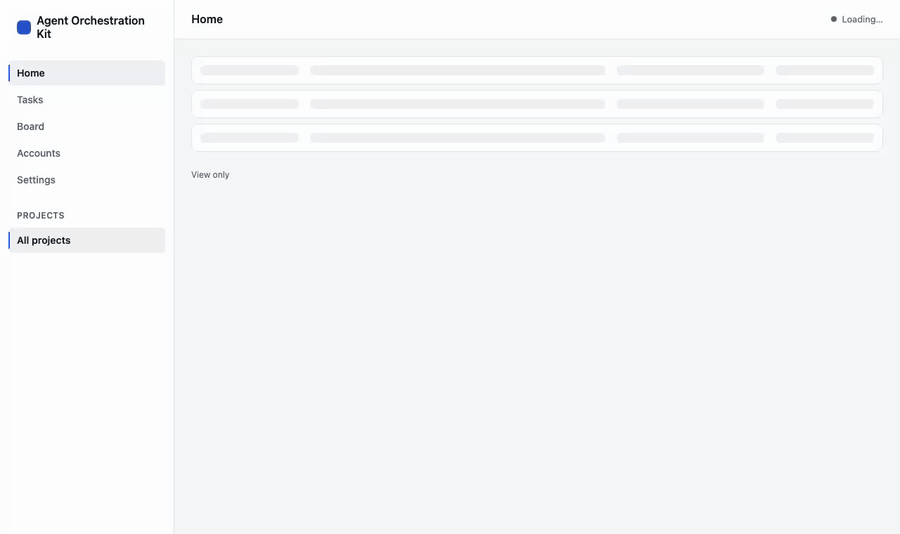

## Configuration

Two optional files in the project's `.ai/` directory:

| File | Purpose |
|---|---|
| `.ai/orchestrator.yaml` | Accounts, agents, roles, routing, workflow stages. Git-ignored (it names machine-specific homes). |
| `.ai/config.json` | Bridge settings: sandbox, timeouts, path rules, verification allowlist. Tracked. |

```yaml
version: 1
accounts:
  codex-work:  {provider: openai,    home: ~/.codex-accounts/homes/work}
  claude-main: {provider: anthropic, home: ~/.claude-accounts/main, max_concurrency: 1}
agents:
  claude:          {adapter: client}                         # the MCP caller
  claude-headless: {adapter: claude-cli, account: claude-main, model: sonnet}
  codex-a:         {adapter: codex-cli,  account: codex-work}
roles:
  planner: claude-headless
  executor: {agents: [codex-a], strategy: ordered}
  reviewer: claude                                           # you review via bridge_review_task
routing:
  quota_fallback: {enabled: false, min_remaining_pct: 10}
workflow:
  stages: [plan, execute, test, review]
  max_rework: 2
```

Shipped examples (`agent-bridge config-init <name>`):

| Example | Planner | Executor | Reviewer |
|---|---|---|---|
| *(no file, legacy)* | Claude Code session | Codex | Claude Code session |
| [`orchestrator`](examples/orchestrator.yaml) | Claude headless | Codex on two accounts, fallback order | Claude headless |
| [`claude-executor`](examples/claude-executor.yaml) | Codex | Claude headless (`allow_write`) | Codex |
| [`single-agent`](examples/single-agent.yaml) | Codex | Codex | Codex |
| [`gates-only`](examples/gates-only.yaml) | — | Codex | None: deterministic gates only |
| [`other-reviewers`](examples/other-reviewers.yaml) | agy | Codex | opencode |
| [`account-limits`](examples/account-limits.yaml) | Claude Code session | Claude headless on two accounts, then Codex, with per-account limits and failover | Claude Code session |

Accounts are logged in by a human, either per project (`agent-bridge account-login <name>`) or
machine-wide (`agent-bridge account-add <name> --provider …`). Quota fallback is off by
default; enabling it authorises the bridge to move a task to another account when quota runs
low (never on AUTH failures).

Full reference: every key and default, accounts, quota, quota fallback and state storage are in
[docs/configuration.md](docs/configuration.md).

## Roles, adapters and providers

| Adapter | Provider | Can write | Isolation | Account home |
|---|---|---|---|---|
| `codex-cli` | `openai` | Yes (default) | Codex OS sandbox (`workspace-write` / `read-only`), no network | `CODEX_HOME` |
| `claude-cli` | `anthropic` | Only with `allow_write: true` | CLI permission rules; no OS sandbox | `CLAUDE_CONFIG_DIR` |
| `client` | — | No | The MCP caller itself; never started by the bridge | — |
| `opencode-cli` | `opencode` | No (refused by config) | Tool permissions denied via config; no OS sandbox | Global login only |
| `agy-cli` | `google` | No (refused by config) | `--mode plan --sandbox`; no OS sandbox | A whole `HOME` |

- `executor` must be able to write, so it is `codex-cli` or `claude-cli` with `allow_write`.
- `planner` and `reviewer` need only read access; `client` means you, through
  `bridge_review_task`.
- **Routing.** A task pinned with `agent` or `account` runs there. Otherwise the bridge picks
  the role's `default`, then the first eligible agent in role order, when the task first starts;
  with `strategy: quota` it picks the eligible agent whose account has the most quota left.
  An account whose slots are all held by other bridge processes on the machine is not eligible;
  a workflow then waits up to `routing.slot_wait_s` for a slot. The task keeps that agent and
  session for retries.

## Workflow lifecycle

One task, from request to report:

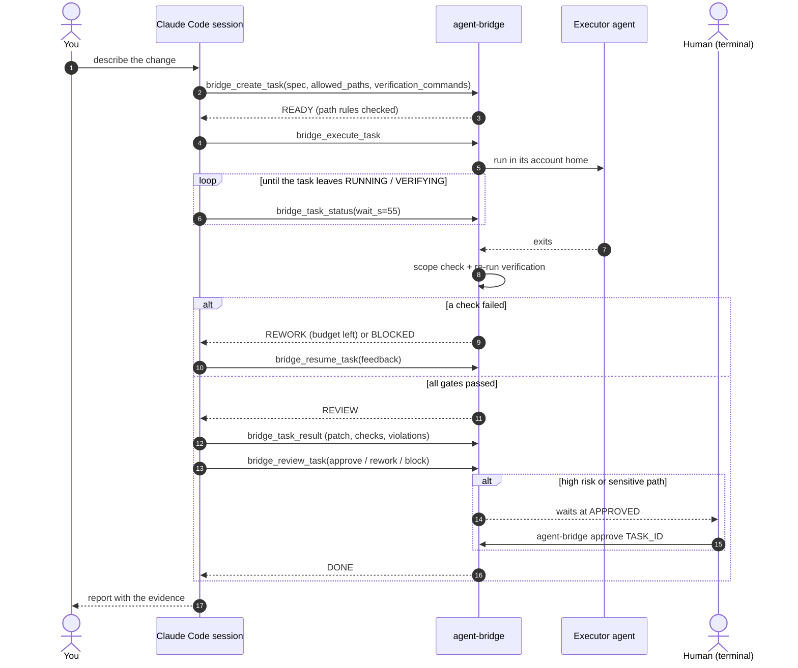

States: `BACKLOG → READY → RUNNING → VERIFYING → REVIEW → APPROVED → DONE`, plus `REWORK`,
`FAILED`, `PAUSED`, `BLOCKED` and `CANCELLED`. `DONE`, `CANCELLED` and `BLOCKED` are terminal.

| Move | Who | Trigger |
|---|---|---|
| `BACKLOG → READY` | Bridge | Every `depends_on` task is `DONE` |
| `READY` / `REWORK` / `FAILED` / `PAUSED` → `RUNNING` | Client or workflow driver | `bridge_execute_task`, `bridge_resume_task`, `bridge_run_workflow` |
| `RUNNING → VERIFYING` | Bridge | The agent exited cleanly |
| `RUNNING → FAILED` | Bridge | Timeout or crash (`BLOCKED` when the attempt budget is spent) |
| `RUNNING` / `VERIFYING → PAUSED` | Bridge | Quota, auth, network, missing CLI or interrupted runner (a stop signal or a dead runner); does not use the attempt budget |
| `VERIFYING → REVIEW` | Bridge | Scope clean, every verification command passed, agent reported `completed` |
| `VERIFYING → REWORK` | Bridge | Any check failed (`BLOCKED` when the budget is spent); an agent that reports `blocked` and changed nothing skips the checks (`verification.skipped`) |
| `REVIEW → APPROVED` / `REWORK` / `BLOCKED` | Client or reviewer agent | `bridge_review_task` or reviewer run |
| `REVIEW → APPROVED` | Bridge | No `review` stage and every gate passed |
| `APPROVED → DONE` | Bridge, or a human for high risk | Quality gates re-checked |
| Any non-terminal → `CANCELLED` | Client | `bridge_cancel_task` |

A task runs at most `max_rework + 1` times (default 3). A runner that dies mid-run is detected on
the next bridge start: the task becomes `PAUSED` (`INTERRUPTED`) and `bridge_resume_task`
continues the same session. A runner that is stopped by SIGTERM, SIGINT, SIGHUP or SIGALRM (for
example a caller's timeout on `execute`, `resume`, `plan` or `run-workflow`) parks its task the
same way before it exits with 128 + the signal number, and gives the attempt back; `serve` shuts
down the same way. Only SIGKILL leaves the task `RUNNING` until the next start.

## Security model and limitations

The kit reduces what an agent can do and verifies what it did. It is not a complete sandbox for
untrusted code.

**Enforced by the bridge, for every adapter:**

- **Paths.** Checked at task creation (absolute paths, `..`, `~`, symlink escape, protected
  paths, globs that cover the whole project such as `**/*`) and after each run (hash snapshot,
  full worktree diff, `HEAD` must not move). Protected paths (`.env*`, keys, `.git/`, `.ai/`,
  `.mcp.json`, `.claude/settings*.json`) can never be allowed; a run that changes one, the
  repository's git hooks or `.git/config` is BLOCKED for a human (`PROTECTED: …`). Git-ignored
  files are tracked by size and mtime: changes are listed as `ignored_files`, protected ones block,
  and without a `review` stage any change outside `allowed_paths` is a violation (tool caches
  excepted).
- **Verification.** Re-run by the bridge with argv lists only (no shell operators, no paths as
  the program), allowlisted executables and a timeout. Under Landlock (Linux) or Seatbelt (macOS) the checks may
  write only to the worktree, a private `TMPDIR` and `workflow.verify_writable`
  (`workflow.verify_sandbox`: `auto` by default, `strict` also cuts TCP, `none`); the worktree is
  diffed again afterwards and what the checks changed is judged like the agent's changes. Nothing
  the agent or a check started outlives it (its process group is ended).
- **Evidence.** A failing git command pauses the task (`EVIDENCE_ERROR`) instead of yielding an
  empty diff. The stored patch keeps every file from its start and names what it had to omit. An
  attempt that ends early (quota, crash, timeout, a dead runner) and left changes outside the task
  blocks it (`SCOPE: …`), so a resume never takes them as its baseline.
- **Approval.** Executors cannot approve. The client or a reviewer agent approves; the bridge
  approves only when the workflow has no `review` stage. High-risk or sensitive-path tasks, and
  changes to agent instructions (`CLAUDE.md`, `AGENTS.md`, `.claude/**`, `.codex/**`, `.envrc`,
  `.vscode/**`), need a human at an interactive terminal. Approving or closing requires every file
  the attempt touched to still have its verified content.
- **Processes.** Agents and verification commands start from argv lists in their own process
  group; timeout or cancel sends SIGTERM, then SIGKILL. The runner polls for a cancel every
  second, in any process (a CLI `execute` too): it kills the agent or the running check, skips
  the remaining checks and frees the account, and `cancel` waits for that before it returns.
  Orphaned groups from a dead runner are killed on the next start, only if the PID is a `codex`,
  `claude`, `opencode` or `agy` process.
- **Environment and output.** Credential-shaped variables (`*_API_KEY`, `*_TOKEN`, `*_SECRET*`,
  `*PASSWORD*`, `AWS_*`, and always `SSH_AUTH_SOCK`, `*_DSN`, `*DATABASE_URL*`, `*CREDENTIALS*`,
  `KUBECONFIG`, `DOCKER_AUTH_CONFIG`, `*SECRET*`, `*_KEY`, `*_PAT`, `NETRC`, `*_AUTH`) are removed
  before an agent or verification command starts. A project's `env_deny` adds to the defaults; it
  cannot remove them. Stored output passes through secret redaction.
- **Recursion guard.** Every agent process and every verification command gets
  `AGENT_BRIDGE_AGENT=1`; the server, the CLI and the `Bridge` Python API refuse to start under it.
- **Audit.** Every transition, attempt, routing decision, review, account change and workflow
  state is an event in `bridge.db`.

**Per adapter:**

- **Codex CLI** runs in its OS sandbox (`workspace-write` or `read-only`; `danger-full-access`
  cannot be configured), without network, with `/tmp` and `$TMPDIR` not writable and
  `~/.codex/config.toml` ignored. Planner and reviewer runs are `read-only`.
- **Claude CLI** has no OS sandbox. The bridge runs it with `--strict-mcp-config` (no MCP
  servers), `--setting-sources ""` (no user or project settings, allow rules or hooks),
  `--permission-mode dontAsk` and an allowlist of Read/Glob/Grep. With `allow_write: true` it also
  gets Edit/Write scoped to the task's `allowed_paths`, with excluded and protected paths denied.
  Reads of Codex/agent-bridge/agy credentials, `~/.claude/.credentials.json`, every configured
  account home and the project's `.env*`/key files are denied; other files your user can read
  remain readable, and `allow_bash: true` is not path-confined.
  Prefer Codex as the executor and never combine `allow_bash` with untrusted work.
- **opencode and agy** are read-only. opencode runs with edit, bash, webfetch and external
  directories denied through `OPENCODE_CONFIG_CONTENT`; agy runs with `--mode plan --sandbox` and
  keeps browser tools the CLI cannot disable. Probes wrote no files with either; neither has an
  OS sandbox.
- **Optional `claude_hook_settings`** in `.ai/config.json` passes a hooks-only settings file to
  every Claude run. These hooks are trusted code running unsandboxed; the option is off by
  default.

**Credentials.** Each account uses its own auth home, created by a fresh login, never by copying
another profile's tokens. The bridge reads only Codex `rate_limits` events from
`<home>/sessions/**/rollout-*.jsonl`; it never reads `auth.json` or other credential files.

**Trust model.** Everything the kit runs runs as your user. Human approval guards against
mistakes and model overreach; it is not a boundary against code running as you. Anything that
can run as your user can write the bridge's database or unset `AGENT_BRIDGE_AGENT`, so human-only
steps rely on the agents being confined (the Codex sandbox, Claude permission rules, the
verification sandbox), not on a permission check inside the bridge.

**Known limitations:**

- Deny rules in `.claude/settings.json` guide Claude Code; they are not a security boundary. The
  interactive-terminal check for human-only commands can be defeated by an agent that allocates
  a pseudo-terminal.
- Verification commands are confined by Landlock (Linux 5.13+) or Seatbelt (macOS). The macOS
  profile is best effort: it confines writes and blocks the known launch-service escapes, but it
  allows everything else. Without either, checks run with your permissions unless
  `verify_sandbox: strict` refuses them, and `health` stays NOT OK (`verify_unconfined`) until a
  human accepts that with `verify_sandbox: none`. Even confined they can read your files, and
  under `auto` they keep the network.
- Git-ignored files are compared by size and mtime, not content. An agent's change to an ignored
  file outside `allowed_paths` is a violation (tool caches excepted); ignored files left only by
  verification commands are listed for the reviewer rather than refused.
- Codex and Claude still write their own session files (`~/.codex/sessions`, `~/.claude.json`).
- Files under `.ai/` other than `config.json` are git-ignored and writable by Codex; treat them
  as convenience copies, not trusted input.
- One writer per worktree; the workflow driver runs tasks one at a time. Parallel writes need
  separate worktrees.
- Claude quota is known only after the account's first run through the bridge; Codex quota is a
  snapshot from the latest session, not a live query.
- The Codex sandbox behaviour was verified on macOS only.
- Not supported: opencode or agy as executors, multi-reviewer voting, and stages for custom
  roles. Another CLI needs a new `Adapter` subclass.

More detail: [docs/REPORT.md](docs/REPORT.md) (verified CLI versions, probes and the full
limitation list).

## Monitoring

### Terminal dashboard

Run `agent-bridge` (or `agent-bridge tui`) in the project. It refreshes every 3 seconds and never
starts an agent: runs belong to the MCP server process.

- **Search**, **Agents** and **Accounts** on the left. Accounts lists every account the machine
  knows: project and machine-wide accounts, codex-switch homes not yet added, codex-switch and
  claude-switch profiles (marked not usable) and installed CLIs without an account.
- **Needs you** (tasks in `APPROVED`, `REVIEW`, `PAUSED`, `FAILED`, `BLOCKED`) and **Tasks** in
  the middle.
- **Detail** on the right: a task's objective, checks, diff stat and reviews, or an account's
  provider, login, state, quota, home and last error.

Press **Enter** on a row for the actions that fit it; the footer shows only keys valid for the
focused row.

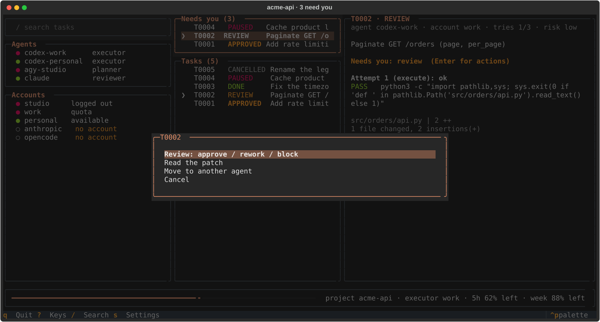
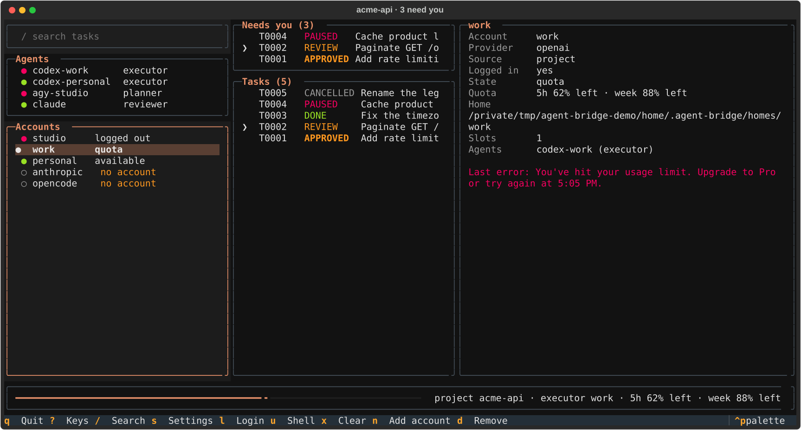

| Key | Action |
|---|---|
| `Tab` / `Shift+Tab`, `↑` `↓` | Move between panels and rows (the mouse works too) |
| `Enter` | Actions for the selected task or account |
| `/` | Search tasks by id, state, agent or objective |
| `p` / `a` / `v` | Patch / approve a task waiting for a human / review a task in `REVIEW` |
| `c` / `m` | Cancel a task / move it to another agent (new session) |
| `l` / `u` / `x` / `d` | On an account: log in / open a shell as it (agy: shows the `eval` line) / mark available / remove |
| `n` | Add a machine-wide account (on a codex-switch home row: add that home) |
| `s` | Settings; `e` there edits `.ai/orchestrator.yaml` (or `config.json`) in `$EDITOR` |
| `?` / `q` | Keys / quit |

### CLI views

These print tables in a terminal and JSON with `--json` or when piped:

```bash
agent-bridge health        # adapters, quota per account, task counts
agent-bridge agents        # roles, agents and availability
agent-bridge usage         # per-account limits: used, remaining, reset time
agent-bridge account-list  # accounts and login state; --all adds profiles and unused CLIs
agent-bridge list          # tasks of this project, newest first
agent-bridge tasks         # tasks of every project and worktree on this machine
```

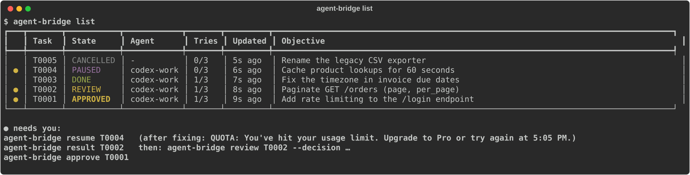
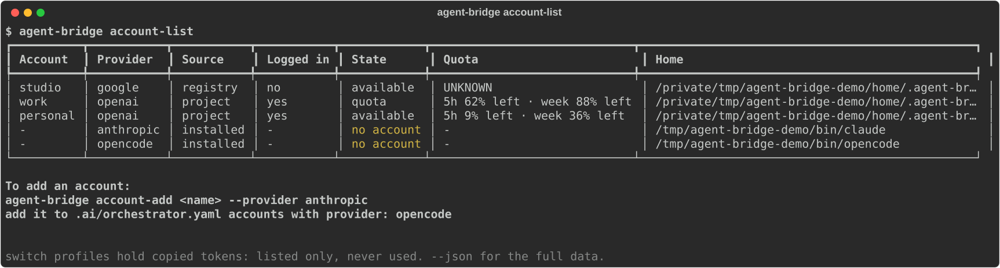

The screenshots come from an end-to-end run of the installed tool on invented data (fake agent
CLIs, a fresh `HOME`, a demo project). Regenerate them with
`"$(uv tool dir)/agent-orchestration-kit/bin/python" scripts/screenshots.py docs/images`.

### Web dashboard

`agent-bridge web [--port N] [--open]` serves a browser dashboard on `127.0.0.1` (default port
8765; `--port 0` picks a free one; Ctrl+C stops it). The printed URL is a one-time link: opening it gives
this browser a session cookie and the link stops working. Do not share it; if it was already used
or is more than ten minutes old, restart the command.

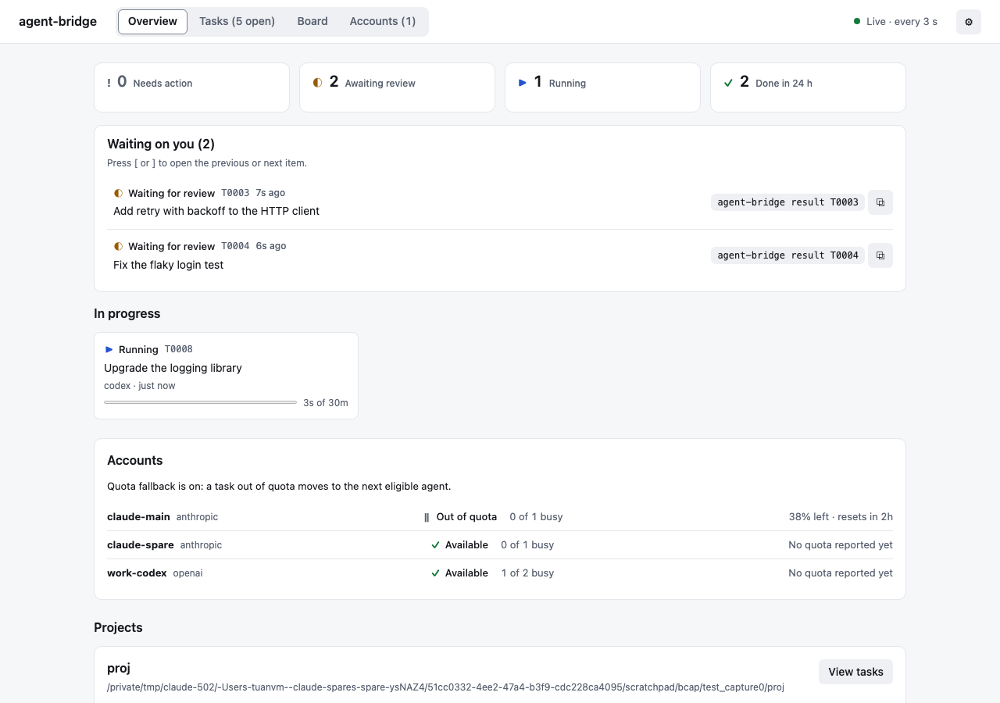

It covers every project agent-bridge knows on this machine and their git worktrees. A sidebar
lists the views and the projects; choosing a project scopes every view. The views:

- **Home.** What is waiting on you, in the bridge's priority order, each with the command to
  copy (`[` and `]` open the previous or next one); the tasks running now with time used against
  their timeout; every account with its state, busy slots and quota left; whether quota fallback
  is on; and the projects.
- **Tasks and Board.** A searchable table with status tabs (project and worktree filters appear
  when there is more than one; columns that would repeat one value are left out), and a board with
  Needs action, In review, Running and Queued lanes and finished work folded underneath.
- **Accounts.** One card per account: available, out of quota or login needed, each quota window
  as a meter with its reset time, slots in use and the agents on it; the quota-fallback policy of
  each project and the recent automatic switches, each opening its task.
- **Task drawer.** Status, a lifecycle stepper, the next step with its command, verification
  checks as pass or fail, scope violations, changed files, the agent's summary, reviews, attempts
  and the live attempt log; raw fields sit under *Technical details*. The selection is part of the
  URL, so a link reopens it. Its Actions section reviews a task in REVIEW (approve, rework or block,
  with notes), runs a READY task, resumes one in REWORK, FAILED or PAUSED with optional feedback,
  and cancels any open task with a reason.

It refreshes every 3 s and says when the bridge cannot be reached, keeping the last data on screen.
Light, dark or the system theme and English or Vietnamese sit in the Settings view; on a phone the
sidebar opens from the menu button and each task becomes a compact row. A state is shown by a symbol and a
label, never by color alone. The design rules and the accessibility checks are in
[docs/design/web-dashboard.md](docs/design/web-dashboard.md).

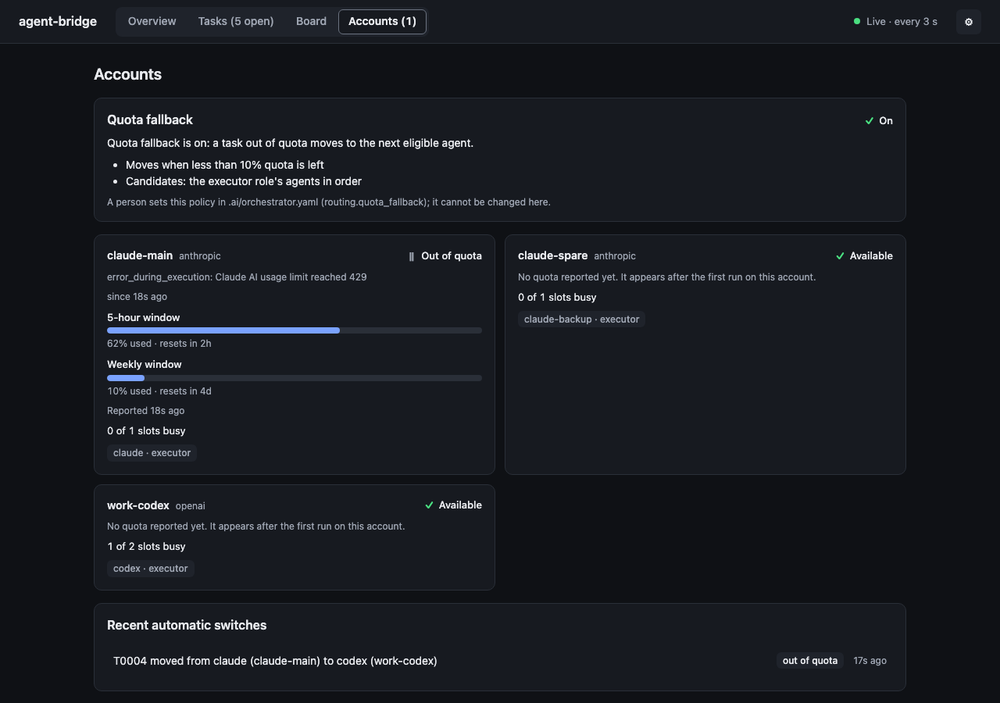

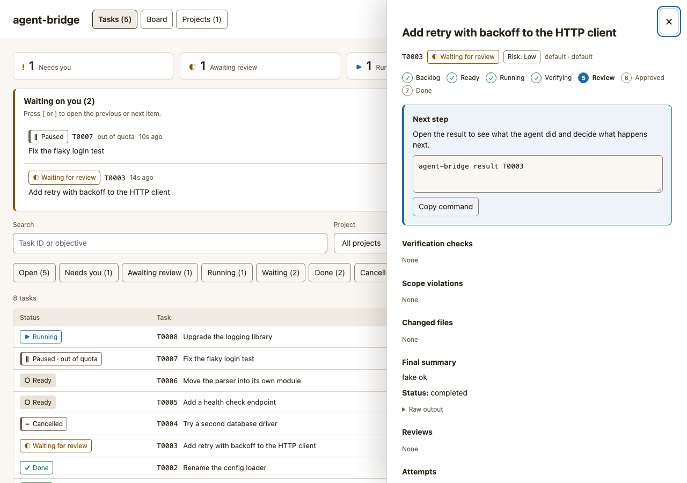 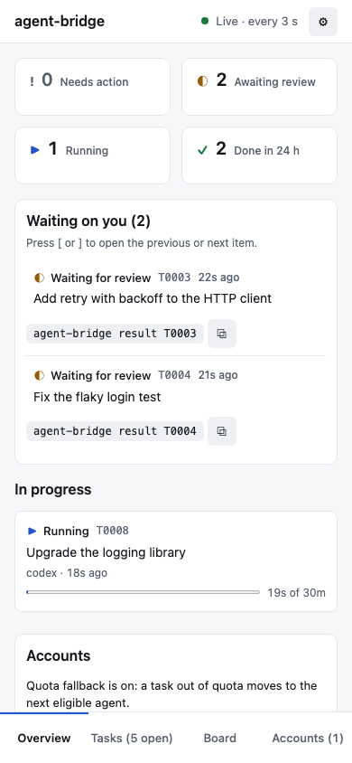

The web dashboard opens each `bridge.db` with SQLite `mode=ro` and reads account state and quota
only from that database and the project config (it never probes a CLI or reads an account home).
Its actions run the same CLI commands you would type (`agent-bridge review`, `execute`, `resume`,
`cancel`); human approval of high-risk tasks, reassignment and account commands stay in the
terminal. An action needs the session cookie, a JSON body and a same-origin request;
`agent-bridge web --read-only` hides the actions and refuses them. It listens on `127.0.0.1` only
and rejects other `Host` headers. The threat model is in
[docs/design/web-dashboard.md](docs/design/web-dashboard.md#threat-model).

## Troubleshooting

| Symptom | Cause and fix |
|---|---|
| `agent-bridge: command not found` | Run `uv tool update-shell` and open a new shell. |
| `not a git repository` or `Target must be a git work tree` | The bridge only runs inside a git repository; run `git init` or change directory. |
| `claude mcp list` shows `agent-bridge: ⏸ Pending approval` | Open `claude` in the folder once and trust it. |
| `config-check` error | The message names the field; fix `.ai/orchestrator.yaml`. |
| `health` reports NOT OK | An adapter CLI is missing or not logged in, a protected file differs from `HEAD` or still holds what a stopped task wrote into it (`protected_dirty`), or verification would run unconfined (`verify_unconfined`, see `verify_sandbox`). `health` lists each cause with its fix under `problems`, and account QUOTA/AUTH marks under `warnings`; a human logs in or reviews that file. |
| `no eligible executor agent (…)` | Every executor is disabled, busy or unavailable; the reasons are listed per agent. |
| Task `PAUSED` with `QUOTA` or `AUTH` | Wait for the quota window to reset, or fix the login; then `agent-bridge account-clear <name>` if the mark remains, and resume. With quota fallback enabled, resume may move the task to another account. |
| Task `PAUSED` with `INTERRUPTED` | The runner was stopped by a signal or died; `bridge_resume_task` continues the session, `cancel` drops it. |
| `agent_review_failed` event | The reviewer agent errored; the task waits in `REVIEW` for `bridge_review_task`. |
| Workflow `WAITING` | `detail.waiting` and the task states say what needs attention; run `bridge_run_workflow` again afterwards. |
| `ConflictError … already writing` | One writer per worktree; wait, or use another worktree. |
| `account … busy in another bridge process` | The account's concurrency slots are in use elsewhere. Unpinned tasks route around it, and a workflow waits up to `routing.slot_wait_s` (default 1800 s) for a slot; a task pinned to it stays `READY` with no attempt spent, so start it again once a slot is free. |
| `REWORK` with `outside allowed paths` | The executor changed files outside the task; read the patch and rework. |
| `health` warns about legacy storage | Migrate with `agent-bridge storage status`, then `storage migrate --apply` ([details](docs/configuration.md#migrating-and-maintaining-state)). |

## FAQ

**Do I need API keys?** No. Every agent runs on a subscription login in its own auth home. No
API key is needed.

**Can an agent approve its own work?** No. Executors cannot approve. The client, a reviewer agent
or (without a `review` stage) the bridge after every gate passed approves; high-risk work waits
for a human at a terminal.

**Can I use it without Codex?** Yes. The [`claude-executor`](examples/claude-executor.yaml)
example runs Claude Code headless as the executor. Codex remains the recommended executor because
it runs in an OS sandbox.

**Can several tasks run at the same time?** Across projects and worktrees, yes, up to each
account's `max_concurrency`. Inside one worktree only one task writes at a time; see
[Roadmap](#roadmap).

**Does running the test suite use my quota?** No. `scripts/check.sh` uses fake agent CLIs. Only
the opt-in smoke tests call the real CLIs.

**Is this a sandbox for untrusted code?** No. It narrows what agents can do and verifies what
they did; see the [trust model](#security-model-and-limitations).

**Where is my data?** Task state, logs and audit events stay on your machine under
`~/.agent-bridge/`. The kit adds no telemetry; the agent CLIs talk to their own providers as
usual.

## Roadmap

Items below are not implemented. They are listed so users know what to expect.

- **Planned:** parallel writing tasks, each in its own git worktree, with results combined on a
  branch a human merges ([draft plan](docs/plans/parallel-worktrees.md)).
- **Under consideration:** multi-reviewer voting; stages for custom roles; feeding CI failures
  and pull-request review comments back to the executor that owns the task; notifications when a
  task needs a human.

Ideas and votes are welcome in [GitHub Issues](https://github.com/leetuanbmt/agent-orchestration-kit/issues).

## Development and testing

```bash
uv sync                          # project-local .venv with Python 3.12+
scripts/check.sh                 # full test suite with fake CLIs (deterministic, no quota used)
scripts/check.sh --with-health   # also requires `agent-bridge health` to report OK
scripts/check.sh --e2e           # also the end-to-end suite in tests/qa (about 3 more minutes)
```

The end-to-end suite drives the real `agent-bridge` CLI, the MCP server over stdio and the web
dashboard in Chromium (Node Playwright; skipped without it) against the fake agent CLIs, each test
in a throwaway `HOME` and git repository. Cases and the latest results:
[docs/qa/e2e-test-cases.md](docs/qa/e2e-test-cases.md); findings:
[docs/qa/e2e-qa-report.md](docs/qa/e2e-qa-report.md).

Opt-in smoke tests against the real CLIs use your quota:

```bash
CODEX_SMOKE=1 uv run pytest -m real_codex                                        # two real Codex runs
CLAUDE_SMOKE=1 uv run pytest tests/e2e/test_real_claude_smoke.py                 # one real Claude review
OPENCODE_SMOKE=1 AGY_SMOKE=1 uv run pytest tests/e2e/test_real_other_smoke.py    # real opencode / agy reviews
```

The fake CLIs in `tests/fakes/` (`codex`, `claude`, `opencode`, `agy`) speak the real JSONL and
stream-json protocols. The suite covers the shipped configurations, routing, pinning, affinity,
quota fallback, bounded rework, reviewer failure, config validation, account isolation,
concurrency slots, legacy mapping, schema upgrades, storage migration, machine-wide accounts and
the dashboards.

## Further documentation

| Document | Content |
|---|---|
| [docs/configuration.md](docs/configuration.md) | Every `orchestrator.yaml` and `config.json` key, accounts, quota, quota fallback, state storage and migration |
| [docs/cli-reference.md](docs/cli-reference.md) | MCP tools with parameters, every CLI command and human-only commands |
| [docs/REPORT.md](docs/REPORT.md) | Build report: verified CLI versions, security probes, known limitations |
| [docs/audits/executive-summary.md](docs/audits/executive-summary.md) | Architecture, security and reliability audit with reproductions |
| [CHANGELOG.md](CHANGELOG.md) | Release history |

## Contributing and license

Contributions are welcome: bug reports, documentation fixes and new adapters. Read
[CONTRIBUTING.md](CONTRIBUTING.md) for the setup, test commands and conventions. In short: run
`scripts/check.sh`, add a `CHANGELOG.md` entry under *Unreleased*, and keep this README and
[README.vi.md](README.vi.md) in sync.

If the kit is useful to you, a star helps others find it.

Released under the [MIT License](LICENSE) © leetuanbmt.
