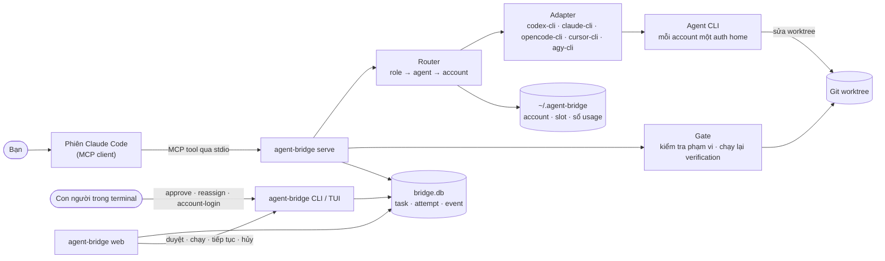
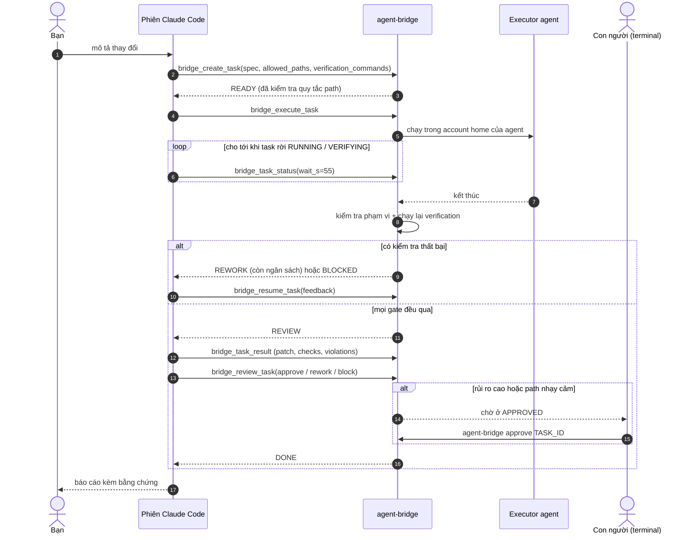

<h1 align="center">agent-orchestration-kit</h1>

<p align="center">
  <b>Điều phối nhiều AI agent cho Claude Code và Codex CLI, dựa trên bằng chứng thay vì lòng tin.</b><br>
  Một MCP server cục bộ gán các role planner, executor và reviewer cho agent trên những account riêng,<br>
  giới hạn những gì chúng được sửa và tự chạy lại test của bạn trước khi bất cứ thứ gì được approve.
</p>

<p align="center">
  <a href="https://github.com/leetuanbmt/agent-orchestration-kit/actions/workflows/ci.yml"></a>
  
  
  
  <a href="LICENSE"></a>
  
</p>

<p align="center">
  <a href="#bắt-đầu-nhanh"><b>Bắt đầu nhanh</b></a> ·
  <a href="docs/configuration.md">Cấu hình</a> ·
  <a href="docs/cli-reference.md">Tham chiếu CLI và MCP</a> ·
  <a href="CONTRIBUTING.md">Đóng góp</a> ·
  <a href="README.md">English</a> · <b>Tiếng Việt</b>
</p>

<p align="center">
  
</p>

Khi để một AI agent vừa viết code vừa tự đánh giá, không ai kiểm tra lại công việc: agent báo
"xong" là xong, kể cả khi test chưa hề chạy hay nó đã sửa file ngoài phạm vi được giao. Khi việc
trải ra nhiều CLI và nhiều account subscription, bạn còn phải xoay xở với login, cửa sổ quota và
việc agent nào đang làm gì.

`agent-orchestration-kit` tách các việc đó ra. Một MCP server nhỏ, `agent-bridge`, chạy ngay trong
repository của bạn. Nó giao từng task cho một executor agent (Codex CLI hoặc Claude Code), giới hạn
những file agent được sửa, tự chạy lại các lệnh verification, và chỉ sau đó mới cho reviewer
approve. Mỗi agent chạy trên account riêng với giới hạn chạy song song và quota riêng, còn các
bước không thể đảo ngược vẫn do con người quyết định.

Kit dành cho developer đang dùng Claude Code và Codex CLI bằng tài khoản subscription, muốn có
một vòng giao việc lặp lại được và kiểm toán được trong từng repository, không cần dịch vụ hosted.

## Mục lục

- [Tính năng chính](#tính-năng-chính)
- [So sánh](#so-sánh)
- [Kiến trúc](#kiến-trúc)
- [Yêu cầu](#yêu-cầu)
- [Cài đặt](#cài-đặt)
- [Bắt đầu nhanh](#bắt-đầu-nhanh)
- [Cấu hình](#cấu-hình)
- [Role, adapter và provider](#role-adapter-và-provider)
- [Vòng đời workflow](#vòng-đời-workflow)
- [Mô hình bảo mật và giới hạn](#mô-hình-bảo-mật-và-giới-hạn)
- [Theo dõi](#theo-dõi)
- [Xử lý sự cố](#xử-lý-sự-cố)
- [Câu hỏi thường gặp](#câu-hỏi-thường-gặp)
- [Lộ trình](#lộ-trình)
- [Phát triển và kiểm thử](#phát-triển-và-kiểm-thử)
- [Tài liệu khác](#tài-liệu-khác)
- [Đóng góp và giấy phép](#đóng-góp-và-giấy-phép)

## Tính năng chính

**Điều phối**

- **Role, agent và account tách biệt.** `planner`, `executor` và `reviewer` được gán cho agent;
  mỗi agent dùng một adapter (`codex-cli`, `claude-cli`, `client`, hoặc `opencode-cli` /
  `cursor-cli` / `agy-cli` chỉ đọc) và một account riêng.
- **Workflow do planner lập.** Một planner agent có thể chia mục tiêu thành các task đã được
  validate, chạy theo thứ tự phụ thuộc.
- **Tùy chọn reviewer.** Bạn review trong phiên Claude Code, một reviewer agent review ở chế độ
  chỉ đọc, hoặc chỉ các gate tất định quyết định.
- **Giới hạn số lần làm lại.** Mỗi task có ngân sách attempt; lỗi chuyển sang `REWORK`, rồi
  `BLOCKED` kèm chẩn đoán.

**Account, chạy song song và quota**

- **Account cô lập.** Mỗi account có auth home riêng (`CODEX_HOME`, `CLAUDE_CONFIG_DIR`, hoặc cả
  một `HOME` với agy) và `max_concurrency` được áp dụng trên mọi bridge process của máy.
- **Giới hạn theo từng account.** Ngưỡng 5 giờ, theo tuần và ngân sách USD (tùy chọn) cho
  từng account, kiểm tra trước mỗi lần chạy và giữ chỗ nguyên tử giữa các bridge; `agent-bridge
  usage` cho biết đã dùng bao nhiêu và khi nào reset.
- **Failover khi hết quota.** Tạm dừng vì quota không tốn attempt. Khi bật
  `routing.quota_fallback`, bridge chuyển task sang agent đủ điều kiện kế tiếp (không bao giờ
  chuyển khi lỗi AUTH).
- **Định tuyến theo quota.** `strategy: quota` trên một role đưa mỗi task mới tới agent đủ điều
  kiện có account còn nhiều quota nhất; account chưa biết quota xếp sau cùng.
- **Chờ slot bận.** Khi task kế tiếp của workflow gặp account đã bị bridge process khác chiếm hết
  slot, workflow thử lại với backoff trong tối đa `routing.slot_wait_s` (mặc định 30 phút) thay vì
  dừng lại.

**Kiểm chứng và an toàn**

- **Bridge quyết định đạt hay không.** Sau mỗi lượt chạy, bridge đối chiếu mọi file bị thay đổi
  với `allowed_paths` của task, xác nhận `HEAD` không đổi và tự chạy lại các lệnh verification.
- **Cổng duyệt của con người.** Task rủi ro cao và thay đổi ở path nhạy cảm (migration, auth,
  deploy, CI, secret) phải chờ `agent-bridge approve` trong một terminal interactive.
- **Audit trail.** Mọi lần chuyển trạng thái, attempt, quyết định định tuyến và review đều là một
  event trong SQLite.

**Theo dõi và cài đặt**

- **Dashboard.** Dashboard trong terminal, các lệnh CLI xuất bảng/JSON và dashboard web trên
  localhost bao quát mọi project trên máy, nơi bạn cũng có thể duyệt, chạy, tiếp tục và hủy task.
- **Cài đặt theo project.** `agent-bridge init` chỉ ghi file trong project; không bao giờ sửa
  `~/.claude`, `~/.codex` hay cấu hình MCP global.

## So sánh

| | Một agent tự viết và tự báo cáo | agent-orchestration-kit |
|---|---|---|
| Ai nói việc đã xong | Bản tóm tắt của chính agent | Bridge tự chạy lại các lệnh verification của bạn |
| File nào được sửa | Bất cứ file nào agent đụng tới | Mọi file thay đổi được đối chiếu với `allowed_paths`; `HEAD` không được đổi |
| Account | Một login cho mỗi CLI | Mỗi agent một auth home riêng, có slot chạy song song và giới hạn |
| Khi hết quota | Phiên dừng lại | Task `PAUSED` mà không tốn attempt; tùy chọn failover sang account khác |
| Bước không thể đảo ngược | Tùy agent | Con người chạy `agent-bridge approve` trong terminal |
| Lịch sử | Lịch sử chat | Mọi thay đổi trạng thái là một event trong `bridge.db` |

Kit không phải: dịch vụ hosted, ứng dụng desktop hay sandbox tổng quát cho code không đáng tin
cậy. Nó là CLI và MCP server cục bộ cho từng repository; task ghi song song cần các worktree riêng
(xem [Lộ trình](#lộ-trình)).

**Cách dùng điển hình**

- Claude Code lập kế hoạch và review, Codex thực thi: mặc định khi chưa có
  `.ai/orchestrator.yaml`.
- Chia việc cho nhiều subscription Codex hoặc Claude, mỗi account có giới hạn và thứ tự failover
  riêng.
- Pipeline chỉ dùng gate, nơi test và kiểm tra phạm vi quyết định, không cần reviewer LLM.
- Một model thứ hai (opencode, cursor hoặc agy) làm planner hoặc reviewer (chỉ đọc), hoặc opencode hay agy làm executor tự chọn bật.

## Kiến trúc

Claude Code chỉ giao tiếp với bridge qua MCP tool. Bridge khởi chạy mọi agent khác trong account
home riêng của chúng, chặn kết quả bằng gate và ghi lại mọi thứ.



| Thành phần | Vị trí |
|---|---|
| MCP server và CLI (`agent-bridge`) | Tool đã cài; `.mcp.json` chạy `agent-bridge serve` |
| Thiết lập của project | `.mcp.json`, `.claude/settings.json`, `.claude/rules/`, `.claude/skills/agent-orchestration/`, một block trong `CLAUDE.md`, `.ai/` |
| Trạng thái task, log, audit event | `~/.agent-bridge/projects/<project>/worktrees/<worktree>/bridge.db` (đổi bằng `AGENT_BRIDGE_HOME`), nằm ngoài worktree để agent không ghi được |
| Account dùng chung toàn máy và lock | `~/.agent-bridge/` (`accounts.json`, `accounts.db`, `homes/`, `locks/`) |

Khi không có `.ai/orchestrator.yaml`, kit dùng **thiết lập legacy**: phiên Claude Code lập kế
hoạch và review, Codex thực thi.

## Yêu cầu

- macOS hoặc Linux. Có code cho Windows nhưng chưa được kiểm thử trên máy Windows thật.
- `git` và [uv](https://docs.astral.sh/uv/) (uv tự tải Python 3.12 trở lên).
- Project đích phải là một git repository.
- [Claude Code](https://docs.anthropic.com/en/docs/claude-code) cho phiên làm việc interactive.
- Ít nhất một agent CLI đã đăng nhập bằng subscription riêng; không cần API key:
  - Codex CLI (đã kiểm chứng với 0.163.0; kiểm tra bằng `codex login status`), và/hoặc
  - Claude Code headless (đã kiểm chứng với 2.1.308; kiểm tra bằng `claude auth status`).
  - Tùy chọn, planner/reviewer: opencode, cursor (`cursor-agent`), agy (chỉ đọc; opencode và agy có thể tự chọn bật thực thi bằng `allow_write: true`).

## Cài đặt

```bash
git clone https://github.com/leetuanbmt/agent-orchestration-kit.git ~/tools/agent-orchestration-kit
uv tool install --editable ~/tools/agent-orchestration-kit   # đưa `agent-bridge` vào PATH
uv tool update-shell                                          # một lần, nếu ~/.local/bin chưa có trong PATH
```

Mở shell mới sau `update-shell`, rồi kiểm tra bằng `agent-bridge --help`.

Bản cài là editable: tool chạy trực tiếp từ thư mục checkout, nên rule và skill mà `init` sao
chép luôn khớp với phiên bản đang cài. Hãy giữ nguyên vị trí thư mục checkout.

- **Cập nhật:** `git -C ~/tools/agent-orchestration-kit pull`. Tool dùng code mới ngay. Rule và
  skill đã sao chép vào project vẫn giữ nguyên; muốn làm mới, chạy `agent-bridge init --force`
  trong project đó. `--force` ghi đè các chỉnh sửa cục bộ trên những file này, sau khi sao lưu
  chúng vào `.ai/backup-<UTC timestamp>/`.
- **Gỡ khỏi một project:** `agent-bridge uninstall` chỉ xoá những gì `init` đã thêm và giữ lại
  file bạn đã sửa (kèm cảnh báo); `--purge` xoá thêm `.ai/`. Lịch sử task vẫn nằm trong
  `~/.agent-bridge`.
- **Gỡ tool:** `uv tool uninstall agent-orchestration-kit`, rồi xoá thư mục checkout.

Nếu không cài tool, `scripts/setup.sh <dir> [--force]` và `scripts/uninstall.sh <dir> [--purge]`
làm việc tương tự từ thư mục checkout. Khi đó `.mcp.json` chạy
`uv run --project <kit> agent-bridge serve`, một đường dẫn tuyệt đối sẽ hỏng nếu kit bị di chuyển.

## Bắt đầu nhanh

Bốn lệnh để thiết lập một project; bước thứ năm là nhờ Claude Code thực hiện thay đổi.

Đo trên macOS với người dùng mới và cache uv trống: clone, `uv tool install`, `init`,
`config-check` và `health` mất tổng cộng 18,5 giây. Đăng nhập agent CLI và trust thư mục trong
Claude Code là bước tương tác, tính thêm; trước khi làm, `health` chỉ rõ login còn thiếu và
lệnh để sửa.

**1. Thiết lập project.**

```bash
cd /path/to/project          # một git repository
agent-bridge init            # .mcp.json, .claude/settings.json, rules, skill, block CLAUDE.md, .ai/
claude                       # một lần: trust thư mục để server agent-bridge kết nối được
claude mcp list              # kỳ vọng: agent-bridge ... Connected
```

`init` làm những việc sau:

- `.mcp.json` nhận `{"command": "agent-bridge", "args": ["serve"]}`, không chứa đường dẫn riêng của
  máy, nên có thể commit. Claude Code phải tìm thấy `agent-bridge` trong `PATH`.
- `.mcp.json` và `.claude/settings.json` có sẵn được gộp theo từng key; các server và deny rule
  khác được giữ nguyên. `CLAUDE.md` nhận một block có đánh dấu (`<!-- agent-bridge:start/end -->`).
- Mọi file bị thay đổi đều được sao lưu trước vào `.ai/backup-<UTC timestamp>/`.
- Nếu đích đã có một file khác, hoặc một server `agent-bridge` khác, `init` sẽ dừng trừ khi có
  `--force`.
- Manifest cài đặt nằm ở `<git-dir>/agent-bridge/install-manifest.json`, ngoài tầm với của agent.
- Project thiết lập bằng kit `codex-bridge` cũ được nâng cấp: server, các mục settings, block
  `CLAUDE.md` và thư mục trạng thái được thay thế; file rule và skill `codex-*` chưa sửa bị xoá
  (file đã sửa được giữ lại kèm cảnh báo). Permission rule bạn tự viết cho tool
  `mcp__codex-bridge__*` phải đổi tên thủ công.

**2. Chọn thiết lập (tùy chọn).** Bỏ qua bước này để dùng thiết lập legacy (Claude Code lập kế
hoạch và review, Codex thực thi bằng login global). Chạy các lệnh này trong terminal của bạn:
`config-init <name>` ghi vào `.ai/`, nơi chỉ người mới được sửa, nên từ chối chạy khi không có
terminal.

```bash
agent-bridge config-init                # liệt kê các ví dụ đi kèm
agent-bridge config-init orchestrator   # ghi .ai/orchestrator.yaml và .ai/accounts.yaml; không bao giờ ghi đè
agent-bridge config-check               # validate
agent-bridge agents                     # ai plan, execute, review; ai đang sẵn sàng
```

**3. Kiểm tra tình trạng.**

```bash
agent-bridge health          # adapter, login, quota, số task; exit 1 khi không OK
```

**4. Nhờ Claude Code thực hiện thay đổi.** Ví dụ: *"Thêm validate đầu vào cho handler signup
kèm một test."* Skill `agent-orchestration` đã cài sẽ điều khiển một trong hai luồng:

```text
you plan:     bridge_create_task → bridge_execute_task → bridge_task_status(wait_s)
                → bridge_task_result → bridge_review_task (→ bridge_resume_task for rework)
agent plans:  bridge_plan → bridge_workflow_status(wait_s) → bridge_run_workflow
                → bridge_workflow_status (DONE / INCOMPLETE / WAITING)
```

**5. Theo dõi tiến độ** bằng `agent-bridge` (dashboard terminal) hoặc `agent-bridge web`. Xem
[Theo dõi](#theo-dõi).


## Cấu hình

Ba file tùy chọn trong thư mục `.ai/` của project, mỗi cài đặt chỉ có một file sở hữu:

| File | Mục đích |
|---|---|
| `.ai/accounts.yaml` | Các account project này dùng (home riêng, hoặc `login:` trỏ tới một login toàn máy) và limit của chúng. Bị git-ignore (vì chứa đường dẫn home riêng của máy). |
| `.ai/orchestrator.yaml` | Agent, role, định tuyến, các stage của workflow. Bị git-ignore. |
| `.ai/config.json` | Cài đặt bridge: sandbox, sandbox verification, timeout, quy tắc path, allowlist verification. Được commit, nên mọi thay đổi trong file này cần review như thay đổi bảo mật. |

Layout cũ (account trong `orchestrator.yaml`) vẫn load được; `config-check` liệt kê những gì cần
chuyển và `agent-bridge config-migrate` (chỉ người chạy) sẽ chuyển chúng. Để đổi một thiết lập mà
không sửa file, chạy `agent-bridge config-set <key> <value> --apply` (ví dụ
`config-set roles.executor.default codex-a --apply`; chỉ người chạy, không có `--apply` thì chỉ
xem trước).
[Hướng dẫn cấu hình](docs/configuration-guide.md) (tiếng Anh) đi qua từng bước cho các thiết lập
thường gặp.

```yaml
# .ai/accounts.yaml
accounts:
  codex-work:  {provider: openai,    home: ~/.codex-accounts/homes/work}
  claude-main: {provider: anthropic, home: ~/.claude-accounts/main, max_concurrency: 1}
```

```yaml
# .ai/orchestrator.yaml
version: 1
agents:
  claude:          {adapter: client}                         # the MCP caller
  claude-headless: {adapter: claude-cli, account: claude-main, model: sonnet}
  codex-a:         {adapter: codex-cli,  account: codex-work}
roles:
  planner: claude-headless
  executor: {agents: [codex-a], strategy: ordered}
  reviewer: claude                                           # you review via bridge_review_task
routing:
  quota_fallback: {enabled: false, min_remaining_pct: 10}
workflow:
  stages: [plan, execute, test, review]
  max_rework: 2
```

Các ví dụ đi kèm (`agent-bridge config-init <name>`):

| Ví dụ | Planner | Executor | Reviewer |
|---|---|---|---|
| *(không có file, legacy)* | Phiên Claude Code | Codex | Phiên Claude Code |
| [`orchestrator`](examples/orchestrator.yaml) | Claude headless | Codex trên hai account, theo thứ tự fallback | Claude headless |
| [`claude-executor`](examples/claude-executor.yaml) | Codex | Claude headless (`allow_write`) | Codex |
| [`single-agent`](examples/single-agent.yaml) | Codex | Codex | Codex |
| [`gates-only`](examples/gates-only.yaml) | — | Codex | Không có: chỉ gate tất định |
| [`other-reviewers`](examples/other-reviewers.yaml) | agy | Codex | opencode |
| [`account-limits`](examples/account-limits.yaml) | Phiên Claude Code | Claude headless trên hai account, rồi Codex, có giới hạn theo account và failover | Phiên Claude Code |

Account do con người đăng nhập, theo project (`agent-bridge account-login <name>`) hoặc dùng
chung toàn máy (`agent-bridge account-add <name> --provider …`). Quota fallback mặc định tắt;
bật nó nghĩa là cho phép bridge chuyển task sang account khác khi quota xuống thấp (không bao
giờ chuyển khi lỗi AUTH).

Tài liệu đầy đủ: mọi key và giá trị mặc định, account, quota, quota fallback và nơi lưu trạng
thái có trong [docs/configuration.md](docs/configuration.md) (tiếng Anh).

## Role, adapter và provider

| Adapter | Provider | Ghi được | Cơ chế cô lập | Account home |
|---|---|---|---|---|
| `codex-cli` | `openai` | Có (mặc định) | OS sandbox của Codex (`workspace-write` / `read-only`), không có mạng | `CODEX_HOME` |
| `claude-cli` | `anthropic` | Chỉ khi `allow_write: true` | Permission rule của CLI; OS sandbox cho Bash | `CLAUDE_CONFIG_DIR` |
| `client` | — | Không | Chính MCP caller; bridge không bao giờ khởi chạy nó | — |
| `opencode-cli` | `opencode` | Chỉ khi `allow_write: true` (allowlist edit, không shell) | Quyền V2 từ chối tất cả (chỉ read, glob, grep), thư mục config người dùng rỗng; không có OS sandbox | Chỉ login global |
| `cursor-cli` | `cursor` | Không (config từ chối) | `--mode ask --sandbox enabled` cùng lệnh chặn `Write(**)`/`Shell(*)` trong thư mục config riêng; từ chối thư mục có `.cursor/hooks.json`, `.cursor/cli.json` hoặc hook trong `.claude/settings*.json`; chưa xác minh OS sandbox | Chỉ login global |
| `agy-cli` | `google` | Chỉ khi `allow_write: true` (quy tắc cho phép `write_file`, không shell) | `--sandbox` cùng settings `request-review` chặn ghi (lượt chỉ đọc), shell và MCP; từ chối `.agents/hooks.json` và `.agents/mcp_config.json`; không có OS sandbox | Cả một `HOME` |

- `executor` phải ghi được, nên chỉ có thể là `codex-cli` hoặc `claude-cli` với `allow_write`.
- `planner` và `reviewer` chỉ cần quyền đọc; `client` nghĩa là chính bạn, thông qua
  `bridge_review_task`.
- **Định tuyến.** Task được ghim bằng `agent` hoặc `account` sẽ chạy ở đó. Nếu không, khi task
  khởi động lần đầu, bridge chọn agent `default` của role, rồi đến agent đủ điều kiện đầu tiên
  theo thứ tự trong role; với `strategy: quota`, bridge chọn agent đủ điều kiện có account còn
  nhiều quota nhất. Account mà các bridge process khác trên máy đã chiếm hết slot thì không đủ
  điều kiện; khi đó workflow chờ slot tối đa `routing.slot_wait_s`. Task giữ agent và session đó
  cho các lần thử lại.

## Vòng đời workflow

Một task, từ yêu cầu đến báo cáo:



Các trạng thái: `BACKLOG → READY → RUNNING → VERIFYING → REVIEW → APPROVED → DONE`, cùng với
`REWORK`, `FAILED`, `PAUSED`, `BLOCKED` và `CANCELLED`. `DONE`, `CANCELLED` và `BLOCKED` là trạng
thái kết thúc; `cancel` vẫn đóng được task `BLOCKED` mà bạn đã tự hoàn tất phần việc.

| Chuyển | Ai | Điều kiện |
|---|---|---|
| `BACKLOG → READY` | Bridge | Mọi task trong `depends_on` đã `DONE` |
| `READY` / `REWORK` / `FAILED` / `PAUSED` → `RUNNING` | Client hoặc trình điều khiển workflow | `bridge_execute_task`, `bridge_resume_task`, `bridge_run_workflow` |
| `RUNNING → VERIFYING` | Bridge | Agent kết thúc bình thường |
| `RUNNING → FAILED` | Bridge | Timeout hoặc crash (`BLOCKED` khi hết ngân sách attempt) |
| `RUNNING` / `VERIFYING → PAUSED` | Bridge | Quota, auth, mạng, thiếu CLI hoặc runner bị gián đoạn (nhận tín hiệu dừng hoặc runner chết); không tốn ngân sách attempt |
| `VERIFYING → REVIEW` | Bridge | Không vi phạm phạm vi, mọi lệnh verification đều qua, agent báo `completed` |
| `VERIFYING → REWORK` | Bridge | Có kiểm tra thất bại (`BLOCKED` khi hết ngân sách); agent báo `blocked` mà không thay đổi gì thì bỏ qua các kiểm tra (`verification.skipped`) |
| `REVIEW → APPROVED` / `REWORK` / `BLOCKED` | Client hoặc reviewer agent | `bridge_review_task` hoặc lượt chạy của reviewer |
| `REVIEW → APPROVED` | Bridge | Không có stage `review` và mọi gate đều qua |
| `APPROVED → DONE` | Bridge, hoặc con người với task rủi ro cao | Kiểm tra lại quality gate |
| Mọi trạng thái chưa kết thúc hoặc `BLOCKED` → `CANCELLED` | Client | `bridge_cancel_task` |

Mỗi task chạy tối đa `max_rework + 1` lần (mặc định 3). Runner chết giữa chừng được phát hiện ở
lần khởi động bridge kế tiếp: task chuyển sang `PAUSED` (`INTERRUPTED`) và `bridge_resume_task`
tiếp tục đúng session đó. Runner bị dừng bằng SIGTERM, SIGINT, SIGHUP hoặc SIGALRM (ví dụ timeout
của bên gọi `execute`, `resume`, `plan` hoặc `run-workflow`) cũng đưa task về trạng thái đó rồi
mới thoát với mã 128 + số hiệu tín hiệu, và trả lại attempt; `serve` cũng dừng theo cách này.
Chỉ SIGKILL mới để task ở `RUNNING` tới lần khởi động sau.

## Mô hình bảo mật và giới hạn

Kit thu hẹp những gì agent được làm và kiểm chứng những gì agent đã làm. Nó không phải một
sandbox hoàn chỉnh cho code không đáng tin cậy.

**Bridge áp dụng cho mọi adapter:**

- **Path.** Kiểm tra khi tạo task (đường dẫn tuyệt đối, `..`, `~`, symlink thoát ra ngoài, path
  protected, glob bao trùm cả project như `**/*`) và sau mỗi lượt chạy (hash snapshot, diff toàn
  worktree, `HEAD` không được đổi). Path protected (`.env*`, key, `.git/`, `.ai/`, `.mcp.json`,
  `.claude/settings*.json`) không bao giờ được cho phép; lượt chạy nào sửa một path như vậy, git
  hook của repo hoặc `.git/config` sẽ bị BLOCKED chờ con người (`PROTECTED: …`). File bị
  git-ignore được theo dõi qua kích thước và mtime: thay đổi được liệt kê trong `ignored_files`,
  file protected thì chặn, và khi workflow không có stage `review` thì mọi thay đổi ngoài
  `allowed_paths` đều là vi phạm (trừ cache của công cụ).
- **Verification.** Bridge tự chạy lại, chỉ dùng argv (không toán tử shell, không dùng đường dẫn
  làm chương trình), file thực thi phải nằm trong allowlist, có timeout. Dưới Landlock (Linux) hoặc Seatbelt (macOS),
  lệnh kiểm tra chỉ ghi được vào worktree, một `TMPDIR` riêng và `verify_writable`
  (`verify_sandbox` trong `.ai/config.json`: mặc định `auto`, `strict` chặn thêm TCP, `none` để tắt); sau đó
  worktree được diff lại và những gì lệnh kiểm tra thay đổi được xét như thay đổi của agent. Không
  tiến trình nào do agent hay lệnh kiểm tra khởi động sống lâu hơn nó (process group bị kết thúc).
- **Bằng chứng.** Lệnh git lỗi sẽ làm task tạm dừng (`EVIDENCE_ERROR`) thay vì cho ra diff rỗng.
  Patch được lưu giữ từng file từ đầu và ghi rõ phần bị lược. Attempt kết thúc sớm (quota, crash,
  timeout, runner chết) mà để lại thay đổi ngoài task sẽ chặn task (`SCOPE: …`), để lần resume
  không lấy chúng làm trạng thái gốc.
- **Duyệt.** Executor không tự approve được. Client hoặc reviewer agent approve; bridge chỉ tự
  approve khi workflow không có stage `review`. Task rủi ro cao, đụng path nhạy cảm, hoặc sửa chỉ
  dẫn cho agent (`CLAUDE.md`, `AGENTS.md`, `.claude/**`, `.codex/**`, `.envrc`, `.vscode/**`) cần
  con người duyệt trong terminal interactive. Muốn approve hoặc đóng task, mọi file mà attempt đã
  đụng vào phải còn đúng nội dung đã được kiểm chứng.
- **Process.** Agent và lệnh verification khởi chạy từ argv list trong process group riêng; khi
  timeout hoặc bị huỷ, bridge gửi SIGTERM rồi SIGKILL. Runner kiểm tra lệnh huỷ mỗi giây, ở bất kỳ
  process nào (kể cả CLI `execute`): nó kill agent hoặc lệnh kiểm tra đang chạy, bỏ các kiểm tra
  còn lại và giải phóng account, và `cancel` chờ việc đó xong rồi mới trả về. Process group mồ côi của runner đã chết bị kill ở lần khởi động
  sau, chỉ khi PID là process `codex`, `claude`, `opencode` hoặc `agy`.
- **Environment và output.** Biến có dạng credential (`*_API_KEY`, `*_TOKEN`, `*_SECRET*`,
  `*PASSWORD*`, `AWS_*`, và luôn luôn `SSH_AUTH_SOCK`, `*_DSN`, `*DATABASE_URL*`, `*CREDENTIALS*`,
  `KUBECONFIG`, `DOCKER_AUTH_CONFIG`, `*SECRET*`, `*_KEY`, `*_PAT`, `NETRC`, `*_AUTH`) bị xoá trước
  khi agent hoặc lệnh verification chạy. `env_deny` của project được cộng thêm vào mặc định, không
  thể bỏ chúng. Output được lưu đều đi qua bước che secret.
- **Chống đệ quy.** Mọi process agent và mọi lệnh verification nhận `AGENT_BRIDGE_AGENT=1`; server,
  CLI và Python API `Bridge` đều từ chối khởi động khi có biến này.
- **Audit.** Mọi lần chuyển trạng thái, attempt, quyết định định tuyến, review, thay đổi account
  và trạng thái workflow đều là một event trong `bridge.db`.

**Theo từng adapter:**

- **Codex CLI** chạy trong OS sandbox của nó (`workspace-write` hoặc `read-only`; không thể cấu
  hình `danger-full-access`), không có mạng, `/tmp` và `$TMPDIR` không ghi được, bỏ qua
  `~/.codex/config.toml`. Lượt plan và review chạy `read-only`.
- **Claude CLI** dùng `--strict-mcp-config` (không MCP server), `--setting-sources ""`
  (không nạp settings của user/project), `--permission-mode dontAsk` và quyền Read/Glob/Grep.
  Với `allow_write: true`, Edit/Write vẫn giới hạn trong path của task, chặn path protected.
  Rule ghi đường dẫn tuyệt đối của project, nên `cd` trong Bash không làm rule lệch; đường dẫn
  project chứa dấu cách, dấu phẩy, ngoặc đơn, dấu nháy hoặc ký tự glob không viết được thành rule và lượt chạy Claude bị từ chối.
  Read/Edit giữ các permission rule hiện có, kể cả rule chặn đọc credential.
  Với `allow_bash: true`, Bash và tiến trình con chạy trong OS sandbox của Claude Code:
  không đọc được path credential (home của mọi account, registry homes, thư mục credential CLI
  global và file account/orchestrator riêng của project), chỉ ghi vào thư mục làm việc và
  `$TMPDIR`, không có mạng. Sandbox phải khả dụng; không được retry ngoài sandbox hay loại
  trừ lệnh. macOS Keychain vẫn truy cập được: `security` và `/usr/bin/security` chỉ bị chặn
  bằng permission rule, là trở ngại nhỏ chứ không phải ranh giới bảo mật. Các file khác mà
  user đọc được vẫn đọc được.
  Nên dùng Codex làm executor cho công việc không đáng tin cậy, vì các tool Read của Claude và
  chính tiến trình claude không bị OS sandbox giới hạn, và Bash trong sandbox vẫn truy cập được Keychain.
- **opencode và agy** mặc định chỉ đọc (cả hai có thể bật chế độ executor bên dưới), được ép bằng quy tắc quyền của CLI chứ không phải cờ mode.
  opencode (2.2.6) chạy với config từ chối tất cả trong `OPENCODE_CONFIG_CONTENT`, chỉ cho
  read, glob và grep (file `.env`, MCP, skill, websearch và subagent bị chặn), tắt config của
  project, và một `XDG_CONFIG_HOME` rỗng riêng cho mỗi lượt chạy, nên plugin, MCP server, agent
  và skill opencode cấp người dùng không được nạp khi bridge chạy (login và session giữ nguyên).
  agy (1.5.7) chạy với `--sandbox --disable-slash-commands` và `--settings` theo phiên đặt
  `toolPermission: request-review`, ghim `agentMode: ""` (Default), chặn `write_file(*)`, `command(*)` và `mcp(*)`; `--mode plan`
  không ép gì cả nên không dùng. Lượt mà agy cần phê duyệt kết thúc với `denied_actions` và bị
  tính là thất bại. agy từ chối thư mục có `.agents/hooks.json` hoặc `.agents/mcp_config.json`,
  vì nó chạy chúng khi khởi động mà không hỏi tin cậy. Vẫn còn hở: cả hai không có OS sandbox
  cho tiến trình của chính chúng; agy vẫn cho `search_web`, subagent và tool trình duyệt, chạy
  hook và MCP server cấp người dùng của bạn và gộp settings global của bạn.
  **Chế độ executor (tự chọn bật):** agent opencode có `allow_write: true` có thể làm executor.
  Lượt chạy giữ config từ chối tất cả và thêm một quy tắc `edit <thư mục>/*` cho mỗi allowed
  path (thư mục hoặc glob kiểu `src/**` thành `<thư mục>/*`, file cụ thể giữ nguyên; glob không
  có tiền tố thư mục như `*.md` bị từ chối chạy) và không bao giờ có quy tắc shell. Các quy tắc
  cho phép này rộng hơn glob của task (mọi độ sâu dưới thư mục); kiểm tra phạm vi sau lượt chạy
  của bridge mới áp dụng phạm vi task. Không có shell nên agent không chạy test, xóa hay đổi
  tên được. Không dựa vào quy tắc deny (`.ENV` đã ghi đè `.env` bị deny trên filesystem không
  phân biệt hoa thường), và opencode đi theo symlink, nên symlink hoặc file được bảo vệ/loại trừ
  nằm dưới thư mục được phép sẽ khiến lượt chạy bị từ chối trước khi bắt đầu.
  `opencode_worktree_remove` vẫn còn (do `edit` quản lý, bị từ chối ngoài allowlist). Chỉ thử
  với model miễn phí nên model khác có thể lộ thêm tool; không có OS sandbox, hãy ưu tiên Codex
  cho việc không tin cậy.
  **Chế độ executor của agy (tự chọn bật):** agy chỉ thực thi khi có `allow_write: true`. Lượt
  chạy dùng settings `request-review` ghim `agentMode: ""` (Default), vì 1.5.7 mặc định chạy headless ở Auto, cho phép ghi trong workspace ngoài quy tắc cho phép (kể cả `.env` và `.git/hooks`), với quy tắc cho phép `write_file(<thư mục>/)` và
  `write_file(<file>)` cho các allowed path đã ánh xạ, và chỉ chặn `command(*)` và `mcp(*)`. Các
  quy tắc cho phép này phủ mọi độ sâu dưới thư mục và kiểm tra phạm vi sau lượt chạy của bridge
  mới áp dụng phạm vi task; ghi ngoài chúng sẽ kết thúc lượt và làm lượt thất bại. Không có
  shell nên không chạy test, xóa hay đổi tên được. Hardlink, symlink hoặc file được bảo vệ/loại
  trừ nằm dưới thư mục được phép sẽ khiến lượt chạy bị từ chối. Không bị chặn: subagent,
  schedule, tạo ảnh và `search_web`. Việc đọc trong workspace (kể cả `.env`) không bị chặn,
  settings agy global của bạn được gộp vào, hook và MCP server cấp người dùng vẫn khởi động, và
  agy giữ trạng thái dưới `~/.gemini`. Không có OS sandbox, hãy ưu tiên Codex cho việc không
  tin cậy. CLI tự cập nhật (đã probe trên 1.5.7), và việc kiểm tra login của agy được biết là
  không đáng tin trên 1.5.x. Lượt agy được resume phải trả lời bằng một JSON object trong
  response text; nếu không thì thất bại thay vì dùng lại kết quả của lượt trước.
- **cursor** cũng chỉ đọc. Nó chạy `cursor-agent` với `--mode ask`, `--sandbox enabled` và
  `--trust`. Chỉ riêng chế độ ask thì dựa vào việc model từ chối, nên mỗi lượt chạy còn đặt
  `CURSOR_CONFIG_DIR=<state dir>/cursor-config` với `cli-config.json` có quyền chặn `Write(**)`
  và `Shell(*)` (các key khác được giữ; file 0600, thư mục 0700). Đã probe trên cursor-agent
  2026.11.11: khi đó chính CLI từ chối sửa file và shell, kể cả với `--force`. Các chat giờ nằm
  trong thư mục đó, nên session Cursor bắt đầu trước thay đổi này không thể resume. CLI thực thi
  hook trong `.cursor/hooks.json`, `.claude/settings.json` và `.claude/settings.local.json`
  (đối tượng `hooks`) của project kể cả ở chế độ ask, ngoài sandbox của nó, nên adapter từ chối
  thư mục có `.cursor/hooks.json`, hoặc có một trong hai file `.claude` đó chứa hook hoặc không
  phải JSON object; nó cũng từ chối `.cursor/cli.json`, vì chưa xác định được file này có nới
  lỏng các lệnh chặn hay không. Agent khi đó được liệt kê là unavailable và `health` cảnh báo.
  `--trust` là bắt buộc (print mode thoát với mã 1 trong thư mục chưa biết) và để lại worktree ở
  trạng thái tin cậy trong `~/.cursor/projects/`. Binary được cài với tên `cursor-agent` và
  `agent`. Hook và skill Cursor cấp người dùng của bạn vẫn được nạp, và chưa xác minh OS sandbox
  nào. Cursor chỉ có login global (`cursor-agent login`).
- **Tùy chọn `claude_hook_settings`** trong `.ai/config.json` truyền một file settings chỉ chứa
  hook cho mọi lượt chạy Claude. Các hook này là code được tin cậy, chạy không có sandbox; tùy
  chọn này mặc định tắt.

**Credential.** Mỗi account dùng auth home riêng, tạo bằng một lần đăng nhập mới, không bao giờ
sao chép token của profile khác. Bridge chỉ đọc các event `rate_limits` của Codex trong
`<home>/sessions/**/rollout-*.jsonl`; không bao giờ đọc `auth.json` hay file credential khác.

**Mô hình tin cậy.** Mọi thứ kit chạy đều chạy với quyền user của bạn. Bước duyệt của con người
chống lại sai sót và việc model vượt quyền; nó không phải ranh giới chống lại code chạy dưới tên
bạn. Bất cứ thứ gì chạy được với quyền user của bạn đều ghi được database của bridge hoặc xoá
`AGENT_BRIDGE_AGENT`, nên các bước chỉ dành cho con người dựa vào việc agent bị giới hạn (sandbox
của Codex, permission rule của Claude, sandbox của verification), không dựa vào một bước kiểm tra
quyền bên trong bridge.

**Giới hạn đã biết:**

- Deny rule trong `.claude/settings.json` chỉ định hướng cho Claude Code, không phải ranh giới bảo
  mật. Việc kiểm tra terminal interactive cho lệnh chỉ dành cho con người có thể bị vượt qua nếu
  agent tự cấp một pseudo-terminal.
- Lệnh verification bị giới hạn bằng Landlock (Linux 5.13+) hoặc Seatbelt (macOS). Profile trên
  macOS chỉ ở mức best effort: nó giới hạn việc ghi và chặn các đường thoát đã biết qua launch
  services, nhưng cho phép mọi thứ khác. Khi không có cả hai, lệnh chạy với quyền của bạn, trừ khi
  `verify_sandbox: strict` từ chối chạy, và `health` báo NOT OK (`verify_unconfined`) cho tới khi
  con người chấp nhận bằng `verify_sandbox: none`. Ngay cả khi bị giới hạn chúng vẫn đọc được file
  của bạn, và ở chế độ `auto` vẫn có mạng.
- File bị git-ignore được so bằng kích thước và mtime, không phải nội dung. Agent thay đổi file
  ignore nằm ngoài `allowed_paths` là vi phạm (trừ cache của công cụ); file ignore chỉ do lệnh
  verification để lại thì được liệt kê cho reviewer thay vì bị từ chối.
- Codex và Claude vẫn ghi file session của riêng chúng (`~/.codex/sessions`, `~/.claude.json`).
- Các file trong `.ai/` ngoài `config.json` bị git-ignore và Codex ghi được; hãy coi chúng là bản
  sao tiện dụng, không phải đầu vào đáng tin cậy.
- Mỗi worktree chỉ có một tiến trình ghi; trình điều khiển workflow chạy lần lượt từng task. Muốn
  ghi song song cần các worktree riêng.
- Quota của Claude chỉ biết được sau lượt chạy đầu tiên của account qua bridge; quota của Codex là
  snapshot từ session gần nhất, không phải truy vấn trực tiếp.
- Hành vi sandbox của Codex mới chỉ được kiểm chứng trên macOS.
- Chưa hỗ trợ: cursor làm executor, nhiều reviewer bỏ phiếu, và stage riêng cho role
  tùy chỉnh. Muốn thêm CLI khác cần viết một lớp con `Adapter` mới.

Chi tiết hơn: [docs/REPORT.md](docs/REPORT.md) (phiên bản CLI đã kiểm chứng, các probe và danh
sách giới hạn đầy đủ, tiếng Anh).

## Theo dõi

### Dashboard trong terminal

Chạy `agent-bridge` (hoặc `agent-bridge tui`) trong project. Dashboard làm mới mỗi 3 giây và
không bao giờ khởi chạy agent: lượt chạy thuộc về process MCP server.

- **Search**, **Agents** và **Accounts** ở bên trái. Accounts liệt kê mọi account máy biết: account
  của project và toàn máy, home codex-switch chưa được thêm, profile codex-switch và claude-switch
  (đánh dấu không dùng được) và các CLI đã cài nhưng chưa có account.
- **Needs you** (task ở `APPROVED`, `REVIEW`, `PAUSED`, `FAILED`, `BLOCKED`) và **Tasks** ở giữa.
- **Detail** bên phải: mục tiêu, kết quả kiểm tra, diff stat và review của task; hoặc provider,
  login, trạng thái, quota, home và lỗi gần nhất của account.

Nhấn **Enter** trên một dòng để xem các thao tác phù hợp; footer chỉ hiện các phím dùng được
cho dòng đang chọn.


| Phím | Thao tác |
|---|---|
| `Tab` / `Shift+Tab`, `↑` `↓` | Chuyển giữa các panel và dòng (dùng chuột cũng được) |
| `Enter` | Thao tác cho task hoặc account đang chọn |
| `/` | Tìm task theo id, trạng thái, agent hoặc mục tiêu |
| `p` / `a` / `v` | Xem patch / approve task đang chờ con người / review task ở `REVIEW` |
| `c` / `m` | Huỷ task / chuyển sang agent khác (session mới) |
| `l` / `u` / `x` / `d` | Trên account: đăng nhập / mở shell bằng account đó (agy: hiện dòng `eval`) / đánh dấu sẵn sàng / xoá |
| `n` | Thêm account toàn máy (trên dòng home codex-switch: thêm home đó) |
| `s` | Settings; `e` trong đó mở `.ai/orchestrator.yaml` (hoặc `config.json`) bằng `$EDITOR` |
| `?` / `q` | Danh sách phím / thoát |

### Các lệnh CLI xem nhanh

Các lệnh này in bảng trong terminal và in JSON khi có `--json` hoặc khi output được pipe:

```bash
agent-bridge health        # adapter, quota mỗi account, số task
agent-bridge agents        # role, agent và tình trạng sẵn sàng
agent-bridge usage         # giới hạn theo account: đã dùng, còn lại, thời điểm reset
agent-bridge account-list  # account và trạng thái login; --all thêm profile và CLI chưa dùng
agent-bridge list          # task của project này, mới nhất trước
agent-bridge tasks         # task của mọi project và worktree trên máy
```


Ảnh chụp màn hình lấy từ một lượt chạy end-to-end của tool đã cài trên dữ liệu giả (agent CLI
giả, `HOME` mới, một project demo). Tạo lại bằng
`"$(uv tool dir)/agent-orchestration-kit/bin/python" scripts/screenshots.py docs/images`.

### Dashboard web

`agent-bridge web [--port N] [--open]` phục vụ dashboard trên trình duyệt tại `127.0.0.1` (port
mặc định 8765; `--port 0` tự chọn port trống; Ctrl+C để dừng). URL được in ra là link dùng một
lần: mở nó sẽ cấp cho trình duyệt này một session cookie và link hết hiệu lực. Đừng chia sẻ link;
nếu link đã được dùng hoặc đã quá mười phút, hãy chạy lại lệnh.


Dashboard bao quát mọi dự án agent-bridge biết trên máy này cùng các git worktree của chúng. Thanh
bên liệt kê các view và các dự án; chọn một dự án sẽ thu phạm vi mọi view về dự án đó. Các view:

- **Tổng quan.** Những gì đang chờ bạn, theo thứ tự ưu tiên của bridge, mỗi mục có lệnh để sao
  chép (phím `[` và `]` mở mục trước hoặc sau); các task đang chạy với thời gian đã dùng so với
  timeout; từng tài khoản với trạng thái, số slot đang bận và quota còn lại; chuyển dự phòng khi
  hết quota có đang bật hay không; và các dự án.
- **Tác vụ và Bảng.** Bảng có ô tìm kiếm và tab trạng thái (bộ lọc dự án và worktree chỉ hiện khi
  có nhiều hơn một; cột nào chỉ lặp một giá trị sẽ bị ẩn), và board với các cột Cần xử lý, Đang
  duyệt, Đang chạy và Trong hàng đợi, việc đã xong được thu gọn bên dưới.
- **Tài khoản.** Mỗi tài khoản một thẻ: sẵn sàng, hết quota hoặc cần đăng nhập, từng cửa sổ quota
  là một thanh đo kèm thời điểm đặt lại, số slot đang dùng và các agent trên tài khoản đó; chính
  sách chuyển dự phòng của từng dự án và các lần chuyển tự động gần đây, mỗi dòng mở task tương ứng.
- **Ngăn chi tiết task.** Trạng thái, thanh tiến trình vòng đời, việc tiếp theo kèm lệnh, kết quả
  từng lệnh kiểm tra (đạt hoặc không), vi phạm phạm vi, file thay đổi, tóm tắt của agent, review,
  các lần chạy và log trực tiếp; các trường thô nằm trong *Chi tiết kỹ thuật*. Task đang chọn nằm
  trong URL nên mở lại được bằng link. Mục Thao tác cho phép duyệt task ở REVIEW (phê duyệt, làm
  lại hoặc chặn, kèm ghi chú), chạy task READY, tiếp tục task ở REWORK, FAILED hoặc PAUSED với
  phản hồi tùy chọn, và hủy bất kỳ task nào chưa kết thúc kèm lý do.

Dashboard làm mới mỗi 3 giây; khi không kết nối được bridge, nó báo rõ và giữ dữ liệu cuối cùng
trên màn hình. Theme sáng, tối hoặc theo hệ thống và tiếng Anh hoặc tiếng Việt nằm trong view Cài
đặt; trên điện thoại thanh bên mở từ nút menu và mỗi task là một dòng gọn. Trạng thái
luôn có ký hiệu và nhãn, không chỉ dựa vào màu. Quy tắc thiết kế và các bước kiểm tra accessibility
nằm trong [docs/design/web-dashboard.md](docs/design/web-dashboard.md) (chỉ có bản tiếng Anh).


 

Dashboard web mở từng `bridge.db` bằng SQLite `mode=ro` và chỉ đọc trạng thái và quota của tài
khoản từ database đó và cấu hình dự án (không bao giờ gọi thử CLI hay đọc thư mục home của tài
khoản). Các thao tác của nó chạy đúng các lệnh CLI bạn sẽ gõ (`agent-bridge review`, `execute`,
`resume`, `cancel`); phê duyệt của con người cho task rủi ro cao, việc chuyển agent và các lệnh tài
khoản vẫn chỉ làm trong terminal. Mỗi thao tác cần session cookie, body JSON và request cùng
origin; `agent-bridge web --read-only` ẩn các thao tác và từ chối chúng. Nó chỉ lắng nghe trên
`127.0.0.1` và từ chối các header `Host` khác. Mô hình đe dọa nằm trong
[docs/design/web-dashboard.md](docs/design/web-dashboard.md#threat-model) (chỉ có bản tiếng Anh).

## Xử lý sự cố

| Triệu chứng | Nguyên nhân và cách xử lý |
|---|---|
| `agent-bridge: command not found` | Chạy `uv tool update-shell` rồi mở shell mới. |
| `not a git repository` hoặc `Target must be a git work tree` | Bridge chỉ chạy trong git repository; chạy `git init` hoặc chuyển thư mục. |
| `claude mcp list` hiện `agent-bridge: ⏸ Pending approval` | Mở `claude` trong thư mục một lần và trust nó. |
| Lỗi `config-check` | Thông báo nêu đúng field; sửa `.ai/orchestrator.yaml`. |
| `health` báo NOT OK | Thiếu adapter CLI hoặc CLI chưa đăng nhập, một file protected khác với `HEAD` hoặc vẫn giữ nội dung một task bị dừng đã ghi vào (`protected_dirty`), hoặc verification sẽ chạy không bị giới hạn (`verify_unconfined`, xem `verify_sandbox`). `health` liệt kê từng nguyên nhân kèm cách sửa trong `problems`, và dấu QUOTA/AUTH của account trong `warnings`; con người đăng nhập hoặc kiểm tra file đó. |
| `no eligible executor agent (…)` | Mọi executor đều bị tắt, bận hoặc không sẵn sàng; lý do được liệt kê theo từng agent. |
| Task `PAUSED` với `QUOTA` hoặc `AUTH` | Chờ cửa sổ quota reset hoặc sửa login; sau đó chạy `agent-bridge account-clear <name>` nếu dấu vẫn còn, rồi resume. Khi bật quota fallback, resume có thể chuyển task sang account khác. |
| Task `PAUSED` với `INTERRUPTED` | Runner bị dừng bằng tín hiệu hoặc đã chết; `bridge_resume_task` tiếp tục session, `cancel` huỷ nó. |
| Event `agent_review_failed` | Reviewer agent gặp lỗi; task chờ ở `REVIEW` để gọi `bridge_review_task`. |
| Workflow `WAITING` | `detail.waiting` và trạng thái task cho biết cần xử lý gì; xử lý xong thì chạy lại `bridge_run_workflow`. |
| `ConflictError … already writing` | Mỗi worktree chỉ một tiến trình ghi; chờ, hoặc dùng worktree khác. |
| `account … busy in another bridge process` | Slot chạy song song của account đang được dùng ở nơi khác. Task không ghim sẽ được định tuyến sang agent khác, và workflow chờ slot tối đa `routing.slot_wait_s` (mặc định 1800 s); task ghim vào account này vẫn ở `READY` và không mất attempt, nên chạy lại khi có slot trống. |
| `REWORK` với `outside allowed paths` | Executor sửa file ngoài phạm vi task; đọc patch rồi yêu cầu rework. |
| `health` cảnh báo storage legacy | Migrate bằng `agent-bridge storage status`, rồi `storage migrate --apply` ([chi tiết](docs/configuration.md#migrating-and-maintaining-state)). |

## Câu hỏi thường gặp

**Có cần API key không?** Không. Mọi agent chạy bằng login subscription trong auth home riêng.
Không cần API key nào.

**Agent có tự approve việc của mình được không?** Không. Executor không approve được. Client,
reviewer agent hoặc (khi không có stage `review`) bridge sau khi mọi gate đều qua mới approve;
việc rủi ro cao phải chờ con người trong terminal.

**Dùng được mà không có Codex không?** Được. Ví dụ [`claude-executor`](examples/claude-executor.yaml)
chạy Claude Code headless làm executor. Codex vẫn là executor nên dùng vì nó chạy trong OS sandbox.

**Nhiều task chạy cùng lúc được không?** Giữa các project và worktree thì được, tối đa
`max_concurrency` của từng account. Trong một worktree, mỗi lúc chỉ một task được ghi; xem
[Lộ trình](#lộ-trình).

**Chạy bộ test có tốn quota không?** Không. `scripts/check.sh` dùng agent CLI giả. Chỉ các smoke
test tùy chọn mới gọi CLI thật.

**Đây có phải sandbox cho code không đáng tin cậy không?** Không. Kit thu hẹp những gì agent
được làm và kiểm chứng những gì agent đã làm; xem [mô hình tin cậy](#mô-hình-bảo-mật-và-giới-hạn).

**Dữ liệu của tôi nằm ở đâu?** Trạng thái task, log và audit event nằm trên máy bạn, trong
`~/.agent-bridge/`. Kit không thêm telemetry; các agent CLI vẫn giao tiếp với provider của chúng
như bình thường.

## Lộ trình

Các mục dưới đây chưa được triển khai. Chúng được liệt kê để người dùng biết hướng đi.

- **Đã lên kế hoạch:** task ghi song song, mỗi task trong một git worktree riêng, kết quả gộp vào
  một branch để con người merge ([bản kế hoạch nháp](docs/plans/parallel-worktrees.md), tiếng Anh).
- **Đang cân nhắc:** nhiều reviewer bỏ phiếu; stage cho role tùy chỉnh; đưa lỗi CI và comment
  review của pull request về lại executor phụ trách task; thông báo khi task cần con người.

Ý tưởng và bình chọn xin gửi qua [GitHub Issues](https://github.com/leetuanbmt/agent-orchestration-kit/issues).

## Phát triển và kiểm thử

```bash
uv sync                          # .venv cục bộ của project với Python 3.12+
scripts/check.sh                 # toàn bộ test với CLI giả (tất định, không tốn quota)
scripts/check.sh --with-health   # thêm yêu cầu `agent-bridge health` báo OK
scripts/check.sh --e2e           # thêm bộ test end-to-end trong tests/qa (thêm khoảng 3 phút)
```

Bộ test end-to-end điều khiển CLI `agent-bridge` thật, MCP server qua stdio và dashboard web trong
Chromium (Node Playwright; bỏ qua nếu không có) với các agent CLI giả, mỗi test trong một `HOME`
và git repository dùng một lần. Các test case và kết quả mới nhất:
[docs/qa/e2e-test-cases.md](docs/qa/e2e-test-cases.md); phát hiện:
[docs/qa/e2e-qa-report.md](docs/qa/e2e-qa-report.md) (tiếng Anh).

Smoke test tùy chọn với CLI thật sẽ tốn quota của bạn:

```bash
CODEX_SMOKE=1 uv run pytest -m real_codex                                        # hai lượt Codex thật
CLAUDE_SMOKE=1 uv run pytest tests/e2e/test_real_claude_smoke.py                 # một lượt review bằng Claude thật
OPENCODE_SMOKE=1 AGY_SMOKE=1 uv run pytest tests/e2e/test_real_other_smoke.py    # review bằng opencode / agy thật
```

Các CLI giả trong `tests/fakes/` (`codex`, `claude`, `opencode`, `cursor-agent`, `agy`) nói đúng giao thức JSONL và
stream-json thật. Bộ test bao phủ các cấu hình đi kèm, định tuyến, ghim agent, affinity, quota
fallback, giới hạn rework, reviewer lỗi, validate config, cô lập account, slot chạy song song,
ánh xạ legacy, nâng cấp schema, migrate storage, account toàn máy và các dashboard.

## Tài liệu khác

| Tài liệu | Nội dung |
|---|---|
| [docs/configuration.md](docs/configuration.md) | Mọi key của `orchestrator.yaml` và `config.json`, account, quota, quota fallback, nơi lưu trạng thái và migration (tiếng Anh) |
| [docs/cli-reference.md](docs/cli-reference.md) | MCP tool kèm tham số, mọi lệnh CLI và các lệnh chỉ dành cho con người (tiếng Anh) |
| [docs/REPORT.md](docs/REPORT.md) | Báo cáo build: phiên bản CLI đã kiểm chứng, probe bảo mật, giới hạn đã biết (tiếng Anh) |
| [docs/audits/executive-summary.md](docs/audits/executive-summary.md) | Audit kiến trúc, bảo mật và độ tin cậy kèm bản tái hiện (tiếng Anh) |
| [CHANGELOG.md](CHANGELOG.md) | Lịch sử phát hành |

## Đóng góp và giấy phép

Mọi đóng góp đều được hoan nghênh: báo lỗi, sửa tài liệu và adapter mới. Đọc
[CONTRIBUTING.md](CONTRIBUTING.md) (tiếng Anh) để biết cách thiết lập, lệnh test và quy ước. Tóm
lại: chạy `scripts/check.sh`, thêm mục vào `CHANGELOG.md` dưới *Unreleased*, và giữ README này
đồng bộ với [README.md](README.md).

Nếu kit hữu ích với bạn, một star sẽ giúp người khác tìm thấy nó.

Phát hành theo [giấy phép MIT](LICENSE) © leetuanbmt.
