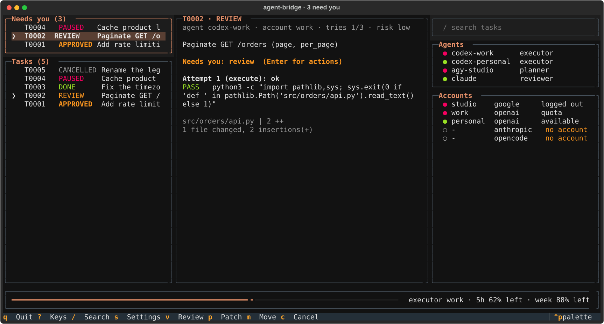
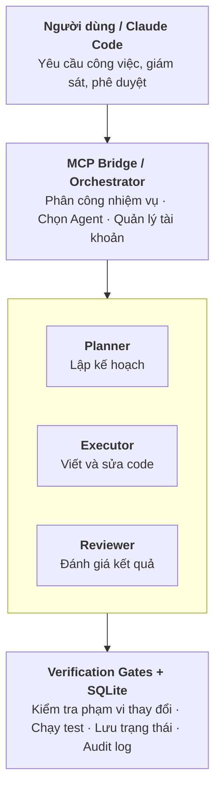
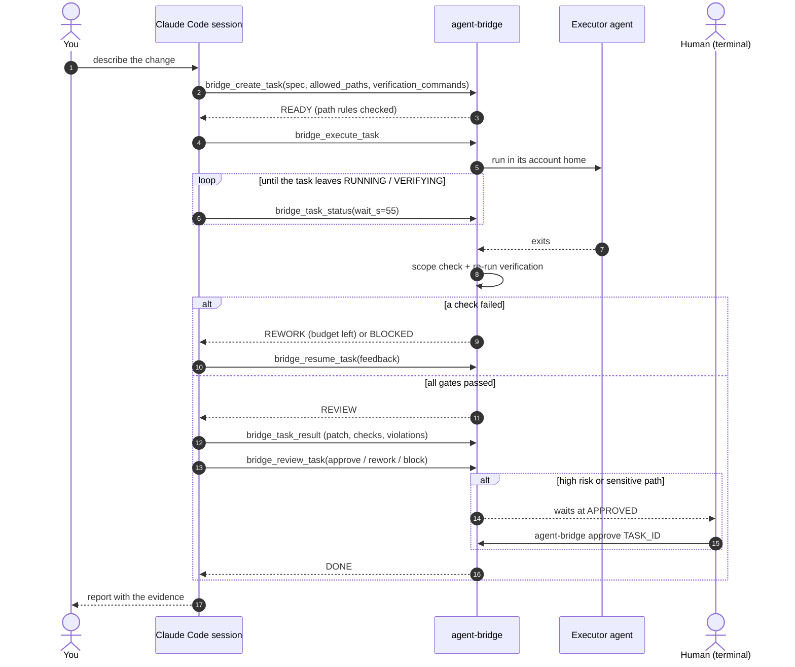
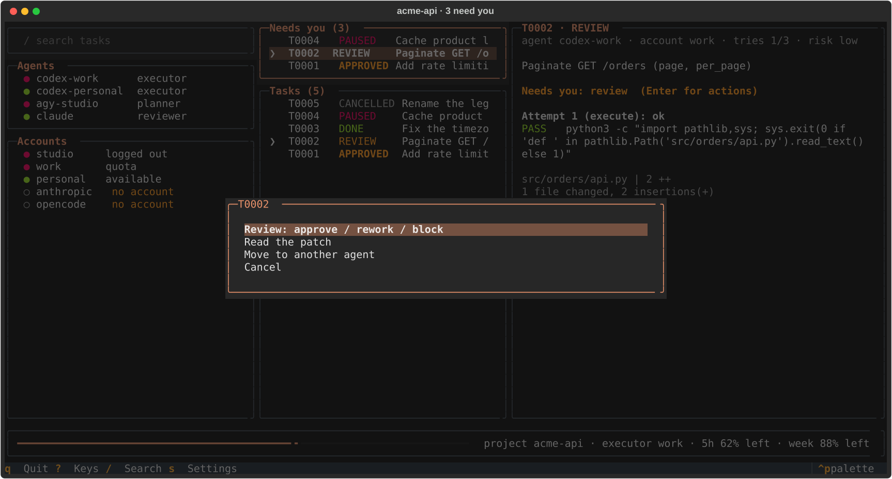
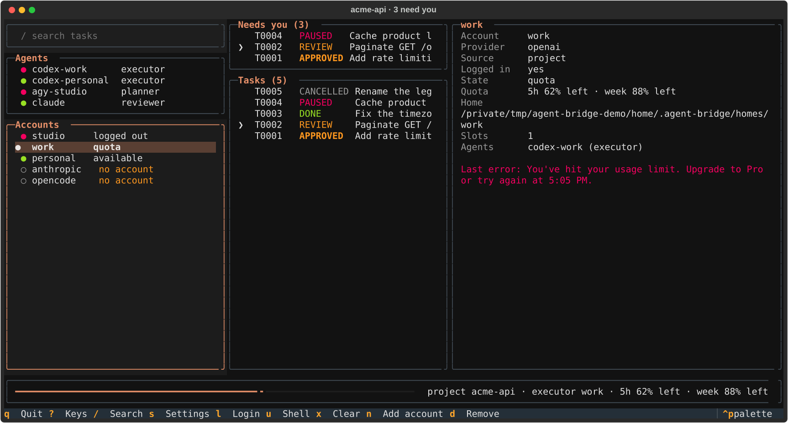
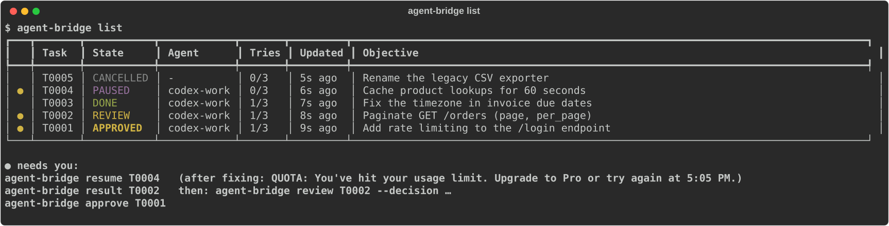
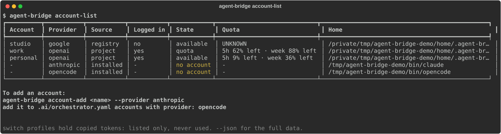

<h1 align="center">agent-orchestration-kit</h1>

<p align="center">
  Chạy các AI agent planner, executor và reviewer trên những CLI và account riêng,<br>
  với một MCP server cục bộ kiểm tra lại kết quả thay vì tin vào lời agent.
</p>

<p align="center">
  <a href="README.md">English</a> · <b>Tiếng Việt</b>
</p>

<p align="center">
  
  
  
  <a href="LICENSE"></a>
  
</p>

<p align="center">
  
</p>

Khi để một AI agent vừa viết code vừa tự đánh giá, không ai kiểm tra lại công việc: agent báo
"xong" là xong, kể cả khi test chưa hề chạy hay nó đã sửa file ngoài phạm vi được giao.

`agent-orchestration-kit` tách các việc đó ra. Một MCP server nhỏ, `agent-bridge`, chạy ngay trong
project của bạn: giao từng task cho một executor agent (Codex CLI hoặc Claude Code), giới hạn
những file agent được sửa, tự chạy lại các lệnh verification, và chỉ sau đó mới cho reviewer
approve. Lời tự báo cáo của agent không bao giờ được coi là bằng chứng, còn các bước không thể
đảo ngược vẫn do con người quyết định.

Kit dành cho developer đang dùng Claude Code và Codex CLI bằng tài khoản subscription, muốn có
một vòng giao việc lặp lại được và kiểm toán được trong từng repository.

## Mục lục

- [Tính năng chính](#tính-năng-chính)
- [Kiến trúc](#kiến-trúc)
- [Yêu cầu](#yêu-cầu)
- [Cài đặt](#cài-đặt)
- [Bắt đầu nhanh](#bắt-đầu-nhanh)
- [Cấu hình](#cấu-hình)
- [Role, adapter và provider](#role-adapter-và-provider)
- [Vòng đời workflow](#vòng-đời-workflow)
- [Mô hình bảo mật và giới hạn](#mô-hình-bảo-mật-và-giới-hạn)
- [Theo dõi](#theo-dõi)
- [Xử lý sự cố](#xử-lý-sự-cố)
- [Phát triển và kiểm thử](#phát-triển-và-kiểm-thử)
- [Tài liệu khác](#tài-liệu-khác)
- [Đóng góp và giấy phép](#đóng-góp-và-giấy-phép)

## Tính năng chính

- **Role, agent và account tách biệt.** `planner`, `executor` và `reviewer` được gán cho agent;
  mỗi agent dùng một adapter (`codex-cli`, `claude-cli`, `client`, hoặc `opencode-cli` /
  `agy-cli` chỉ đọc) và một account riêng.
- **Bridge quyết định đạt hay không.** Sau mỗi lượt chạy, bridge đối chiếu mọi file bị thay đổi
  với `allowed_paths` của task, xác nhận `HEAD` không đổi và tự chạy lại các lệnh verification.
- **Giới hạn số lần làm lại.** Mỗi task có ngân sách attempt; lỗi chuyển sang `REWORK`, rồi
  `BLOCKED` kèm chẩn đoán.
- **Cổng duyệt của con người.** Task rủi ro cao và thay đổi ở path nhạy cảm (migration, auth,
  deploy, CI, secret) phải chờ `agent-bridge approve` trong một terminal interactive.
- **Account cô lập.** Mỗi account có auth home riêng (`CODEX_HOME`, `CLAUDE_CONFIG_DIR`, hoặc cả
  một `HOME` với agy), giới hạn chạy song song và theo dõi quota. Quota fallback (tùy chọn) chuyển
  việc sang account khác.
- **Workflow do planner lập.** Một planner agent có thể chia mục tiêu thành các task đã được
  validate, chạy theo thứ tự phụ thuộc.
- **Theo dõi.** Dashboard trong terminal, các lệnh CLI xuất bảng/JSON và dashboard web chỉ đọc
  trên localhost.
- **Cài đặt theo project.** `agent-bridge init` chỉ ghi file trong project; không bao giờ sửa
  `~/.claude`, `~/.codex` hay cấu hình MCP global.

## Kiến trúc

Phiên Claude Code chỉ giao tiếp với bridge qua MCP tool; bridge khởi chạy mọi agent khác và
chặn kết quả của chúng bằng các gate.



| Thành phần | Vị trí |
|---|---|
| MCP server và CLI (`agent-bridge`) | Tool đã cài; `.mcp.json` chạy `agent-bridge serve` |
| Thiết lập của project | `.mcp.json`, `.claude/settings.json`, `.claude/rules/`, `.claude/skills/agent-orchestration/`, một block trong `CLAUDE.md`, `.ai/` |
| Trạng thái task, log, audit event | `~/.agent-bridge/projects/<project>/worktrees/<worktree>/bridge.db` (đổi bằng `AGENT_BRIDGE_HOME`), nằm ngoài worktree để agent không ghi được |
| Account dùng chung toàn máy và lock | `~/.agent-bridge/` (`accounts.json`, `accounts.db`, `homes/`, `locks/`) |

Khi không có `.ai/orchestrator.yaml`, kit dùng **thiết lập legacy**: phiên Claude Code lập kế
hoạch và review, Codex thực thi.

## Yêu cầu

- macOS hoặc Linux. Có code cho Windows nhưng chưa được kiểm thử trên máy Windows thật.
- `git` và [uv](https://docs.astral.sh/uv/) (uv tự tải Python 3.12 trở lên).
- Project đích phải là một git repository.
- [Claude Code](https://docs.anthropic.com/en/docs/claude-code) cho phiên làm việc interactive.
- Ít nhất một agent CLI đã đăng nhập bằng subscription riêng; không cần API key:
  - Codex CLI (đã kiểm chứng với 0.163.0; kiểm tra bằng `codex login status`), và/hoặc
  - Claude Code headless (đã kiểm chứng với 2.1.306; kiểm tra bằng `claude auth status`).
  - Tùy chọn, dùng làm planner/reviewer chỉ đọc: opencode, agy.

## Cài đặt

```bash
git clone https://github.com/leetuanbmt/agent-orchestration-kit.git ~/tools/agent-orchestration-kit
uv tool install --editable ~/tools/agent-orchestration-kit   # đưa `agent-bridge` vào PATH
uv tool update-shell                                          # một lần, nếu ~/.local/bin chưa có trong PATH
```

Mở shell mới sau `update-shell`, rồi kiểm tra bằng `agent-bridge --help`.

Bản cài là editable: tool chạy trực tiếp từ thư mục checkout, nên rule và skill mà `init` sao
chép luôn khớp với phiên bản đang cài. Hãy giữ nguyên vị trí thư mục checkout.

- **Cập nhật:** `git -C ~/tools/agent-orchestration-kit pull`. Tool dùng code mới ngay. Rule và
  skill đã sao chép vào project vẫn giữ nguyên; muốn làm mới, chạy `agent-bridge init --force`
  trong project đó. `--force` ghi đè các chỉnh sửa cục bộ trên những file này, sau khi sao lưu
  chúng vào `.ai/backup-<UTC timestamp>/`.
- **Gỡ khỏi một project:** `agent-bridge uninstall` chỉ xoá những gì `init` đã thêm và giữ lại
  file bạn đã sửa (kèm cảnh báo); `--purge` xoá thêm `.ai/`. Lịch sử task vẫn nằm trong
  `~/.agent-bridge`.
- **Gỡ tool:** `uv tool uninstall agent-orchestration-kit`, rồi xoá thư mục checkout.

Nếu không cài tool, `scripts/setup.sh <dir> [--force]` và `scripts/uninstall.sh <dir> [--purge]`
làm việc tương tự từ thư mục checkout. Khi đó `.mcp.json` chạy
`uv run --project <kit> agent-bridge serve`, một đường dẫn tuyệt đối sẽ hỏng nếu kit bị di chuyển.

## Bắt đầu nhanh

**1. Thiết lập project.**

```bash
cd /path/to/project          # một git repository
agent-bridge init            # .mcp.json, .claude/settings.json, rules, skill, block CLAUDE.md, .ai/
claude                       # một lần: trust thư mục để server agent-bridge kết nối được
claude mcp list              # kỳ vọng: agent-bridge ... Connected
```

`init` làm những việc sau:

- `.mcp.json` nhận `{"command": "agent-bridge", "args": ["serve"]}`, không chứa đường dẫn riêng của
  máy, nên có thể commit. Claude Code phải tìm thấy `agent-bridge` trong `PATH`.
- `.mcp.json` và `.claude/settings.json` có sẵn được gộp theo từng key; các server và deny rule
  khác được giữ nguyên. `CLAUDE.md` nhận một block có đánh dấu (`<!-- agent-bridge:start/end -->`).
- Mọi file bị thay đổi đều được sao lưu trước vào `.ai/backup-<UTC timestamp>/`.
- Nếu đích đã có một file khác, hoặc một server `agent-bridge` khác, `init` sẽ dừng trừ khi có
  `--force`.
- Manifest cài đặt nằm ở `<git-dir>/agent-bridge/install-manifest.json`, ngoài tầm với của agent.
- Project thiết lập bằng kit `codex-bridge` cũ được nâng cấp: server, các mục settings, block
  `CLAUDE.md` và thư mục trạng thái được thay thế; file rule và skill `codex-*` chưa sửa bị xoá
  (file đã sửa được giữ lại kèm cảnh báo). Permission rule bạn tự viết cho tool
  `mcp__codex-bridge__*` phải đổi tên thủ công.

**2. Chọn thiết lập (tùy chọn).** Bỏ qua bước này để dùng thiết lập legacy (Claude Code lập kế
hoạch và review, Codex thực thi bằng login global).

```bash
agent-bridge config-init orchestrator   # ghi .ai/orchestrator.yaml; không bao giờ ghi đè
agent-bridge config-check               # validate
agent-bridge agents                     # ai plan, execute, review; ai đang sẵn sàng
```

**3. Kiểm tra tình trạng.**

```bash
agent-bridge health          # adapter, login, quota, số task; exit 1 khi không OK
```

**4. Nhờ Claude Code thực hiện thay đổi.** Skill `agent-orchestration` đã cài sẽ điều khiển một
trong hai luồng:

```text
you plan:     bridge_create_task → bridge_execute_task → bridge_task_status(wait_s)
                → bridge_task_result → bridge_review_task (→ bridge_resume_task for rework)
agent plans:  bridge_plan → bridge_workflow_status(wait_s) → bridge_run_workflow
                → bridge_workflow_status (DONE / INCOMPLETE / WAITING)
```

**5. Theo dõi tiến độ** bằng `agent-bridge` (dashboard terminal) hoặc `agent-bridge web`. Xem
[Theo dõi](#theo-dõi).

## Cấu hình

Hai file tùy chọn trong thư mục `.ai/` của project:

| File | Mục đích |
|---|---|
| `.ai/orchestrator.yaml` | Account, agent, role, định tuyến, các stage của workflow. Bị git-ignore (vì chứa đường dẫn home riêng của máy). |
| `.ai/config.json` | Cài đặt bridge: sandbox, timeout, quy tắc path, allowlist verification. Được commit. |

```yaml
version: 1
accounts:
  codex-work:  {provider: openai,    home: ~/.codex-accounts/homes/work}
  claude-main: {provider: anthropic, home: ~/.claude-accounts/main, max_concurrency: 1}
agents:
  claude:          {adapter: client}                         # the MCP caller
  claude-headless: {adapter: claude-cli, account: claude-main, model: sonnet}
  codex-a:         {adapter: codex-cli,  account: codex-work}
roles:
  planner: claude-headless
  executor: {agents: [codex-a], strategy: ordered}
  reviewer: claude                                           # you review via bridge_review_task
routing:
  quota_fallback: {enabled: false, min_remaining_pct: 10}
workflow:
  stages: [plan, execute, test, review]
  max_rework: 2
```

Các ví dụ đi kèm (`agent-bridge config-init <name>`):

| Ví dụ | Planner | Executor | Reviewer |
|---|---|---|---|
| *(không có file, legacy)* | Phiên Claude Code | Codex | Phiên Claude Code |
| [`orchestrator`](examples/orchestrator.yaml) | Claude headless | Codex trên hai account, theo thứ tự fallback | Claude headless |
| [`claude-executor`](examples/claude-executor.yaml) | Codex | Claude headless (`allow_write`) | Codex |
| [`single-agent`](examples/single-agent.yaml) | Codex | Codex | Codex |
| [`gates-only`](examples/gates-only.yaml) | — | Codex | Không có: chỉ gate tất định |
| [`other-reviewers`](examples/other-reviewers.yaml) | agy | Codex | opencode |

Account do con người đăng nhập, theo project (`agent-bridge account-login <name>`) hoặc dùng
chung toàn máy (`agent-bridge account-add <name> --provider …`). Quota fallback mặc định tắt;
bật nó nghĩa là cho phép bridge chuyển task sang account khác khi quota xuống thấp (không bao
giờ chuyển khi lỗi AUTH).

Tài liệu đầy đủ: mọi key và giá trị mặc định, account, quota, quota fallback và nơi lưu trạng
thái có trong [docs/configuration.md](docs/configuration.md) (tiếng Anh).

## Role, adapter và provider

| Adapter | Provider | Ghi được | Cơ chế cô lập | Account home |
|---|---|---|---|---|
| `codex-cli` | `openai` | Có (mặc định) | OS sandbox của Codex (`workspace-write` / `read-only`), không có mạng | `CODEX_HOME` |
| `claude-cli` | `anthropic` | Chỉ khi `allow_write: true` | Permission rule của CLI; không có OS sandbox | `CLAUDE_CONFIG_DIR` |
| `client` | — | Không | Chính MCP caller; bridge không bao giờ khởi chạy nó | — |
| `opencode-cli` | `opencode` | Không (config từ chối) | Chặn tool qua config; không có OS sandbox | Chỉ login global |
| `agy-cli` | `google` | Không (config từ chối) | `--mode plan --sandbox`; không có OS sandbox | Cả một `HOME` |

- `executor` phải ghi được, nên chỉ có thể là `codex-cli` hoặc `claude-cli` với `allow_write`.
- `planner` và `reviewer` chỉ cần quyền đọc; `client` nghĩa là chính bạn, thông qua
  `bridge_review_task`.
- **Định tuyến.** Task được ghim bằng `agent` hoặc `account` sẽ chạy ở đó. Nếu không, khi task
  khởi động lần đầu, bridge chọn agent `default` của role, rồi đến agent đủ điều kiện đầu tiên
  theo thứ tự trong role. Task giữ agent và session đó cho các lần thử lại.

## Vòng đời workflow

Một task, từ yêu cầu đến báo cáo:



Các trạng thái: `BACKLOG → READY → RUNNING → VERIFYING → REVIEW → APPROVED → DONE`, cùng với
`REWORK`, `FAILED`, `PAUSED`, `BLOCKED` và `CANCELLED`. `DONE`, `CANCELLED` và `BLOCKED` là trạng
thái kết thúc.

| Chuyển | Ai | Điều kiện |
|---|---|---|
| `BACKLOG → READY` | Bridge | Mọi task trong `depends_on` đã `DONE` |
| `READY` / `REWORK` / `FAILED` / `PAUSED` → `RUNNING` | Client hoặc trình điều khiển workflow | `bridge_execute_task`, `bridge_resume_task`, `bridge_run_workflow` |
| `RUNNING → VERIFYING` | Bridge | Agent kết thúc bình thường |
| `RUNNING → FAILED` | Bridge | Timeout hoặc crash (`BLOCKED` khi hết ngân sách attempt) |
| `RUNNING → PAUSED` | Bridge | Quota, auth, mạng, thiếu CLI hoặc runner bị gián đoạn; không tốn ngân sách attempt |
| `VERIFYING → REVIEW` | Bridge | Không vi phạm phạm vi, mọi lệnh verification đều qua, agent báo `completed` |
| `VERIFYING → REWORK` | Bridge | Có kiểm tra thất bại (`BLOCKED` khi hết ngân sách) |
| `REVIEW → APPROVED` / `REWORK` / `BLOCKED` | Client hoặc reviewer agent | `bridge_review_task` hoặc lượt chạy của reviewer |
| `REVIEW → APPROVED` | Bridge | Không có stage `review` và mọi gate đều qua |
| `APPROVED → DONE` | Bridge, hoặc con người với task rủi ro cao | Kiểm tra lại quality gate |
| Mọi trạng thái chưa kết thúc → `CANCELLED` | Client | `bridge_cancel_task` |

Mỗi task chạy tối đa `max_rework + 1` lần (mặc định 3). Runner chết giữa chừng được phát hiện ở
lần khởi động bridge kế tiếp: task chuyển sang `PAUSED` (`INTERRUPTED`) và `bridge_resume_task`
tiếp tục đúng session đó.

## Mô hình bảo mật và giới hạn

Kit thu hẹp những gì agent được làm và kiểm chứng những gì agent đã làm. Nó không phải một
sandbox hoàn chỉnh cho code không đáng tin cậy.

**Bridge áp dụng cho mọi adapter:**

- **Path.** Kiểm tra khi tạo task (đường dẫn tuyệt đối, `..`, `~`, symlink thoát ra ngoài, path
  protected, glob quá rộng) và sau mỗi lượt chạy (hash snapshot, diff toàn worktree, `HEAD` không
  được đổi). Path protected (`.env*`, key, `.git/`, `.ai/`, `.mcp.json`,
  `.claude/settings*.json`) không bao giờ được cho phép.
- **Verification.** Bridge tự chạy lại, chỉ dùng argv (không qua shell), file thực thi phải nằm
  trong allowlist, có timeout.
- **Duyệt.** Executor không tự approve được. Client hoặc reviewer agent approve; bridge chỉ tự
  approve khi workflow không có stage `review`. Task rủi ro cao hoặc đụng path nhạy cảm cần con
  người duyệt trong terminal interactive.
- **Process.** Agent khởi chạy từ argv list trong process group riêng; khi timeout hoặc bị huỷ,
  bridge gửi SIGTERM rồi SIGKILL. Process group mồ côi của runner đã chết bị kill ở lần khởi động
  sau, chỉ khi PID là process `codex`, `claude`, `opencode` hoặc `agy`.
- **Environment và output.** Biến có dạng credential (`*_API_KEY`, `*_TOKEN`, `*_SECRET*`,
  `*PASSWORD*`, `AWS_*`) bị xoá trước khi agent hoặc lệnh verification chạy. Output được lưu đều
  đi qua bước che secret.
- **Chống đệ quy.** Mọi process agent nhận `AGENT_BRIDGE_AGENT=1`; server và CLI từ chối khởi
  động khi có biến này.
- **Audit.** Mọi lần chuyển trạng thái, attempt, quyết định định tuyến, review, thay đổi account
  và trạng thái workflow đều là một event trong `bridge.db`.

**Theo từng adapter:**

- **Codex CLI** chạy trong OS sandbox của nó (`workspace-write` hoặc `read-only`; không thể cấu
  hình `danger-full-access`), không có mạng, `/tmp` và `$TMPDIR` không ghi được, bỏ qua
  `~/.codex/config.toml`. Lượt plan và review chạy `read-only`.
- **Claude CLI** không có OS sandbox. Bridge chạy nó với `--strict-mcp-config` (không MCP server
  nào), `--setting-sources ""` (không nạp settings, allow rule hay hook của user lẫn project),
  `--permission-mode dontAsk` và allowlist Read/Glob/Grep. Khi `allow_write: true`, nó có thêm
  Edit/Write giới hạn trong `allowed_paths` của task, còn path bị loại trừ và path protected bị
  chặn. Tool đọc vẫn đọc được mọi thứ user của bạn đọc được, và `allow_bash: true` hoàn toàn
  không bị giới hạn path. Nên dùng Codex làm executor và không bao giờ bật `allow_bash` cho việc
  không đáng tin cậy.
- **opencode và agy** chỉ đọc. opencode chạy với edit, bash, webfetch và thư mục bên ngoài bị
  chặn qua `OPENCODE_CONFIG_CONTENT`; agy chạy `--mode plan --sandbox` và vẫn giữ các tool trình
  duyệt mà CLI không tắt được. Probe không ghi file nào với cả hai; cả hai đều không có OS sandbox.
- **Tùy chọn `claude_hook_settings`** trong `.ai/config.json` truyền một file settings chỉ chứa
  hook cho mọi lượt chạy Claude. Các hook này là code được tin cậy, chạy không có sandbox; tùy
  chọn này mặc định tắt.

**Credential.** Mỗi account dùng auth home riêng, tạo bằng một lần đăng nhập mới, không bao giờ
sao chép token của profile khác. Bridge chỉ đọc các event `rate_limits` của Codex trong
`<home>/sessions/**/rollout-*.jsonl`; không bao giờ đọc `auth.json` hay file credential khác.

**Giới hạn đã biết:**

- Deny rule trong `.claude/settings.json` chỉ định hướng cho Claude Code, không phải ranh giới bảo
  mật. Việc kiểm tra terminal interactive cho lệnh chỉ dành cho con người có thể bị vượt qua nếu
  agent tự cấp một pseudo-terminal.
- Lệnh verification chạy ngoài sandbox của Codex, với quyền của bạn.
- Snapshot sau lượt chạy bao gồm file được track, file đã sửa và file protected ở cấp gốc; thay
  đổi ở một file secret lồng sâu và bị git-ignore sẽ không bị phát hiện.
- Codex và Claude vẫn ghi file session của riêng chúng (`~/.codex/sessions`, `~/.claude.json`).
- Các file trong `.ai/` ngoài `config.json` bị git-ignore và Codex ghi được; hãy coi chúng là bản
  sao tiện dụng, không phải đầu vào đáng tin cậy.
- Mỗi worktree chỉ có một tiến trình ghi; trình điều khiển workflow chạy lần lượt từng task. Muốn
  ghi song song cần các worktree riêng.
- Quota của Claude chỉ biết được sau lượt chạy đầu tiên của account qua bridge; quota của Codex là
  snapshot từ session gần nhất, không phải truy vấn trực tiếp.
- Hành vi sandbox của Codex mới chỉ được kiểm chứng trên macOS.
- Chưa hỗ trợ: opencode hoặc agy làm executor, chiến lược định tuyến ngoài "agent đủ điều kiện
  đầu tiên", nhiều reviewer bỏ phiếu, và stage riêng cho role tùy chỉnh. Muốn thêm CLI khác cần
  viết một lớp con `Adapter` mới.

Chi tiết hơn: [docs/REPORT.md](docs/REPORT.md) (phiên bản CLI đã kiểm chứng, các probe và danh
sách giới hạn đầy đủ, tiếng Anh).

## Theo dõi

### Dashboard trong terminal

Chạy `agent-bridge` (hoặc `agent-bridge tui`) trong project. Dashboard làm mới mỗi 3 giây và
không bao giờ khởi chạy agent: lượt chạy thuộc về process MCP server.

- **Search**, **Agents** và **Accounts** ở bên trái. Accounts liệt kê mọi account máy biết: account
  của project và toàn máy, home codex-switch chưa được thêm, profile codex-switch và claude-switch
  (đánh dấu không dùng được) và các CLI đã cài nhưng chưa có account.
- **Needs you** (task ở `APPROVED`, `REVIEW`, `PAUSED`, `FAILED`, `BLOCKED`) và **Tasks** ở giữa.
- **Detail** bên phải: mục tiêu, kết quả kiểm tra, diff stat và review của task; hoặc provider,
  login, trạng thái, quota, home và lỗi gần nhất của account.

Nhấn **Enter** trên một dòng để xem các thao tác phù hợp; footer chỉ hiện các phím dùng được
cho dòng đang chọn.




| Phím | Thao tác |
|---|---|
| `Tab` / `Shift+Tab`, `↑` `↓` | Chuyển giữa các panel và dòng (dùng chuột cũng được) |
| `Enter` | Thao tác cho task hoặc account đang chọn |
| `/` | Tìm task theo id, trạng thái, agent hoặc mục tiêu |
| `p` / `a` / `v` | Xem patch / approve task đang chờ con người / review task ở `REVIEW` |
| `c` / `m` | Huỷ task / chuyển sang agent khác (session mới) |
| `l` / `u` / `x` / `d` | Trên account: đăng nhập / mở shell bằng account đó (agy: hiện dòng `eval`) / đánh dấu sẵn sàng / xoá |
| `n` | Thêm account toàn máy (trên dòng home codex-switch: thêm home đó) |
| `s` | Settings; `e` trong đó mở `.ai/orchestrator.yaml` (hoặc `config.json`) bằng `$EDITOR` |
| `?` / `q` | Danh sách phím / thoát |

### Các lệnh CLI xem nhanh

Các lệnh này in bảng trong terminal và in JSON khi có `--json` hoặc khi output được pipe:

```bash
agent-bridge health        # adapter, quota mỗi account, số task
agent-bridge agents        # role, agent và tình trạng sẵn sàng
agent-bridge account-list  # account và trạng thái login; --all thêm profile và CLI chưa dùng
agent-bridge list          # task của project này, mới nhất trước
agent-bridge tasks         # task của mọi project và worktree trên máy
```




Ảnh chụp màn hình lấy từ một lượt chạy end-to-end của tool đã cài trên dữ liệu giả (agent CLI
giả, `HOME` mới, một project demo). Tạo lại bằng
`"$(uv tool dir)/agent-orchestration-kit/bin/python" scripts/screenshots.py docs/images`.

### Dashboard web

`agent-bridge web [--port N] [--open]` phục vụ dashboard trên trình duyệt tại `127.0.0.1` (port
mặc định 8765; `--port 0` tự chọn port trống; Ctrl+C để dừng). URL được in ra chứa một token bí
mật sinh cho mỗi lần chạy, mọi request API đều cần token này; đừng chia sẻ nó.

Dashboard bao quát mọi project mà agent-bridge biết trên máy cùng các git worktree của chúng:
approval đang chờ kèm lệnh chính xác, task bị blocked, failed hoặc paused, task chờ review, task
đang chạy với thời gian đã chạy so với timeout, tiến độ tổng thể, hoạt động trong 24 giờ qua và
bảng request có ngăn chi tiết (không có patch). Giao diện chuyển được giữa tiếng Việt và tiếng
Anh.

Dashboard web chỉ đọc: nó mở từng `bridge.db` bằng SQLite `mode=ro`, không khởi chạy agent nào
và không thực hiện thao tác nào dành cho con người. Nó chỉ lắng nghe trên `127.0.0.1` và từ chối
các header `Host` khác.

## Xử lý sự cố

| Triệu chứng | Nguyên nhân và cách xử lý |
|---|---|
| `agent-bridge: command not found` | Chạy `uv tool update-shell` rồi mở shell mới. |
| `not a git repository` hoặc `Target must be a git work tree` | Bridge chỉ chạy trong git repository; chạy `git init` hoặc chuyển thư mục. |
| `claude mcp list` hiện `agent-bridge: ⏸ Pending approval` | Mở `claude` trong thư mục một lần và trust nó. |
| Lỗi `config-check` | Thông báo nêu đúng field; sửa `.ai/orchestrator.yaml`. |
| `health` báo NOT OK | Thiếu adapter CLI hoặc CLI chưa đăng nhập; con người đăng nhập. |
| `no eligible executor agent (…)` | Mọi executor đều bị tắt, bận hoặc không sẵn sàng; lý do được liệt kê theo từng agent. |
| Task `PAUSED` với `QUOTA` hoặc `AUTH` | Chờ cửa sổ quota reset hoặc sửa login; sau đó chạy `agent-bridge account-clear <name>` nếu dấu vẫn còn, rồi resume. Khi bật quota fallback, resume có thể chuyển task sang account khác. |
| Task `PAUSED` với `INTERRUPTED` | Runner đã chết; `bridge_resume_task` tiếp tục session. |
| Event `agent_review_failed` | Reviewer agent gặp lỗi; task chờ ở `REVIEW` để gọi `bridge_review_task`. |
| Workflow `WAITING` | `detail.waiting` và trạng thái task cho biết cần xử lý gì; xử lý xong thì chạy lại `bridge_run_workflow`. |
| `ConflictError … already writing` | Mỗi worktree chỉ một tiến trình ghi; chờ, hoặc dùng worktree khác. |
| `account … busy in another bridge process` | Slot chạy song song của account đang được dùng ở nơi khác. |
| `REWORK` với `outside allowed paths` | Executor sửa file ngoài phạm vi task; đọc patch rồi yêu cầu rework. |
| `health` cảnh báo storage legacy | Migrate bằng `agent-bridge storage status`, rồi `storage migrate --apply` ([chi tiết](docs/configuration.md#migrating-and-maintaining-state)). |

## Phát triển và kiểm thử

```bash
uv sync                          # .venv cục bộ của project với Python 3.12+
scripts/check.sh                 # toàn bộ test với CLI giả (tất định, không tốn quota)
scripts/check.sh --with-health   # thêm yêu cầu `agent-bridge health` báo OK
```

Smoke test tùy chọn với CLI thật sẽ tốn quota của bạn:

```bash
CODEX_SMOKE=1 uv run pytest -m real_codex                                        # hai lượt Codex thật
CLAUDE_SMOKE=1 uv run pytest tests/e2e/test_real_claude_smoke.py                 # một lượt review bằng Claude thật
OPENCODE_SMOKE=1 AGY_SMOKE=1 uv run pytest tests/e2e/test_real_other_smoke.py    # review bằng opencode / agy thật
```

Các CLI giả trong `tests/fakes/` (`codex`, `claude`, `opencode`, `agy`) nói đúng giao thức JSONL và
stream-json thật. Bộ test bao phủ các cấu hình đi kèm, định tuyến, ghim agent, affinity, quota
fallback, giới hạn rework, reviewer lỗi, validate config, cô lập account, slot chạy song song,
ánh xạ legacy, nâng cấp schema, migrate storage, account toàn máy và các dashboard.

## Tài liệu khác

| Tài liệu | Nội dung |
|---|---|
| [docs/configuration.md](docs/configuration.md) | Mọi key của `orchestrator.yaml` và `config.json`, account, quota, quota fallback, nơi lưu trạng thái và migration (tiếng Anh) |
| [docs/cli-reference.md](docs/cli-reference.md) | MCP tool kèm tham số, mọi lệnh CLI và các lệnh chỉ dành cho con người (tiếng Anh) |
| [docs/REPORT.md](docs/REPORT.md) | Báo cáo build: phiên bản CLI đã kiểm chứng, probe bảo mật, giới hạn đã biết (tiếng Anh) |
| [CHANGELOG.md](CHANGELOG.md) | Lịch sử phát hành |

## Đóng góp và giấy phép

Trước khi mở pull request, hãy chạy `scripts/check.sh`, thêm mục vào `CHANGELOG.md` dưới
*Unreleased*, và giữ README này đồng bộ với [README.md](README.md).

Phát hành theo [giấy phép MIT](LICENSE) © leetuanbmt.
