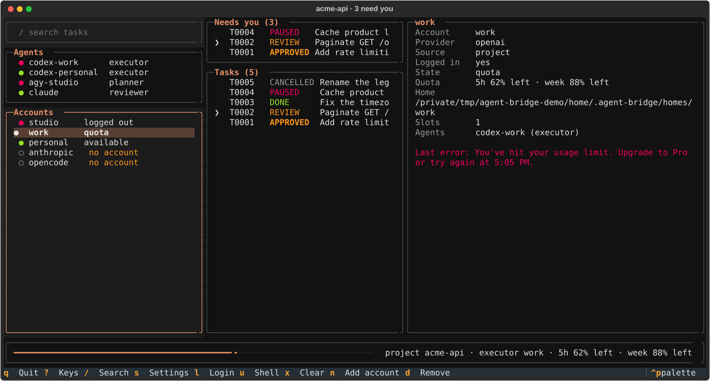

<h1 align="center">agent-orchestration-kit</h1>

<p align="center">
  Harness cục bộ theo từng project, không phụ thuộc nhà cung cấp, cho <b>quy trình lập trình nhiều agent</b>.<br>
  Role (planner, executor, reviewer) được gán cho agent; agent chạy trên CLI (Codex, Claude Code) với account tách biệt.<br>
  Một MCP server nhỏ (<code>agent-bridge</code>) giữ trạng thái task, chạy agent an toàn và tự kiểm chứng lại kết quả.<br>
  Mọi thứ nằm trong repository, không đụng tới cấu hình global.
</p>

<p align="center">
  <a href="README.md">English</a> · <b>Tiếng Việt</b>
</p>

<p align="center">
  
  
  
  
</p>

<p align="center">
  
</p>

---

Khi để một AI agent vừa viết code vừa tự đánh giá, không có ai kiểm tra lại: agent báo "xong" là
xong, kể cả khi test chưa chạy hay nó sửa ra ngoài phạm vi được giao.

`agent-orchestration-kit` tách các việc ra và để bạn chọn ai làm việc nào:

- **Role**: `planner` chia việc thành task, `executor` implement từng task một, `reviewer` quyết
  định approve / rework / block. Có thể thêm role tuỳ chỉnh.
- **Agent**: một adapter (`codex-cli`, `claude-cli`, `client` là chính MCP client, hoặc
  `opencode-cli` / `agy-cli` chỉ đọc, dùng để lập kế hoạch và review), một account, model tuỳ
  chọn, quyền đọc/ghi.
- **Account**: các phiên đăng nhập tách biệt (`CODEX_HOME`, `CLAUDE_CONFIG_DIR`, cả một `HOME`
  với agy), mỗi account có giới hạn chạy song song và quota riêng. Account dùng chung toàn máy
  được tạo và chuyển bằng chính `agent-bridge`, không cần công cụ switch nào khác.
- **`agent-bridge`**: giữ trạng thái task trong SQLite, định tuyến task tới agent, chạy agent với
  quyền hẹp nhất, kiểm tra file nào thay đổi và tự chạy lại lệnh verification. Lời tự báo cáo
  của agent không được tính là bằng chứng.

```
user ─▶ MCP client (Claude Code) ──MCP stdio──▶ agent-bridge ──argv, own process group──▶ codex exec --json
          (plan, review, hoặc chỉ điều phối)     (role → agent → account,                  claude -p --output-format stream-json
                                                  scope check, verification, audit log)    (plan / implement / review)
```

Không có `.ai/orchestrator.yaml` thì kit chạy y như 0.1: phiên Claude Code lập kế hoạch và
review, Codex thực thi, account lấy từ `.ai/config.json`.

Mọi thứ đều cục bộ theo project: `.mcp.json`, `.claude/`, `CLAUDE.md`, `.ai/`, và trạng thái
runtime trong git directory của repository (`.git/agent-bridge/`). Không có gì dưới `~/.claude`,
`~/.codex` hay cấu hình MCP global bị sửa.

---

## Cài đặt

**Yêu cầu:**
- macOS hoặc Linux, git, [uv](https://docs.astral.sh/uv/) (uv tự tải Python 3.12).
- Ít nhất một agent CLI, đăng nhập bằng subscription riêng: Codex CLI (đã test 0.163.0,
  `codex login status`) và/hoặc Claude Code (đã test 2.1.306, `claude auth status`). Không cần
  API key.

```bash
git clone https://github.com/leetuanbmt/agent-orchestration-kit.git ~/tools/agent-orchestration-kit
uv tool install --editable ~/tools/agent-orchestration-kit   # đưa lệnh `agent-bridge` lên PATH
uv tool update-shell                                          # một lần, nếu ~/.local/bin chưa có trong PATH
```

Bản cài là editable: tool chạy thẳng từ thư mục clone, nên `git pull` ở đó là cập nhật, và rules
cùng skill mà `init` copy luôn cùng phiên bản với tool. Đừng di chuyển thư mục clone.

### Cài cho một project

Chạy `init` trong folder muốn dùng bridge; settings nằm luôn trong folder đó.

```bash
cd /path/to/project
agent-bridge init            # .mcp.json, .claude/settings.json, rules, skill, block CLAUDE.md, .ai/
claude                       # một lần: trust thư mục → agent-bridge kết nối
claude mcp list              # agent-bridge: ✔ Connected
agent-bridge                 # mở dashboard của project này
```

- `.mcp.json` nhận `{"command": "agent-bridge", "args": ["serve"]}`, không có đường dẫn riêng
  của máy, nên commit được. Claude Code phải tìm thấy `agent-bridge` trong `PATH` của nó.
- `.mcp.json` và `.claude/settings.json` có sẵn được merge theo từng key (server khác, deny rule
  và setting khác giữ nguyên); `CLAUDE.md` có thêm một block đánh dấu
  (`<!-- agent-bridge:start/end -->`). Mọi file `init` thay đổi đều được copy trước vào
  `.ai/backup-<UTC timestamp>/`.
- Rules được cài thành `.claude/rules/{orchestration,delegation,security}.md` và skill thành
  `.claude/skills/agent-orchestration/`. Nếu đích đã có file khác, hoặc có server `agent-bridge`
  khác, `init` dừng lại trừ khi dùng `--force`.
- Nâng cấp bản cài của kit cũ: server `codex-bridge`, các entry trong settings, block
  `CLAUDE.md` và thư mục state được thay bằng bản `agent-bridge`; file rule/skill tên `codex-*`
  chưa sửa thì bị xoá (đã sửa thì giữ kèm cảnh báo). Permission rule bạn tự viết cho tool
  `mcp__codex-bridge__*` thì phải tự đổi tên.
- Install manifest nằm ở `<git-dir>/agent-bridge/install-manifest.json`, ngoài tầm với của agent.
  `agent-bridge uninstall [--purge]` chỉ gỡ những gì `init` đã thêm và giữ file bạn đã sửa (kèm
  cảnh báo); `--purge` xoá luôn `.ai/`, kể cả config.
- Không cài tool: `scripts/setup.sh <dir> [--force]` và `scripts/uninstall.sh <dir> [--purge]`
  làm việc tương tự từ thư mục clone; khi đó `.mcp.json` chạy `uv run --project <kit>
  agent-bridge serve`, một đường dẫn tuyệt đối sẽ hỏng nếu kit bị di chuyển.

Phát triển chính kit: `uv sync`, rồi `scripts/check.sh --with-health`.

---

## Bắt đầu nhanh

### 1. Chọn một cấu hình

Copy một file mẫu thành `.ai/orchestrator.yaml` (hoặc không có file nào để dùng cấu hình
legacy), rồi:

```bash
agent-bridge config-check   # kiểm tra schema, lỗi ghi rõ field
agent-bridge agents         # ai plan, ai thực thi, ai review; ai đang sẵn sàng
```

| Mẫu | Planner | Executor | Reviewer |
|---|---|---|---|
| *(không có file, legacy)* | phiên Claude Code | Codex (theo account trong `config.json`) | phiên Claude Code |
| [`examples/orchestrator.yaml`](examples/orchestrator.yaml) | Claude headless | Codex trên hai account (thứ tự fallback) | Claude headless |
| [`examples/claude-executor.yaml`](examples/claude-executor.yaml) | Codex | Claude headless (`allow_write`) | Codex |
| [`examples/single-agent.yaml`](examples/single-agent.yaml) | Codex | Codex | Codex |
| [`examples/gates-only.yaml`](examples/gates-only.yaml) | — | Codex | không có: chỉ gate tất định |

### 2. Nhờ Claude Code thực hiện thay đổi

Skill `agent-orchestration` điều khiển một trong hai luồng:

```
bạn plan:      bridge_create_task → bridge_execute_task → bridge_task_status(wait_s)
                 → bridge_task_result → bridge_review_task (→ bridge_resume_task khi rework)
agent plan:    bridge_plan → bridge_workflow_status(wait_s) → bridge_run_workflow
                 → bridge_workflow_status (DONE / INCOMPLETE / WAITING)
```

### 3. Theo dõi trên dashboard

Chạy `agent-bridge` trong project. Tất cả nằm trên một màn hình, tự làm mới mỗi 3 giây:

- **Search**, **Agents** và **Accounts** (trái). Accounts liệt kê mọi account máy đang có:
  account của project và toàn máy, home codex-switch chưa thêm, profile codex-switch và
  claude-switch (đánh dấu không dùng được vì chứa token đã copy) và CLI agent đã cài nhưng chưa
  có account.
- **Needs you** (giữa, trên): task đang chờ bạn (APPROVED, REVIEW, PAUSED, FAILED, BLOCKED).
  **Tasks** ở dưới: mọi task.
- **Detail** (phải): mục tiêu của task đang chọn, kết quả kiểm tra (PASS / FAIL), diff stat,
  review; hoặc thông tin account đang chọn: provider, đăng nhập, trạng thái, quota, home, các
  agent dùng nó và lỗi gần nhất.
- Thanh dưới đáy hiện quota còn lại của account executor.

Bấm **Enter** trên bất kỳ dòng nào để mở các thao tác hợp lệ cho dòng đó, không cần nhớ phím.
Footer chỉ hiện những phím dùng được cho dòng đang chọn.




| Phím | Thao tác |
|---|---|
| `Tab` / `Shift+Tab`, `↑` `↓` | Chuyển ô / dòng (dùng chuột cũng được) |
| `Enter` | Thao tác cho task hoặc account đang chọn |
| `/` | Tìm task theo id, trạng thái, agent hoặc mục tiêu |
| `p` / `a` / `v` | Xem patch / approve task chờ người duyệt / review task ở `REVIEW` |
| `c` / `m` | Huỷ task / chuyển task sang agent khác (session mới) |
| `l` / `u` / `x` / `d` | Trên account: đăng nhập / mở shell bằng account (agy: hiện dòng `eval`) / đánh dấu sẵn sàng / xoá |
| `n` | Thêm account toàn máy (trên dòng home codex-switch: thêm chính home đó) |
| `s` | Settings; trong đó `e` sửa `.ai/orchestrator.yaml` (hoặc `config.json`) bằng `$EDITOR` |
| `?` / `q` | Bảng phím / thoát |

Dashboard không bao giờ khởi chạy agent: một lần chạy thuộc về process đã khởi chạy nó (MCP
server), thoát dashboard sẽ làm gián đoạn lần chạy đó. Dữ liệu tương tự có ở dạng bảng trong
terminal (JSON khi thêm `--json` hoặc qua pipe):

```bash
agent-bridge health        # adapter, quota còn lại theo account, số task
agent-bridge account-list  # account, trạng thái đăng nhập, codex-switch / claude-switch, CLI chưa dùng
agent-bridge list          # task, mới nhất trước
```


Ảnh chụp lấy từ một lần chạy end-to-end bằng bản tool đã cài, trên dữ liệu giả (CLI agent giả,
`HOME` mới, project demo trong `/tmp/agent-bridge-demo`). Tạo lại bằng
`"$(uv tool dir)/agent-orchestration-kit/bin/python" scripts/screenshots.py docs/images`.

---

## Role và agent (`.ai/orchestrator.yaml`)

```yaml
version: 1
accounts:
  codex-work:  {provider: openai,    home: ~/.codex-accounts/homes/work}
  claude-main: {provider: anthropic, home: ~/.claude-accounts/main, max_concurrency: 1}
agents:
  claude:          {adapter: client}                         # chính MCP client
  claude-headless: {adapter: claude-cli, account: claude-main, model: sonnet}
  codex-a:         {adapter: codex-cli,  account: codex-work}
roles:
  planner: claude-headless
  executor: {agents: [codex-a], strategy: ordered}
  reviewer: claude                                           # bạn review qua bridge_review_task
routing:
  quota_fallback: {enabled: false, min_remaining_pct: 10}
workflow:
  stages: [plan, execute, test, review]
  max_rework: 2
```

| Mục | Key |
|---|---|
| `accounts.<id>` | `provider` (`openai` \| `anthropic` \| `google` \| `opencode`; opencode không có `home`), `home` (auth home tách biệt; bỏ trống để dùng login global kế thừa, chỉ đọc), `max_concurrency` (1–8) |
| `agents.<id>` | `adapter` (`codex-cli` \| `claude-cli` \| `client` \| `opencode-cli` \| `agy-cli`; hai cái cuối chỉ đọc), `account`, `model`, `capabilities` (tập con của `[read, write]`), `allow_write` (claude-cli chỉ ghi khi bật), `allow_bash` (claude-cli), `timeout_s`, `enabled` |
| `roles.<name>` | một agent id, hoặc `{agents: [...], strategy: ordered \| explicit, requires: read \| write}`. Bắt buộc có `executor` và phải ghi được; `planner`/`reviewer` cần đọc |
| `routing.quota_fallback` | `enabled`, `min_remaining_pct`, `agents` (ứng viên theo thứ tự; mặc định: role executor) |
| `workflow` | `stages` (tập con có thứ tự của `plan, execute, test, review`; cần `execute` và ít nhất một gate), `max_rework` (0–4) |

Key lạ, id không tồn tại, provider không khớp adapter, hai account dùng chung một home, hoặc role
mà không agent nào trong danh sách đảm nhận được đều bị từ chối, thông báo lỗi ghi rõ đường dẫn
field.

- **Định tuyến.** Task được ghim bằng `agent` (hoặc `account`) sẽ chạy ở đó. Nếu không, khi bắt
  đầu lần đầu, bridge chọn executor đủ điều kiện đầu tiên theo thứ tự trong role (đang bật, CLI đã
  cài, ghi được, account sẵn sàng và chưa vượt `max_concurrency`), ghi event `agent_routed`; từ
  đó task giữ agent và session ấy. `strategy: explicit` bắt buộc mỗi task phải chỉ định agent.
- **Stage review.** Reviewer `client` là chính MCP client. Reviewer là agent thì chạy read-only
  sau khi các check của bridge đã pass; quyết định được ghi kèm `reviewer: <agent>`. Nếu reviewer
  lỗi, task ở lại REVIEW để client quyết định. Không có stage `review` thì bridge tự approve việc
  đã qua mọi gate (`reviewer: bridge`); việc rủi ro cao vẫn chờ người duyệt.
- **Stage plan.** `bridge_plan` chạy planner agent ở chế độ read-only; bridge kiểm tra mọi task
  được plan (path, lệnh, dependency) trước khi tạo task nào, rồi `bridge_run_workflow` chạy
  chúng theo thứ tự dependency, lần lượt từng task.

---

## Vòng đời task

Trạng thái: `BACKLOG → READY → RUNNING → VERIFYING → REVIEW → APPROVED → DONE`, cộng thêm
`REWORK`, `FAILED`, `PAUSED`, `BLOCKED`, `CANCELLED`.

| Chuyển trạng thái | Ai | Khi nào |
|---|---|---|
| `RUNNING → VERIFYING` | bridge | agent thoát bình thường |
| `VERIFYING → REVIEW` / `REWORK` | bridge | scope sạch và mọi lệnh verification pass / có check fail |
| `RUNNING → PAUSED` | bridge | quota, auth, network, thiếu CLI, runner bị ngắt (không tính vào số lần thử) |
| `REVIEW → APPROVED` / `REWORK` / `BLOCKED` | client hoặc reviewer agent | `bridge_review_task` / lượt chạy reviewer |
| `REVIEW → APPROVED` | bridge | không có stage review và mọi gate đã pass |
| `APPROVED → DONE` | bridge, hoặc **người** với task rủi ro cao | quality gate được kiểm tra lại |

Task có `risk_level: high`, hoặc thay đổi đụng tới path nhạy cảm (migrations, auth, deploy, CI,
secrets), dừng ở `APPROVED` cho tới khi một người chạy `agent-bridge approve <id>` trong
terminal.

---

## Danh sách lệnh

### MCP tools

| Tool | Mô tả |
|---|---|
| `bridge_health` | Adapter (path/version), login Codex, task đang chạy, % quota còn lại theo account |
| `bridge_list_agents` | Agent, role, quyền, tình trạng sẵn sàng, stage, quota fallback |
| `bridge_list_accounts` | Account, trạng thái đăng nhập, snapshot quota (cửa sổ 5h / 7d), home/profile codex-switch (không lộ credential) |
| `bridge_create_task` | Hợp đồng task đã validate (path, tiêu chí, verification, deps, risk, agent/account) |
| `bridge_execute_task` | Chạy executor agent ở background |
| `bridge_task_status` | Trạng thái gọn; long-poll `wait_s ≤ 55` |
| `bridge_task_result` | Spec, các attempt, JSON cuối của agent, diff stat + patch, check của bridge, review |
| `bridge_review_task` | approve / rework / block bởi client (cũng dùng để thay quyết định khi reviewer agent lỗi) |
| `bridge_resume_task` | Rework hoặc khôi phục, cùng session và agent |
| `bridge_cancel_task` | Kill process group của lượt chạy và huỷ task |
| `bridge_list_tasks` | Mới nhất trước, lọc theo trạng thái tuỳ chọn |
| `bridge_plan` | Chạy planner agent; tạo workflow |
| `bridge_workflow_status` | Trạng thái workflow và các task; long-poll `wait_s ≤ 55` |
| `bridge_run_workflow` | Chạy workflow tới DONE / INCOMPLETE / WAITING |

### CLI (`agent-bridge <cmd>`)

| Lệnh | Mô tả |
|---|---|
| *(không có)* / `tui` | Dashboard cho project ở thư mục hiện tại |
| `init [dir] [--force]` / `uninstall [dir] [--purge]` | Cài vào / gỡ khỏi một project |
| `serve` | MCP stdio server (lệnh mà `.mcp.json` chạy) |
| `config-check` | Kiểm tra `.ai/orchestrator.yaml` (hoặc cấu hình legacy) |
| `agents [--json]` | Role → agent, rồi bảng agent kèm quyền và tình trạng sẵn sàng |
| `health [--json]` | OK / NOT OK, adapter, quota, số task và việc cần sửa; thoát exit 1 khi không OK |
| `create <spec.json>` | Tạo task từ file spec |
| `execute` / `status` / `result` | Chạy task, xem trạng thái, xem kết quả |
| `review` / `resume` / `cancel` | Review, chạy tiếp hoặc huỷ task |
| `plan "<objective>"` / `run-workflow <W…>` / `workflow-status <W…>` | Workflow do planner agent lập |
| `list [--json]` | Task kèm trạng thái, số lần chạy và thời gian; task cần bạn xử lý có dấu `●` và lệnh tiếp theo |
| `account-list [--all] [--json]` | Account dùng được (của project và toàn máy) kèm lệnh để thêm; `--all` hiện thêm profile codex-switch / claude-switch, home chưa thêm và CLI đã cài chưa có account. Terminal hẹp sẽ có bảng gọn |

Trong terminal bốn lệnh này in bảng; khi có `--json` hoặc khi pipe output, chúng in đúng JSON
mà các MCP tool trả về.
| `account-use <name> [--shell]` | In dòng `export`/function cho `eval "$(…)"`, hoặc mở subshell, để CLI interactive của bạn dùng account đó |
| `account-clear <name>` | Gỡ cờ "unavailable" của account sau khi user xác nhận |

**Chỉ dành cho người** (cần terminal interactive và gõ xác nhận, hoặc dùng dashboard):

| Lệnh | Mô tả |
|---|---|
| `approve <id>` | Duyệt task rủi ro cao / đụng path nhạy cảm |
| `reassign <id> <agent\|account>` | Chuyển task sang agent khác (session mới) |
| `account-login <name>` | Đăng nhập mới vào home riêng của account (`codex login`, `claude auth login`, `agy`, `opencode auth login`) |
| `account-add <name> --provider openai\|anthropic\|google\|opencode [--home DIR]` | Tạo account toàn máy (home mới trong `~/.agent-bridge/homes/` nếu không có `--home`; opencode: một account dùng login global), rồi đăng nhập |
| `account-remove <name>` | Bỏ account toàn máy; chỉ xoá home nếu `account-add` đã tạo nó |

---

## Cấu hình bridge (`.ai/config.json`, tuỳ chọn)

Xem `.ai/config.example.json` (chỉ có cấu hình bridge; dùng được cùng `orchestrator.yaml`).
Key lạ bị từ chối. Account khai báo trong `orchestrator.yaml` hoặc tạo bằng `account-add`; các
key `accounts` / `auto_switch` bên dưới chỉ dành cho cấu hình legacy.

| Key | Mặc định | Ý nghĩa |
|---|---|---|
| `sandbox` | `workspace-write` | hoặc `read-only`; không chấp nhận `danger-full-access` |
| `codex_bin` / `claude_bin` / `opencode_bin` / `agy_bin` | `codex` / `claude` / `opencode` / `agy` | file chạy của CLI |
| `default_timeout_s` / `max_timeout_s` | 1800 / 7200 | giới hạn mỗi lượt chạy |
| `max_attempts` | 3 | chỉ cho cấu hình legacy; có `orchestrator.yaml` thì dùng `workflow.max_rework` |
| `network_retries` / `retry_backoff_s` | 1 / 10 | retry có giới hạn, chỉ cho lỗi network |
| `verify_timeout_s` | 900 | cho mỗi lệnh verification |
| `verify_allowlist` | pytest, uv, python, … | file chạy mà verification được phép gọi |
| `protected_paths` | `.env*`, key, `.git/**`, `.ai/**`, … | task không bao giờ được ghi |
| `sensitive_paths` | migrations, auth, deploy, CI, secrets | thay đổi ⇒ cần người duyệt |
| `env_deny` / `env_allow` | `*_API_KEY`, `*_TOKEN`, … | bị xoá khỏi env của agent/verify |
| `accounts` / `default_account` / `auto_switch` | — | chỉ cho cấu hình legacy; khi có `orchestrator.yaml`, đặt `accounts` hoặc bật `auto_switch` ở đây là lỗi |
| `lock_dir` | thư mục temp hệ thống | lock account giữa các process |

### Trạng thái và file

| Path | Commit | Nội dung |
|---|---|---|
| `.ai/config.json` | có | cấu hình bridge; agent sửa file này là vi phạm scope |
| `.ai/orchestrator.yaml` | không (home gắn với máy) | role, agent, account, workflow |
| `$(git rev-parse --absolute-git-dir)/agent-bridge/` | không bao giờ | `bridge.db` (task, attempt, workflow, snapshot quota, audit log), file tạm mỗi lượt chạy, `install-manifest.json` (setup) |

Trạng thái nằm trong git directory vì sandbox `workspace-write` của Codex ghi được mọi nơi trong
worktree, kể cả file bị git-ignore, nhưng không ghi được dưới `.git/` (đã kiểm chứng trên
codex-cli 0.163). Database cũ được thêm cột và bảng mới ở lần khởi động đầu tiên.

---

## Account

Account không có `home` dùng login global kế thừa của CLI (`~/.codex`, `~/.claude`), bridge chỉ
đọc. Account có `home` là một phiên đăng nhập riêng: bridge đặt `CODEX_HOME` hoặc
`CLAUDE_CONFIG_DIR` cho mọi lượt chạy trên nó. Home phải là đường dẫn tuyệt đối, nằm ngoài
project và ngoài các home global, và không bao giờ dùng chung giữa hai account.

`agent-bridge account-login <name>` (người chạy) đăng nhập mới vào home đó; với Codex, lệnh báo
lỗi rõ ràng nếu `~/.codex/auth.json` global bị thay đổi trong lúc đăng nhập. Home tạo bằng
`codex-switch home add` dùng được làm account Codex; profile snapshot của `codex-switch` chỉ được
liệt kê, không bao giờ được dùng, vì dùng nghĩa là phải copy refresh token.

### Account toàn máy và chuyển account

`agent-bridge account-add work --provider openai` (người chạy) tạo `~/.agent-bridge/homes/work`
(mode 0700), ghi vào `~/.agent-bridge/accounts.json` và chạy lệnh đăng nhập của chính provider
trong home đó: một phiên mới, không bao giờ copy từ login khác. `--home DIR` đăng ký một home có
sẵn, ví dụ home tạo bằng `codex-switch home add`. Mọi project đều thấy các account này theo tên;
account mà project tự khai báo thì được ưu tiên.

Để dùng một account trong terminal của bạn:

```bash
eval "$(agent-bridge account-use work)"   # export CODEX_HOME=… / CLAUDE_CONFIG_DIR=…
agent-bridge account-use work --shell     # hoặc mở subshell; exit để quay lại
```

`~/.codex` và `~/.claude` không bao giờ bị ghi đè. Với agy, home của account là cả một `HOME`,
nên `account-use` định nghĩa hàm shell `agy` thay vì đổi `HOME`. opencode chỉ có một login global
nên `account-add <name> --provider opencode` tạo một account không có `home`; sau đó
`account-login <name>` chạy `opencode auth login`, nơi bạn chọn integration và phương thức đăng
nhập (ví dụ API key hoặc token).

- Task ở yên trên agent và account của nó. Retry và resume dùng cùng home và session. Người dùng
  chuyển nó bằng `agent-bridge reassign <id> <agent>` (session mới), hoặc bridge tự chuyển khi bật
  quota fallback (bên dưới).
- QUOTA hoặc AUTH đánh dấu account là unavailable. Lượt chạy mới trên account đó bị từ chối cho
  tới khi chạy `agent-bridge account-clear <name>` sau khi user xác nhận.
- Quota: với Codex là event `rate_limits` mới nhất trong rollout session của home
  (`<home>/sessions/**/rollout-*.jsonl`; không mở gì khác); với Claude là `rate_limit_event` mà
  CLI báo ở lượt chạy gần nhất qua bridge. Còn lại = `100 − max(% đã dùng 5h, % đã dùng 7d)`;
  `UNKNOWN` với account chưa từng báo.
- Chạy song song: tối đa `max_concurrency` process agent mỗi account (slot `flock` giữa các
  process trong `lock_dir`) và một task `workspace-write` mỗi worktree; lượt chạy read-only
  (plan, review, task `read-only`) có thể chạy cùng lúc.

### Quota fallback (opt-in)

```yaml
routing:
  quota_fallback: {enabled: true, min_remaining_pct: 15, agents: [codex-b, codex-a]}
```

Trước khi task bắt đầu hoặc chạy lại, bridge kiểm tra account của nó. Khi account đang ở trạng
thái QUOTA hoặc dưới `min_remaining_pct`, task được chuyển sang agent ứng viên đầu tiên trên
account khác mà đang sẵn sàng, đã đăng nhập, chưa vượt giới hạn song song và có quota từ ngưỡng
trở lên (hoặc `UNKNOWN`). Việc chuyển bỏ session cũ (task chạy lại với prompt đầy đủ cộng feedback
review), được ghi event `account_auto_switched`, và không bao giờ kích hoạt bởi AUTH. Bật nó chính
là sự cho phép của user; block `auto_switch` legacy trong `config.json` được ánh xạ sang đây.

---

## Cách hoạt động & Bảo mật

1. **Codex CLI:** OS sandbox `workspace-write` hoặc `read-only`, không network, `/tmp` và `$TMPDIR`
   không ghi được, bỏ qua `~/.codex/config.toml` của user, prompt qua stdin. Lượt plan và review
   chạy `read-only`.
2. **Claude CLI:** không có OS sandbox, nên bridge thu hẹp nó: `--strict-mcp-config` (không MCP
   server nào, nên không thể điều phối đệ quy), `--setting-sources project` (không hook của user),
   `--permission-mode dontAsk` với allowlist tool: Read/Glob/Grep; khi `allow_write: true` thì
   có thêm Edit/Write giới hạn theo `allowed_paths` của task (`Edit(./src/**)`), còn path bị
   loại trừ và path protected bị chặn. Probe cho thấy Write không giới hạn ghi được file ngoài
   worktree, còn rule theo path thì bị từ chối. **Mức cô lập vẫn yếu hơn Codex**: tool đọc đọc
   được mọi thứ user đọc được, và Bash (`allow_bash: true`) hoàn toàn không bị giới hạn path.
   Nên dùng Codex làm executor; không bao giờ bật `allow_bash` cho việc không đáng tin cậy.
3. **opencode và agy:** chỉ đọc (planner / reviewer); config từ chối `allow_write`. opencode
   chạy với `OPENCODE_CONFIG_CONTENT` cấm edit, bash, webfetch và thư mục ngoài, tắt config của
   project; probe không ghi file nào. Rule edit giới hạn theo path cũng không ghi được gì, nên
   quyền ghi tắt cho tới khi chứng minh được việc giới hạn path. agy chạy `--mode plan
   --sandbox`, probe không ghi file nào; nó vẫn có các tool trình duyệt mà CLI không tắt được.
   Cả hai không có OS sandbox như Codex.
4. **Chống đệ quy:** mọi process agent có `AGENT_BRIDGE_AGENT=1`; server và CLI từ chối khởi động
   khi có biến này.
5. **Process:** argv list, không shell; process group riêng, SIGTERM rồi SIGKILL khi timeout hoặc
   huỷ; process group agent mồ côi của runner đã chết bị kill ở lần khởi động sau (chỉ khi PID là
   process `codex`, `claude`, `opencode` hoặc `agy`).
6. **Environment:** biến trông giống credential (`*_API_KEY`, `*_TOKEN`, `*_SECRET*`, …) bị xoá.
7. **Path:** kiểm tra khi tạo task (tuyệt đối, `..`, `~`, symlink thoát ra ngoài, protected, quá
   rộng) và sau mỗi lượt chạy với mọi adapter (hash snapshot, diff toàn worktree, `HEAD` không
   được đổi).
8. **Verification:** bridge tự chạy lại, chỉ argv, file chạy nằm trong allowlist, có timeout.
9. **Duyệt:** executor không tự approve được. Client hoặc reviewer agent approve; bridge chỉ
   approve trong workflow gates-only. Task rủi ro cao hoặc đụng path nhạy cảm cần người ở terminal
   interactive. `.claude/settings.json` cũng chặn Claude Code chạy các lệnh này, lệnh đăng nhập
   account, `sqlite3` và sửa file dưới `.ai/`.
10. **Audit:** mọi chuyển trạng thái, attempt, quyết định định tuyến, review (kèm reviewer), thay
   đổi account và trạng thái workflow đều là event trong `bridge.db`. Output được lưu đều qua bước
   che secret.

---

## Kiểm thử

```bash
scripts/check.sh                                   # toàn bộ suite (fake codex + fake claude: tất định)
CODEX_SMOKE=1 uv run pytest -m real_codex          # hai lượt Codex thật (task + workflow một agent), opt-in, tốn quota của bạn
CLAUDE_SMOKE=1 uv run pytest tests/e2e/test_real_claude_smoke.py   # một lượt review bằng Claude thật (haiku)
OPENCODE_SMOKE=1 AGY_SMOKE=1 uv run pytest tests/e2e/test_real_other_smoke.py  # review bằng opencode / agy thật
```

Kết quả:
```console
169 passed, 5 skipped
```

`tests/fakes/codex`, `claude`, `opencode` và `agy` nói đúng giao thức JSONL / stream-json thật và trả lời
theo output schema (executor, reviewer, planner). Suite bao phủ cấu hình A–E
(Claude→Codex→Claude, Codex→Claude→Codex, hai account Codex executor, một agent, chỉ gate),
định tuyến, ghim agent, affinity, quota fallback, giới hạn rework, reviewer lỗi, validate config,
cô lập account, slot chạy song song, ánh xạ legacy, nâng cấp schema, account toàn máy và dashboard.

---

## Đã hỗ trợ và chưa hỗ trợ

| Đã hỗ trợ | Chưa hỗ trợ |
|---|---|
| Adapter `codex-cli`, `claude-cli`, `client`; `opencode-cli`, `agy-cli` chỉ đọc | opencode / agy làm executor (chưa chứng minh giới hạn ghi theo path); CLI khác: thêm một subclass `Adapter` |
| Role planner / executor / reviewer + role tuỳ chỉnh trong config | Role tuỳ chỉnh chưa có stage riêng; `tester` chính là stage `test` của bridge |
| Định tuyến ordered và explicit, ghim agent, affinity, giới hạn theo account | Chiến lược cân bằng tải ngoài "đủ điều kiện đầu tiên" |
| Quota fallback opt-in giữa các agent | Fallback khi AUTH (theo thiết kế: không bao giờ) |
| Planner agent → workflow → driver tuần tự | Nhiều task ghi song song trong một worktree (dùng worktree riêng) |
| Reviewer agent, client có thể thay quyết định; workflow chỉ gate | Nhiều reviewer bỏ phiếu |
| Quota Claude từ `rate_limit_event` | Quota Claude trước lượt chạy đầu tiên của account qua bridge |

---

## Xử lý sự cố

| Triệu chứng | Nguyên nhân / cách xử lý |
|---|---|
| `agent-bridge: ⏸ Pending approval` | mở `claude` trong thư mục một lần và trust nó |
| `config-check` báo lỗi | thông báo ghi rõ field; sửa `.ai/orchestrator.yaml` |
| `health.ok = false` | thiếu CLI của một adapter, hoặc `codex` chưa đăng nhập: đăng nhập (người làm) |
| `no eligible executor agent (…)` | mọi executor đều tắt, bận hoặc unavailable; lý do được liệt kê theo từng agent |
| task PAUSED `QUOTA` / `AUTH` | chờ hoặc đăng nhập lại, rồi `agent-bridge account-clear <name>` và resume; bật quota fallback thì resume một lần pause QUOTA sẽ chuyển task |
| event `agent_review_failed` | reviewer agent lỗi; task chờ ở REVIEW để `bridge_review_task` |
| workflow `WAITING` | `detail.waiting` và trạng thái task cho biết cần xử lý gì; xử lý xong chạy lại `bridge_run_workflow` |
| task PAUSED `INTERRUPTED` | runner đã chết; `bridge_resume_task` chạy tiếp session |
| `ConflictError … already writing` | mỗi worktree một writer; chờ hoặc dùng worktree khác |
| `account … busy in another bridge process` | slot của account đang bị dùng ở nơi khác |
| REWORK `outside allowed paths` | executor sửa file ngoài spec; đọc patch, rework |

---

## Gỡ cài đặt

Trong project: `agent-bridge uninstall` (thêm `--purge` để xoá `.ai/`). Database của bridge
trong `.git/agent-bridge/` có thể xoá tay. Gỡ tool: `uv tool uninstall agent-orchestration-kit`,
rồi xoá thư mục clone; không có gì bên ngoài nó được dùng (ngoài các account home bạn tự tạo).

## Hạn chế đã biết

Xem `docs/REPORT.md` → *Limitations*.

## Changelog

Xem [CHANGELOG.md](CHANGELOG.md).
