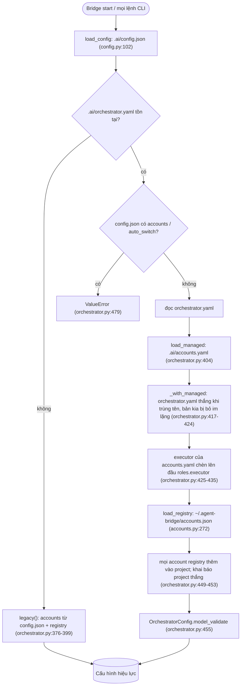
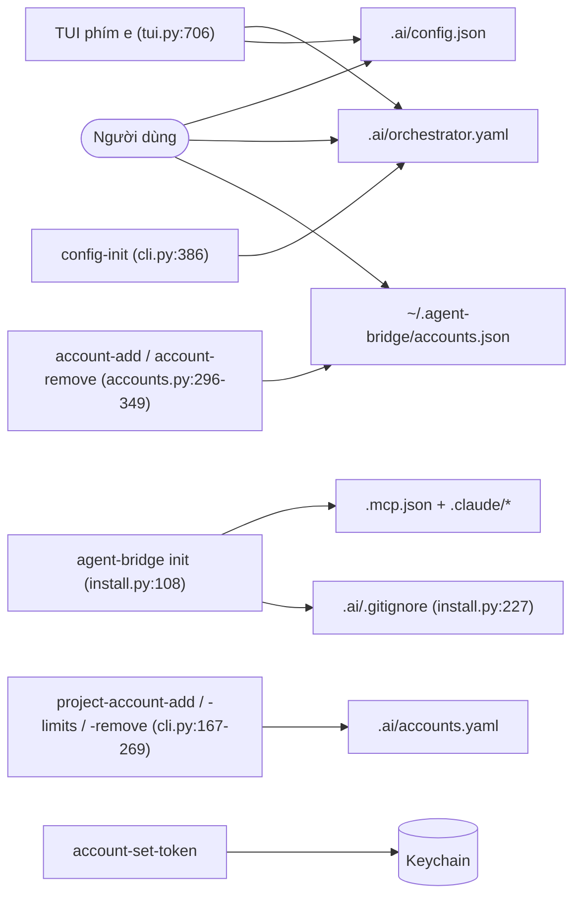
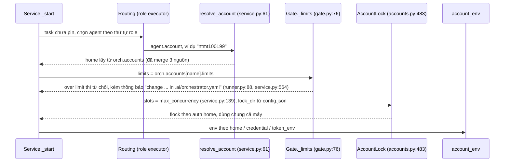
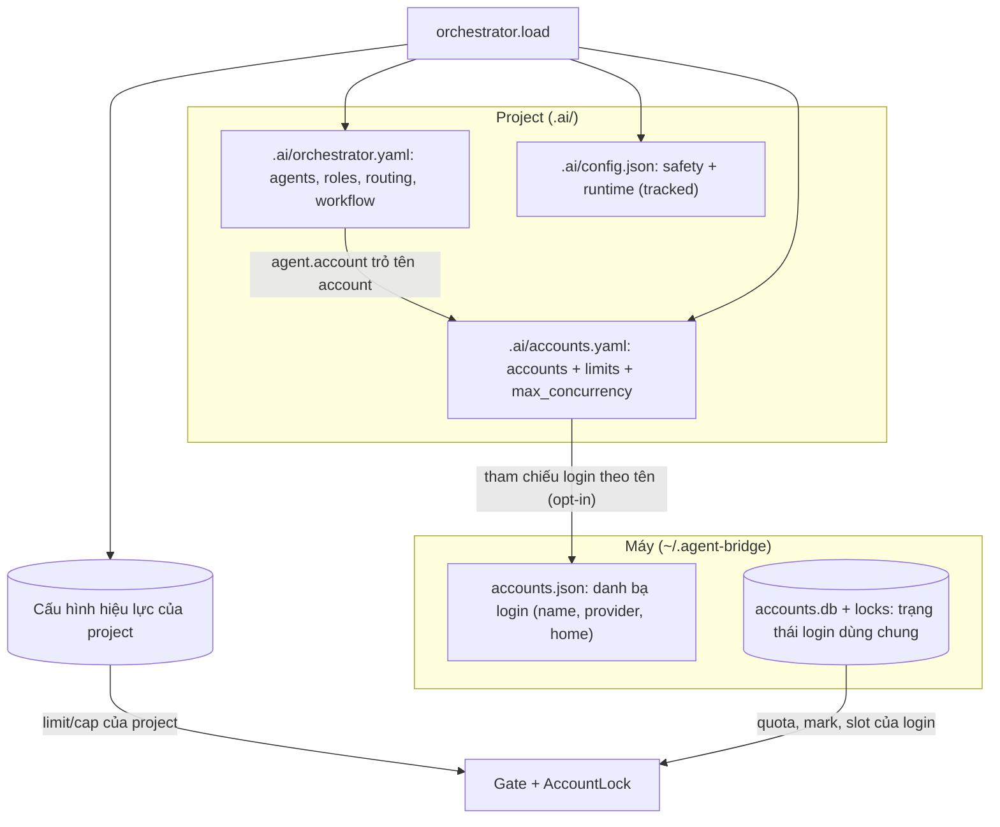

# Agent Bridge: Settings Audit (2026-11-09)

Phạm vi: audit read-only toàn bộ nguồn settings. Không sửa source, không tạo bridge task.

Bằng chứng gồm:
- source `bridge/*.py` tại `origin/main` `1e48d45` (sau khi merge PR #62);
- `docs/`, `README.md` (bản ở `origin/main`), `.claude/rules/`, `examples/`;
- cấu hình thật của máy này: `.ai/orchestrator.yaml`, `.ai/accounts.yaml`, `~/.agent-bridge/accounts.json`, chỉ đọc tên và limit. Không đọc credential nào.

Audit này được làm sau khi hai task sửa cấu hình (T0137, T0138) bị huỷ. Lý do huỷ: chúng vá từng chỗ mà chưa có bản đồ settings, và T0138 còn thêm việc ghi limit ở cấp máy.

## 1. Yêu cầu gốc

Trích từ `prompts.md` (GOAL "Project-level Account & Authentication Management"):

> - "Mở rộng `agent-bridge` thành hệ thống quản lý AI accounts **ở cấp project**." (dòng 5)
> - "**Mỗi project có account settings độc lập.**" (dòng 19)
> - "Tách biệt hoàn toàn Project Settings và Credential Storage." (dòng 139)
> - "Project settings phải hỗ trợ Git-safe configuration, phân biệt metadata có thể chia sẻ với local-only configuration." (dòng 239)
> - "Không bắt buộc người dùng migrate ngay … Có migration path" (dòng 245-246)

Mọi gap ở mục 5 được đo theo các câu trên.

**Phân biệt settings với trạng thái login dùng chung:**
- **Settings** là lựa chọn của con người: agent, role, routing, limit, `max_concurrency`, path rule. Yêu cầu là settings thuộc về project.
- **Trạng thái login dùng chung** là sự thật về một login: mark QUOTA/AUTH, quota snapshot, usage ledger, slot lock (`accounts.db`, `locks/`). Phần này *phải* ở cấp máy, vì hai project dùng một auth home thì thật sự dùng chung quota và cùng một phiên đăng nhập. Nếu tách slot theo project, một home sẽ chạy quá số agent cho phép.
- Phần trạng thái này không vi phạm yêu cầu. Nó chỉ cần được tài liệu hoá là *state*, không phải *settings*.

## 2. Kiểm kê nguồn settings

| # | Nguồn | Cấp | Git | Schema / số key | Ai ghi | Ai đọc |
|---|---|---|---|---|---|---|
| S1 | `.ai/config.json` | project | tracked | `BridgeConfig` (`bridge/config.py:38`), **23 key** | người (tay) | mọi lệnh, `load_config` (`config.py:102`) |
| S2 | `.ai/orchestrator.yaml` | project | ignored | `OrchestratorConfig` (`orchestrator.py:286`). Có 7 key cấp đầu; tổng **khoảng 48 key** kể cả lồng nhau: account 7, limits 8, agent 9, role 4, routing 2+5, workflow 4, security 2 | người (tay), `config-init` (`cli.py:386-393`), TUI phím `e` (`tui.py:706`) | `orchestrator.load` (`orchestrator.py:473`) |
| S3 | `.ai/accounts.yaml` | project | ignored | `{accounts, agents, executor}` (`orchestrator.py:22-25`, `:404`) | `project-account-add/-limits/-remove` (`cli.py:167-269`) | merge vào S2 (`orchestrator.py:417-436`) |
| S4 | `~/.agent-bridge/accounts.json` (registry) | **máy** | — | `AccountProfile` mỗi mục (provider, home, có thể kèm `limits`) | `account-add/-remove` (`accounts.py:296-349`) chỉ ghi provider+home (`:331`). **Không lệnh nào ghi `limits`**; `git log -S five_hour_pct -- bridge/` chỉ ra `3f3ac1c`, `c7244ab`, cả hai phía project | merge vào **mọi** project (`orchestrator.py:449-453`), và cả nhánh legacy (`:384`) |
| S5 | Biến môi trường | process | — | `AGENT_BRIDGE_HOME` (`storage.py:21`, `registry.py:16`), `BRIDGE_PROJECT_ROOT` (`registry.py:71`, do `.mcp.json` đặt ở `install.py:58`), `AGENT_BRIDGE_CLAUDE_*_TOKEN` (`orchestrator.py:121`) | shell của người dùng, `.mcp.json` | registry, storage, account env |
| S6 | macOS Keychain (`service agent-bridge`) | máy | — | credential (`credential: keychain`) | `account-set-token` | `account_env` khi chạy |
| S7 | `.mcp.json`, `.claude/settings.json`, `.claude/rules/*`, skill | project | tracked | do `init` cài (`install.py:108-227`) | `init`/`uninstall`, người | Claude Code |
| S8 | Web Settings (theme, ngôn ngữ) | trình duyệt | — | `localStorage` (`app.js:211,219`) | người xem | chỉ UI. Không phải project config, ngoài phạm vi |
| S9 | `codex-switch` homes / profiles | máy | — | `~/.codex-accounts` (`accounts.py:92`, `:405`) | công cụ ngoài | chỉ để liệt kê (`account-list`) |

Trạng thái (không phải settings): `$AGENT_BRIDGE_HOME/accounts.db` (bảng `accounts`, `account_quota`, `account_usage`; `state.py:41-42,87,276-279`), `locks/` (`accounts.py:488`), `projects.json`, `projects/
/worktrees/<w>/bridge.db` và `worktree.json` (`storage.py:91`).

**Account của project này đến từ 4 nguồn:** S2, S3, S4 và nhánh legacy S1 (`accounts`/`default_account`/`auto_switch`). Bảng giá trị thực tế, đọc từ cấu hình thật:

| Account | Khai báo ở | Có agent dùng | `max_concurrency` | 5h / tuần |
|---|---|---|---|---|
| printless004 | orchestrator.yaml **và** registry (registry bị che, không cảnh báo) | có | 1 | 85 / 90 |
| claude-thuyseatch | accounts.yaml | có | 1 | 80 / 90 |
| vydnt | accounts.yaml | có | 1 | 80 / 80 |
| ntmt100199 | **chỉ registry** | có (`codex-ntmt`) | 1 | 85 / **90** |
| leetuanbmt@google | chỉ registry | có (`google-leetuanbmt`) | 1 | 85 / 90 |
| leetuanbmt, oc, thuyntm1, thuyseatech | chỉ registry | **không** | 1 | 85/90 (thuyntm1: không có) |

Như vậy project hiện thấy 9 account. Project chỉ tự khai báo 3; 6 account còn lại bị registry tự động đưa vào, trong đó 4 account không agent nào dùng.

## 3. Sơ đồ hiện trạng

### 3a. Load và thứ tự ưu tiên

### 3b. Ai ghi vào đâu

Không có lệnh nào ghi `limits` vào registry, nhưng registry thật đang có `limits` ở 6/7 mục. TUI không mở được `accounts.yaml`.

### 3c. Một task lấy account như thế nào

## 4. Lệch giữa docs, thông báo lỗi và code

| # | Ở đâu | Nói gì | Thực tế |
|---|---|---|---|
| D1 | `runner.py:88`, `service.py:564`, `cli.py:231` | Bảo người dùng sửa limit trong `.ai/orchestrator.yaml` | Account có thể nằm ở accounts.yaml hoặc registry. **Đây là nguyên nhân Claude chỉ sai** cho `ntmt100199` hôm nay; account này chỉ có trong registry |
| D2 | `docs/configuration.md:7-10`, `README.md:275-276` | `.ai/` chỉ có 2 file; orchestrator.yaml chứa "Accounts …" | Còn `accounts.yaml` và registry |
| D3 | `docs/configuration.md:346` | "Limits live in `.ai/orchestrator.yaml` or the machine-wide account registry" | Thiếu `accounts.yaml`, mà `project-account-limits` lại chỉ ghi vào file này. Registry thì không có lệnh nào ghi limit |
| D4 | `docs/configuration.md:219-220` | "an entry there [orchestrator.yaml] wins on a name clash" | Đúng với code, nhưng là ghi đè **im lặng**; `config-check` không báo |
| D5 | `docs/configuration.md:291`, `.claude/rules/security.md` | Account của registry "every project sees by name" | Đúng với code, nhưng trái với yêu cầu §1 |
| D6 | `docs/configuration.md:456-460` (bảng state) | Không có `accounts.yaml` | Thiếu |
| D7 | `docs/cli-reference.md` | Không nhắc `project-account-*` (0 lần) | Có 3 lệnh human-only |
| D8 | `accounts.py:451` `config_snippet` | Gợi ý `{"accounts": {name: {"codex_home": …}}}` | Đó là định dạng legacy của config.json; dùng chung với orchestrator.yaml sẽ bị **lỗi** (`orchestrator.py:479`) |
| D9 | `install.py:227` | `.ai/.gitignore` = `*`, `!.gitignore`, `!config.json` | File của repo có thêm `!config.example.json` và comment |
| D10 | `examples/*.yaml` (6/6), `config-init` | Mọi example đặt `accounts:` trong orchestrator.yaml | `project-account-add` đặt account vào accounts.yaml, nên project mới có hai kiểu ngay từ đầu |
| D11 | `executor.py:101` | Claude agent bị chặn đọc `.ai/orchestrator.yaml` | Không chặn `accounts.yaml` (cũng không có secret, nhưng hai file đối xử không nhất quán) |
| D12 | `.claude/settings.json` của repo (WIP) | Từng chặn Claude đọc orchestrator.yaml | Đã bỏ chặn đọc ngày 2026-11-09 theo yêu cầu người dùng; vẫn giữ `Edit(/.ai/**)` |

## 5. Gap so với yêu cầu §1

| # | Gap | Bằng chứng | Hậu quả |
|---|---|---|---|
| G1 | Account registry tự vào mọi project | `orchestrator.py:449-453`; 6/9 account ở đây là registry | Project không "độc lập". Đổi registry thì đổi mọi project |
| G2 | Limit có thể nằm ở cấp máy và áp cho mọi project | registry `limits` của `ntmt100199` | Cách mở khoá duy nhất có lệnh làm sẵn hôm nay là sửa toàn máy (T0136 đang bị chặn bởi đúng điều này) |
| G3 | Một account có 3 chỗ khai báo (4 với legacy), thứ tự ưu tiên ngầm | 3a | Sửa một file mà không có tác dụng (printless004 có cả hai, bản registry bị che không báo) |
| G4 | `accounts.yaml` chứa cả agent và thứ tự executor, tức là dữ liệu điều phối | `MANAGED_KEYS` (`orchestrator.py:25`) | Trái phân vai "accounts = đăng ký, orchestrator = điều phối" |
| G5 | Key trùng hoặc tách đôi giữa config.json và orchestrator.yaml | xem dưới | Quá nhiều chỗ chỉnh cho cùng một khái niệm |
| G6 | `lock_dir` override theo project nhưng slot là thuộc tính của login | `accounts.py:488`; nháp `docs/plans/multi-bridge-accounts.md` A4 | Hai project khác `lock_dir` không loại trừ nhau |

Các cặp trùng hoặc tách đôi (G5):
- `model` (config.json) và `agents.*.model`.
- `max_attempts` (config.json, chỉ legacy) và `workflow.max_rework`.
- `auto_switch` (config.json, legacy) và `routing.quota_fallback`.
- `verify_allowlist`/`verify_timeout_s` (config.json) và `workflow.verify_sandbox`/`verify_writable` (orchestrator.yaml).
- `default_timeout_s`/`max_timeout_s` (config.json) và `agents.*.timeout_s`.

**Xung đột cần ghi nhận, chưa giải quyết ở đây:** nháp `docs/plans/multi-bridge-accounts.md` §4.1 đề xuất cap `max_concurrency` **cấp máy**. Như §1 đã phân tích, cap đó thuộc về trạng thái login dùng chung. Muốn nó không trái với yêu cầu thì phải định nghĩa nó là giới hạn an toàn của login, không phải setting của project.

## 6. Đề xuất mô hình đích

Mỗi khái niệm có một nơi sở hữu:

| Nơi | Chứa | Không chứa |
|---|---|---|
| `.ai/accounts.yaml` (project, local-only) | Account mà **project này** dùng: provider, home hoặc tham chiếu login, credential reference, `max_concurrency`, `limits` | agent, role |
| `.ai/orchestrator.yaml` (project, local-only) | agents, roles, routing, workflow, security | account |
| `.ai/config.json` (project, tracked, Git-safe) | an toàn và runtime: path rule, env rule, sandbox, timeout, verify_* (gom một chỗ) | account, auto_switch |
| Registry máy | **Danh bạ login** (tên, provider, home) để project tham chiếu; không tự vào project, không có limit | settings |
| `accounts.db`, `locks/` | Trạng thái login dùng chung (mark, quota, ledger, slot) | settings |

Hành vi chuyển tiếp (theo yêu cầu "Không bắt buộc migrate ngay"):
- Cấu hình cũ vẫn load **giống hệt**. Đây là tiêu chí chấp nhận: cấu hình thật của máy này phải load ra cùng một `OrchestratorConfig`.
- `config-check`/`health` liệt kê mục cần chuyển chỗ.
- Trùng tên giữa hai file project chuyển từ "ghi đè im lặng" sang báo lỗi rõ.
- Một lệnh human-only `config-migrate`: mặc định chỉ xem trước; `--apply` chỉ ghi `accounts.yaml` và in ra đoạn cần xoá hoặc dán trong orchestrator.yaml. Bridge không bao giờ tự viết lại orchestrator.yaml.
- Sửa D1: thông báo lỗi nêu đúng file đang sở hữu account.

## 7. Quyết định (đã chốt 2026-11-09: "tự xử lý theo khuyến nghị")

1. **Registry không tự vào project nữa.** Project tham chiếu login rõ ràng trong `.ai/accounts.yaml` (`login: <tên>`). Chuyển tiếp: một agent đang trỏ tới account chỉ có ở registry vẫn chạy, giữ limit của registry, và có cảnh báo deprecated. Account registry mà không agent nào dùng thì không còn xuất hiện trong project. Lệnh cấp máy (`account-login/-use/-show/-verify/-clear`) vẫn tìm được mọi login của registry.
2. **Limit chỉ ở project.** Một mục `login:` chỉ dùng limit của project. `config-migrate` (human-only, mặc định chỉ xem trước) chép limit registry hiện tại vào project để không mất cap an toàn nào.
3. **Key trùng (G5), thu hẹp theo bằng chứng:**
   - `model` của config.json **vẫn đang dùng** (`executor.py:410`, model mặc định khi agent không đặt), không phải legacy.
   - `default_timeout_s` với `agents.*.timeout_s` là cặp mặc định và ghi đè, không phải trùng.
   - Chỉ cảnh báo các key bị bỏ qua khi có orchestrator.yaml (`max_attempts`).
   - `verify_sandbox`/`verify_writable` gom về `config.json` (tracked) làm task riêng cuối cùng. Đặt ở cả hai file là lỗi, và sandbox hiệu lực không bao giờ yếu đi.
4. **Cap concurrency cấp máy** là giới hạn an toàn của login, không phải setting của project. Nằm ngoài phạm vi này; xem `docs/plans/multi-bridge-accounts.md`.

Thứ tự task:
1. Loader: tham chiếu login, bỏ tự đưa vào, catalog cho lệnh cấp máy, lỗi trùng tên, sửa role executor dạng chuỗi.
2. Thông báo đúng file sở hữu, `deprecated` trong config-check/health, `project-account-*`.
3. `config-migrate`.
4. examples/config-init.
5. `verify_*`.
6. Docs.

Mỗi task được đối chiếu với baseline cấu hình thật: chỉ các account registry không ai dùng được phép biến mất.

## 8. Mở khoá T0136 hôm nay, chỉ trong project này

Đã mô phỏng bằng `orchestrator.parse` trên cấu hình thật, không ghi file: một mục `ntmt100199` trong `.ai/accounts.yaml` với `limits: {five_hour_pct: 85, weekly_pct: 99}` (cùng provider và home như registry) thay mục registry **chỉ cho project này**. Registry giữ 90%. Quota 10% còn lại vẫn là của login, dùng chung với mọi project.
