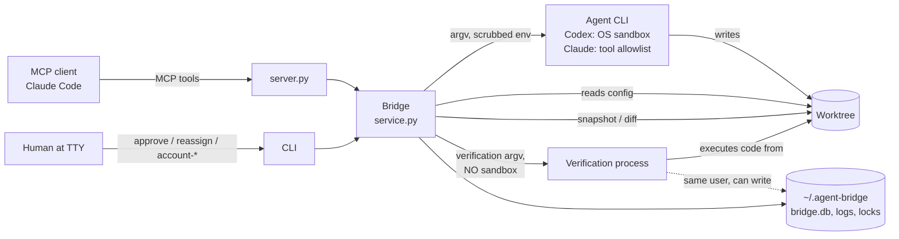
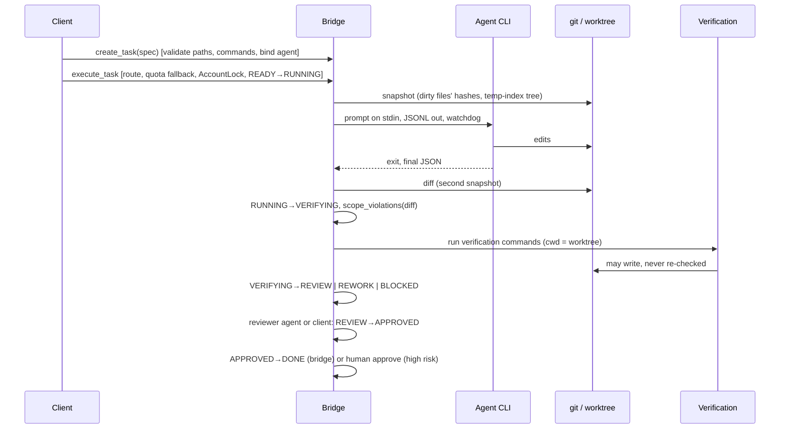

# Architecture assessment

Audited revision: `3571546`, 2026-11-04. ~6,800 lines of Python in `bridge/`, ~360 tests.

Superseded in part (2026-11-05). After PR #48 moved the attempt decision into
`models.run_failure_state` / `models.verdict`, Track B in `GOAL.md` chose to extract
`AccountGate` (`bridge/gate.py`) and `TaskRunner` (`bridge/runner.py`) behind `Bridge`, as a
refactor with no behaviour change. For those two, that decision replaces the "Defer" and
"Do not extract" verdicts in section 7. `review.evaluate_attempt` is still to do, in PR-2.

## 1. Entry points

| Entry point | Module | Who uses it |
|---|---|---|
| MCP stdio server (`agent-bridge serve`, started by `.mcp.json`) | `bridge/server.py` | The MCP client (Claude Code) |
| CLI (`agent-bridge <cmd>`) | `bridge/cli.py` | Humans, scripts; human-only commands need a TTY |
| TUI (`agent-bridge` with no subcommand) | `bridge/tui.py` | Humans: browse, review, approve, reassign |
| Web dashboard (`agent-bridge web`) | `bridge/webui.py`, `bridge/progress.py`, `bridge/static/` | Humans: read-only progress |
| Installer (`scripts/setup.sh`, `bridge/install.py`) | `bridge/install.py` | Humans installing into a project |

All mutating paths go through one class, `bridge.service.Bridge`; the dashboard reads the
databases read-only through `progress.py`.

## 2. Components

| Module | Lines | Responsibility |
|---|---|---|
| `service.py` | 1088 | `Bridge`: task creation and validation, routing, quota fallback, account state, execution attempts, verification decision, review stage, approval, workflows (plan/drive), recovery, health |
| `executor.py` | 720 | Adapter base (subprocess, timeout, cancel, JSONL streaming) and four adapters (Codex, Claude, opencode, agy); prompts and output schemas |
| `tui.py` | 726 | Textual TUI |
| `storage.py` | 497 | Central state location, migration from legacy per-repo state, relink, GC |
| `accounts.py` | 468 | Account resolution, auth homes, login status, registry, `AccountLock` |
| `progress.py` | 455 | Read-only aggregation for the dashboard |
| `state.py` | 434 | SQLite `Store`: tasks, attempts, events, accounts, quota, workflows; validated transitions |
| `cli.py` | 394 | argparse CLI |
| `install.py` | 371 | Project install/uninstall |
| `orchestrator.py` | 331 | `orchestrator.yaml` schema and validation; legacy mapping |
| `render.py` | 255 | Rich renderers |
| `server.py` | 194 | MCP tool definitions |
| `review.py` | 166 | Evidence: worktree snapshot, diff, scope check, verification runner |
| `security.py` | 157 | Path validation, glob matching, redaction, env scrubbing |
| `webui.py` | 133 | HTTP server for the dashboard |
| `config.py` | 129 | `.ai/config.json` schema, project root discovery |
| `models.py` | 110 | States, actors, transition table, `TaskSpec` |
| `osutil.py`, `quota.py` | 195 | Platform locks/process ops; Codex rollout quota parsing |

Dependency direction is clean and acyclic: `server/cli/tui → service → {executor, review, state,
accounts, orchestrator, config} → {security, models, osutil, storage}`. `progress`/`webui` do
not import `service`: they read the databases read-only and reuse `accounts`, `config`,
`orchestrator`, `quota`, `storage`, `security.redact` and `executor.describe_event`.

## 3. Trust boundaries

| Boundary | Enforced by | Weak point |
|---|---|---|
| Agent → files outside worktree | Codex Seatbelt sandbox; Claude scoped `Edit(./…)` rules | Claude `allow_bash`, Claude Read (documented) |
| Agent → files inside worktree but out of scope | Post-run hash snapshot + scope check | Ignored paths (SEC-03), late writers (SEC-04), not contained (SEC-02) |
| Agent-written code → user privileges | None: verification runs it unsandboxed | SEC-01 |
| Client → human-only actions | Not exposed over MCP; CLI TTY check; Claude Code deny globs | Python API, PTY, same-user DB writes (SEC-08) |
| Worktree config → bridge behaviour | Hash in snapshot (detection only) | Re-read on every start (SEC-02) |
| Dashboard → network | 127.0.0.1, Host check, token, GET only, CSP | Token in URL (acceptable) |

## 4. Data flow of one task

Persistent state: per-worktree `bridge.db` (tasks, attempts with JSON evidence, events,
workflows), machine-wide `accounts.db` (account state and quota shared across projects), per-attempt
JSONL logs, lock files. All under `~/.agent-bridge/` with 0700/0600 permissions.

## 5. Strengths

- **One service layer** behind MCP, CLI and TUI: no duplicated lifecycle logic.
- **Explicit state machine with actors** (`models.TRANSITIONS`), enforced in one transactional
  method that also writes the audit event.
- **Evidence without side effects**: the snapshot builds a tree in a throwaway index, so the
  user's index and history are never touched.
- **Thin adapters**: each adapter only builds argv/env and parses its CLI's events; process
  handling, timeout and cancellation are shared.
- **Conservative process handling**: argv only, process groups, pid + start time before killing.
- **Honest documentation** of many limits (`README.md` "Known limitations", `docs/REPORT.md` with
  probed CLI versions).
- **Test suite with deterministic fakes** for every CLI; 359 tests pass.
- **Project-local and provider-agnostic** design kept consistently (no daemon, no external
  service, SQLite only).

## 6. Weaknesses

1. **The trust model is implicit.** The code treats verification as trusted, agents as
   untrusted, and worktree config as trusted, but the attempt pipeline lets untrusted output flow
   into the trusted parts (SEC-01, SEC-02). This is the root of the two High findings; it is a
   design gap, not a missing check.
2. **Control flow reads the audit log.** `_assert_gates` and `resume_task` decide by parsing
   `events.detail`, which is redacted and truncated text. This coupling caused REL-03 and REL-06.
   Decisions belong in structured columns; events should only describe them.
3. **Evidence is a free-form JSON blob** (`attempts.changes`, `attempts.verification`) with no
   schema. Fields added for binding (SEC-05) or truncation flags (SEC-06) need a defined shape
   that readers (TUI, dashboard, reviewer prompt, `task_result`) agree on.
4. **`Bridge` mixes several responsibilities** (routing/quota ~250 lines, execution pipeline
   ~180, review/approval ~110, workflows ~110, recovery, health). It is large but cohesive around
   one database and one worktree; size alone is not the problem (see section 7).
5. **Fail-open helpers** (`review._git` returning `""`) in an evidence path that must fail
   closed (REL-01).
6. **No CI.** `scripts/check.sh` exists, nothing runs it on push; the Codex sandbox claims are
   verified on macOS only.

## 7. Extraction candidates

Assessed against concrete problems, not file size.

| Candidate | Concrete problem it would solve | Verdict |
|---|---|---|
| **Attempt evaluation** (`review.evaluate_attempt`: kill leftovers → diff → verify → re-diff → violations → binding hashes → verdict) | The security fixes SEC-01/03/04/05 and REL-01 all land in `_run_inner` lines 689-742; a pure-ish function returning a verdict makes them testable without a fake CLI | **Do it, inside the first security PR**, as a function in `review.py`, not a class |
| **Evidence schema** (a `TypedDict`/pydantic model for `changes` and `verification`) | Readers drift (TUI, dashboard, prompts); new fields need one definition | **Do it** with SEC-05/SEC-06, small |
| **Review record** (a column or table for review decisions) | REL-03/REL-06: gates parsing redacted events | **Do it** in the REL-03 PR |
| `VerificationService` | — | Not needed: `run_verification` is one function; cancellation (REL-02) is a parameter |
| `ApprovalService` | — | Not needed after the review record exists; approval is ~50 lines |
| `AgentRouter` (routing + quota fallback) | Would matter if `docs/plans/parallel-worktrees.md` is implemented (routing per worktree) | **Defer**; revisit with that plan |
| `WorkflowEngine` | Same: only with parallel worktrees | **Defer** |
| `TaskService`, `ExecutionRunner`, `EvidenceStore` | No defect or change pressure traced to their absence | **Do not extract** |

## 8. Target architecture

No rewrite. The target is the current architecture with three structural changes:

1. **An explicit trust model in code**: the attempt pipeline ends with a single evaluation
   function whose inputs are the pre-run snapshot and whose checks cover everything that ran in
   the worktree (agent, its leftovers, verification), failing closed on evidence errors.
2. **Decisions in columns, history in events**: review decisions and verified-content hashes live
   on the attempt row; events stay descriptive and may be redacted freely.
3. **Config integrity visible**: protected config files that differ from `HEAD` are reported by
   `health` and block tasks that changed them.

Scalability inside the project-local model is adequate: one writer per worktree, SQLite WAL, and
cross-process account locks. Redis, PostgreSQL or a daemon would solve no demonstrated problem.
The parallel-worktrees draft (`docs/plans/parallel-worktrees.md`) should wait until the evidence
fixes land, because it multiplies the number of worktrees whose evidence must be trustworthy.
