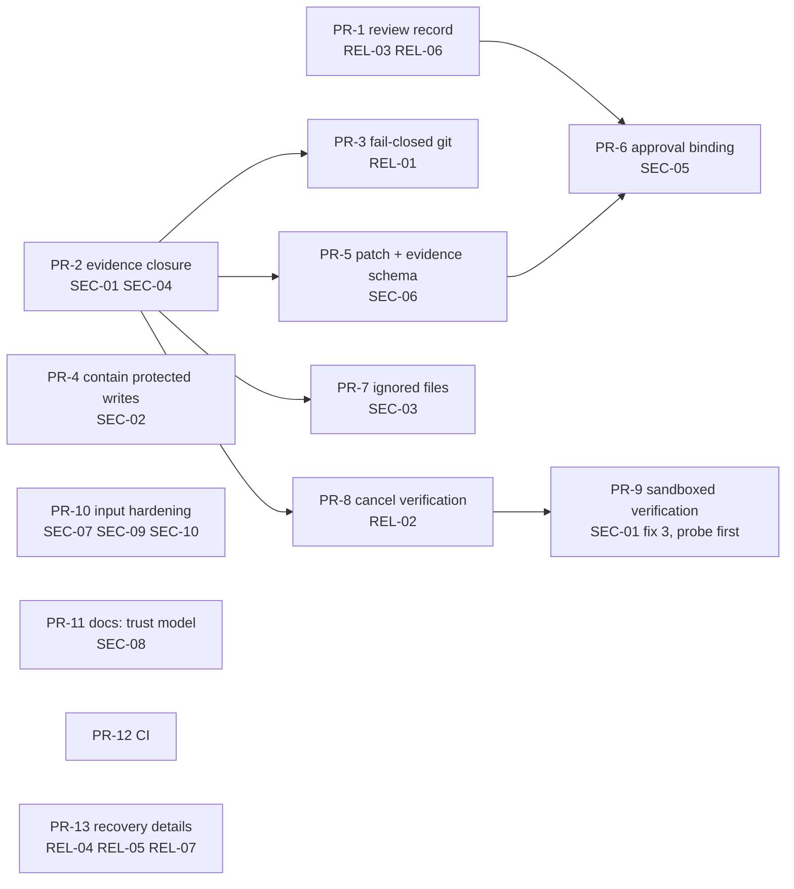

# Implementation plan

Source findings: [security-audit.md](security-audit.md), [reliability-audit.md](reliability-audit.md),
[architecture-assessment.md](architecture-assessment.md). Revision `3571546`.

## Revalidation at `643ec2f` (2026-11-05)

The findings were re-checked against `main` at `643ec2f`, 33 commits after the audit. Read this
section before a PR section: where they disagree, this section wins.

| Finding | Status at `643ec2f` | Evidence |
|---|---|---|
| SEC-01 to SEC-07, REL-01 | Open | Their reproductions still pass (defect present) |
| REL-03, REL-06 | Fixed by PR-1 (#42) | `test_rel03` fails (inverted) |
| REL-02 | Half fixed | `950113b` made cancel and shutdown stop verification (`run_verification(…, should_cancel)`), and `test_rel02` now fails. The verification process group is still not recorded, so `recover` cannot kill one left by a dead runner |
| REL-04 | Open | `Bridge.recover` (`bridge/service.py:1306`) still trusts `_alive(runner_pid)` without a start time |
| REL-05 | Open, changed | `Bridge._run` (`:817`) now clears `runner_pid` in `finally`, but the `store.log` call before the suppressed rescue transition raises first on a busy database, so the rescue never runs |
| REL-07 | Open | `Store.transition` (`bridge/state.py:656`) still refuses only writer beside writer |
| SEC-08 to SEC-10 | Open (code unchanged) | `bridge/security.py` has not changed since `3571546`; still re-check before fixing |

Code that moved after the audit:

- PR #48 moved the attempt outcome → state decision out of `_run_inner` into
  `models.run_failure_state` and `models.verdict` (`bridge/models.py:88-110`), covered by
  `KIT-UNIT-012`/`013`. A PR that changes the decision (PR-2 violations over the union, PR-4
  `PROTECTED` → `BLOCKED`) changes `verdict` and its tests, not inline code in `_run_inner`.
  The rebind SQL is now `Store.rebind`.
- Line numbers in the PR sections are from `3571546`. Locate code by symbol name.
- Track B in `GOAL.md` moves `_start`, `_run`, `_run_inner` and `_review_stage` into
  `bridge/runner.py` and the routing, quota and limit methods into `bridge/gate.py`. Never run an
  audit PR that touches `bridge/service.py` while Track B is in flight. After Track B merges, look
  for those methods in the new modules. Track B replaces the "Router/workflow extraction" row
  below.
- PR-8 shrinks to the recovery half; see its section.
- `main` is the only long-lived branch. Every PR branches from and targets `main`.

## Principles

- Smallest safe change first; each PR is one reviewable change (≤ ~400 changed lines) with its
  own regression tests, and leaves every existing test passing.
- Fix where all callers route through: the attempt pipeline (`service._run_inner` →
  `review.py`), `Store._event`, and `_assert_gates`.
- No new dependencies, no new services, no schema rewrite: new columns via the existing
  `ALTER TABLE` migration in `Store.__init__`.
- Each reproduction in `evidence/test_audit_repro.py` is inverted into a real test under `tests/`
  by the PR that fixes it.
- Project rules apply to the implementation itself: the executor writes the code through
  `bridge_create_task`; PRs that change gates (PR-2 to PR-7) are created with `risk_level: high`,
  so a human closes them, and the reviewer reads every hunk of `review.py`, `service.py` gate code
  and `state.py`.

## Roadmap

| Order | PR | Group | Priority | Effort | Depends on |
|---|---|---|---|---|---|
| 1 | PR-1 Review decisions out of the audit log | B | P1 | S | — |
| 2 | PR-2 Close the evidence window | A | P0 | M | — |
| 3 | PR-3 Fail-closed evidence | B | P1 | S | PR-2 |
| 4 | PR-4 Contain protected-path writes | A | P1 | S | — |
| 5 | PR-5 Patch truncation and evidence schema | A | P1 | S | PR-2 |
| 6 | PR-6 Bind approval to verified content | A | P1 | M | PR-1, PR-5 |
| 7 | PR-7 Ignored-file evidence | A | P1 | M | PR-2 |
| 8 | PR-8 Cancellable, recoverable verification | B | P2 | M | PR-2 |
| 9 | PR-9 Sandboxed verification (opt-in) | A | P2 | M | PR-8, probe |
| 10 | PR-10 Input hardening | A | P2 | S | — |
| 11 | PR-11 Trust-model documentation | D | P2 | S | PR-2, PR-4 |
| 12 | PR-12 CI | D | P2 | S | — |
| 13 | PR-13 Recovery details | B | P3 | S | — |
| — | Router/workflow extraction | C | P3 | — | only with `docs/plans/parallel-worktrees.md` |

PR-1, PR-2, PR-4, PR-10 and PR-12 are independent and can be reviewed in any order; one writer per
worktree means they are executed one at a time (or in separate worktrees).

---

## A. Security

### PR-2: Close the evidence window (P0)

Status: done (3101afd), 2026-11-05

- **Objective** Everything that runs in the worktree during an attempt (the agent, processes it
  left, verification) is covered by the scope check.
- **Problems** SEC-01 (fixes 1-2), SEC-04.
- **Modules** `bridge/executor.py` (`Adapter.run`), `bridge/review.py` (`run_verification`, new
  `evaluate_attempt`), `bridge/service.py` (`_run_inner` lines 689-742).
- **Design**
  1. `Adapter.run`: after `proc.wait()` returns, always call `kill_group(proc)` (SIGTERM, grace,
     SIGKILL; `ProcessLookupError` ignored) before returning.
  2. `run_verification`: after each command exits, kill its process group the same way.
  3. New `review.evaluate_attempt(root, before, spec, cfg, commands) -> dict` holding the
     current post-run logic: `diff` → scope violations → verification → second `diff` against
     the same `before` → violations over the union; `verification.changed_by_verification`
     lists files the verification step changed. `_run_inner` calls it and keeps state handling.
  4. Files changed only by verification that match a small built-in cache list
     (`**/__pycache__/**`, `**/*.pyc`, `.pytest_cache/**`) are reported but not violations.
- **Steps** Extract `evaluate_attempt` with no behaviour change (existing tests green) → add the
  second diff → add group kills → convert SEC-01/SEC-04 reproductions into tests.
- **Tests** Verification writes out-of-scope file → `REWORK` with `outside allowed paths: X`;
  verification writes `.env` → violation; agent leaves `sleep 2; touch LATE` child → child killed,
  no file; verification leaves a detached child → killed; pytest cache noise → no violation.
- **Acceptance** The four tests pass; `test_sec01`/`test_sec04` reproductions fail (inverted);
  full suite green.
- **Compatibility** A test suite that writes tracked or untracked non-ignored files during
  verification now fails the gate. That is the intended behaviour; the failure message names
  the files. Agents that relied on background daemons outliving the run lose them (none should).
- **Rollback** Revert the PR; no data migration.
- **Risk / effort** Medium risk (gate code), M (~200 lines incl. tests).

### PR-4: Contain protected-path writes (P1)

Status: done (98ff857), 2026-11-05

- **Objective** A run that touched a protected path stops for a human, and tampered config is
  visible before it is used.
- **Problems** SEC-02.
- **Modules** `bridge/service.py` (`_run_inner` decision), `bridge/review.py`
  (`scope_violations` returns a protected flag), `bridge/config.py` (`sensitive_paths` default),
  `bridge/service.py` (`health`).
- **Design** Protected violation → `BLOCKED` with failure `PROTECTED: <paths>: inspect and restore
  them, then create a new task`. `health` adds `protected_dirty: [...]` for tracked protected
  files that differ from `HEAD` (`git status` over `protected_paths`); `ok` becomes false when
  non-empty. The git-ignored `.ai/orchestrator.yaml` has no `HEAD` version; a run that changes it
  is caught by the snapshot and now blocks, which is the case that matters. Default
  `sensitive_paths` gains
  `CLAUDE.md`, `AGENTS.md`, `.claude/**`, `.codex/**`, `.envrc`, `.vscode/**`.
- **Tests** Executor writes `.ai/config.json` → `BLOCKED` (not `REWORK`); `health` reports it;
  task touching `CLAUDE.md` stops at `APPROVED` for a human.
- **Acceptance** `test_sec02` reproduction inverted; existing protected-path tests updated only
  where they asserted `REWORK`.
- **Compatibility** Projects with a customised `sensitive_paths` keep theirs (user config
  overrides defaults). Tasks that legitimately edit `CLAUDE.md` now need human approval.
- **Rollback** Revert; no data change.
- **Risk / effort** Low risk, S.

### PR-5: Patch truncation and evidence schema (P1)

Status: done (c49f21c), 2026-11-05

- **Objective** Reviewers know exactly what they did not see.
- **Problems** SEC-06; architecture weakness 3.
- **Modules** `bridge/review.py` (`diff`), `bridge/executor.py` (`build_review_prompt`),
  `bridge/render.py`/`bridge/tui.py` only if they read the changed keys.
- **Design** Define `Changes` (`files`, `head_before`, `head_after`, `head_changed`, `stat`,
  `patch`, `patch_truncated`, `patch_omitted_files`, later `after_hashes`) as a `TypedDict` in
  `review.py`. Split `git diff` output per file, give each file a share of `PATCH_LIMIT`, keep
  the head of each, redact per file. The reviewer prompt prints the full file list and the omitted
  files.
- **Tests** Large later file → earlier file present; omitted list correct; flag set; redaction
  still applied.
- **Acceptance** `test_sec06` inverted; dashboard and TUI render the new keys or ignore them.
- **Compatibility** Old attempts lack the new keys; readers use `.get`.
- **Rollback** Revert; stored attempts remain readable.
- **Risk / effort** Low, S.

### PR-6: Bind approval to verified content (P1)

Status: done (1e4ccb8), 2026-11-05

- **Objective** A task can only be approved or closed while its changed files still have the
  content that was verified.
- **Problems** SEC-05.
- **Modules** `bridge/review.py` (record `after_hashes`), `bridge/service.py` (`_apply_review`,
  `human_approve`, `_assert_gates`).
- **Design** After the final diff, store `after_hashes = {path: sha256 | null}` for every changed
  file plus `head_after`. `_assert_gates` recomputes them; mismatch raises `TransitionError("worktree
  changed since verification: <files>; resume the task to re-verify")`. Binding covers the task's
  own files only, so later tasks touching other files do not block it.
- **Tests** Edit a verified file before client approve → refused; before human approve →
  refused; unrelated file edited → allowed; deleted verified file → refused; old attempt without
  `after_hashes` → allowed (compatibility) with a logged warning.
- **Acceptance** `test_sec05` inverted.
- **Compatibility** Tasks verified before the upgrade have no hashes and keep today's behaviour.
- **Rollback** Revert; the extra key is ignored.
- **Risk / effort** Medium (approval path), M.

### PR-7: Ignored-file evidence (P1)

Status: done (2428763), 2026-11-05

- **Objective** Changes under git-ignored paths are visible to reviewers and, outside caches,
  fail the scope check.
- **Problems** SEC-03.
- **Modules** `bridge/review.py` (`snapshot`, `diff`).
- **Design** `git ls-files --others --ignored --exclude-standard -z` + `os.stat` → `{path:
  (size, mtime_ns)}` in the snapshot (no hashing). Changes are reported as
  `changes.ignored_files`; outside `allowed_paths` and not matching the cache list they are
  violations. A config switch `ignored_scope: "report" | "enforce"` starts at `"report"` for one
  release, then `"enforce"`.
- **Steps** Measure snapshot time on a repository with a large `node_modules` and `.venv`
  first; record the numbers in the PR. If listing exceeds ~1 s, scope the scan to ignored
  *directories* with mtime short-circuit before listing files.
- **Tests** Write under ignored `build/` → listed (report) / violation (enforce); `__pycache__`
  writes → neither.
- **Acceptance** `test_sec03` inverted under `enforce`.
- **Compatibility** `report` default changes nothing but evidence.
- **Rollback** Set `ignored_scope: report` or revert.
- **Risk / effort** Medium (performance), M.

### PR-9: Sandboxed verification, opt-in (P2)

Status: done (9cc0b3a), 2026-11-05

- **Objective** Executor-authored code no longer runs with full user privileges during
  verification.
- **Problems** SEC-01 fix 3, SEC-07 (real control), SEC-08 (closes the bridge-started path).
- **Prerequisite probe** Confirm, on the CLI version pinned in `docs/REPORT.md`, that Codex can run
  an arbitrary argv under its workspace-write Seatbelt policy (`codex sandbox macos …` or the
  version's equivalent), with network off, `/tmp` excluded, exit code preserved, and that common
  test runners (`pytest`, `uv run pytest`, `npm test`) work inside it. Record results in
  `docs/REPORT.md`. Stop here if the probe fails.
- **Design** `verify_sandbox: "none" | "codex"` in `.ai/config.json`, default `"none"`;
  `run_verification` prefixes argv with the probed runner when set. `health` shows the mode.
- **Tests** Fake `codex sandbox` records argv; verification argv is wrapped when enabled;
  real-CLI smoke under `CODEX_SMOKE=1` writes outside the worktree and fails.
- **Compatibility** Opt-in; tests needing network or `/tmp` fail under it, by design.
- **Rollback** Set `verify_sandbox: none`.
- **Risk / effort** Medium (depends on third-party CLI), M.

### PR-10: Input hardening (P2)

Status: done (9a4aa5b), 2026-11-05

- **Problems** SEC-07 (argv[0] path), SEC-09, SEC-10.
- **Modules** `bridge/review.py` (`parse_command`), `bridge/config.py` (`env_deny` default),
  `bridge/security.py` (`validate_pattern`).
- **Design** Reject `argv[0]` containing `/` or `\`; add `SSH_AUTH_SOCK`, `*_DSN`,
  `*DATABASE_URL*`, `*CREDENTIALS*`, `KUBECONFIG`, `DOCKER_AUTH_CONFIG` to `env_deny`; reject
  patterns matching both `a` and `a/b/c.x`. Show planned `verification_commands` in
  `bridge_workflow_status` and add a step to the `agent-orchestration` skill: read planned
  commands before `bridge_run_workflow`.
- **Tests** `/x/pytest` rejected; each new env pattern dropped; `**/*` rejected; `src/**` kept.
- **Compatibility** A task using `./node_modules/.bin/jest` must use `npx jest`; documented in the
  error message.
- **Risk / effort** Low, S.

## B. Reliability and correctness

### PR-1: Review decisions out of the audit log (P1)

Status: done in tuanvm/audit-pr-1-review-record, 2026-11-04

- **Objective** Approving a task can never strand it, whatever the notes contain.
- **Problems** REL-03, REL-06.
- **Modules** `bridge/state.py` (`_event`, new `attempts.review` column), `bridge/service.py`
  (`_apply_review`, `_assert_gates`, `human_approve`, `resume_task`), `bridge/progress.py` only
  if it parses review details.
- **Design**
  1. `_event`: redact string leaves recursively and cap each string, then `json.dumps`; the
     stored detail is always valid JSON.
  2. `_apply_review` stores `{decision, notes, reviewer, actor}` on the latest attempt row in the
     same transaction as the `REVIEW → *` transition (`Store.transition` gains an optional
     `attempt_review` argument); the separate pre-transition `log` call goes away.
  3. `_assert_gates` reads the latest attempt's `review`; for rows created before the migration
     it falls back to events, skipping non-dict details.
  4. `human_approve` logs its event inside the `_close` transaction.
- **Tests** Approve with `"password=x"` notes → `DONE`; with 8000-character notes → `DONE`;
  rejected approve leaves no approve event; resume after rework uses the stored notes.
- **Acceptance** `test_rel03` reproductions inverted.
- **Compatibility** New nullable column; old tasks use the fallback path.
- **Rollback** Revert; the column stays unused (harmless).
- **Risk / effort** Low, S-M.

### PR-3: Fail-closed evidence (P1)

Status: done (09d6574), 2026-11-05

- **Problems** REL-01.
- **Modules** `bridge/review.py` (`_git` → raises `EvidenceError` from snapshot/diff paths),
  `bridge/service.py` (`_run_inner`: `EvidenceError` → `PAUSED`, failure `EVIDENCE_ERROR: …`,
  attempt not consumed).
- **Tests** `git status` failing after the run → `PAUSED`, never `REVIEW`; failing before the
  run → task does not start.
- **Acceptance** `test_rel01` inverted.
- **Compatibility** A repository where git already fails intermittently now pauses instead of
  passing silently.
- **Risk / effort** Low, S.

### PR-8: Recoverable verification (P2)

Status: done (8cc5f9b), 2026-11-05

- **Problems** REL-02, recovery half. The cancel half landed in `950113b`: `run_verification`
  already polls `should_cancel`, so `test_rel02` already fails. Do not redo it, and do not stop
  because that reproduction no longer passes.
- **Modules** `bridge/review.py` (`run_verification(…, on_start)`), `bridge/service.py`
  (`_run_inner`, `recover`), or `bridge/runner.py` once Track B has merged.
- **Design** `run_verification` reports each command's pid through `on_start`. Record the pid and
  start time in `codex_pid`/`codex_started`, and clear them when the command exits, so `recover`
  kills an orphaned verification group the way it kills an agent process.
- **Tests** Simulated dead runner during verification → the next `recover` kills the group and
  the task is `PAUSED` (`INTERRUPTED`). Keep the existing cancel tests green.
- **Acceptance** The new recover test passes; full suite green.
- **Risk / effort** Low, S.

### PR-13: Recovery details (P3)

Status: done (fd2f52c), 2026-11-05

- **Problems** REL-04, REL-05, REL-07.
- **Design** `tasks.runner_started` column compared in `recover`; rescue transition retried with
  backoff; refuse any second active task in a worktree (read-only included).
- **Tests** pid reused with different start time → recovered; second active read-only task →
  `ConflictError`.
- **Compatibility** REL-07 change forbids a read-only task beside a writer, which the README
  already describes as unsupported.
- **Risk / effort** Low, S.

## C. Architecture

No standalone refactoring PR is recommended now. The structural changes that pay for
themselves ride with the fixes:

- `review.evaluate_attempt` (PR-2): one testable function for the post-run pipeline.
- `Changes` schema (PR-5): one definition for every evidence reader.
- Review record on attempts (PR-1): decisions in columns, history in events.

Extracting `AgentRouter`/`WorkflowEngine` from `Bridge` is deferred to the
parallel-worktrees work, where routing per worktree gives it a concrete reason.

## D. Testing, CI and documentation

### PR-11: Trust-model documentation (P2)

Status: done (89e8341), 2026-11-05

- **Problems** SEC-08 and the undocumented consequences of SEC-01/SEC-02.
- **Modules** `README.md`, `README.vi.md` (kept in sync), `docs/REPORT.md`, `.claude/rules/security.md`.
- **Content** Verification is trusted execution of executor-written code; human approval guards
  against mistakes and model overreach, not against code running as the user; what PR-2/PR-4/PR-6
  now enforce; the residual risks (ignored-file mode, unsandboxed verification unless PR-9 is on).
- **Acceptance** Every claim maps to code or a probe; no claim of a check that does not run.

### PR-12: CI (P2)

Status: done (7fad951), 2026-11-05

- **Design** One workflow running `uv sync` and `scripts/check.sh` on `macos-latest` and
  `ubuntu-latest`, no secrets, real-CLI smokes stay opt-in.
- **Note** Adding a workflow under `.github/workflows/` touches a default sensitive path, so the
  task stops for human approval, as intended.

## Regression test matrix

| Test (new, under `tests/`) | Finding | PR | Layer |
|---|---|---|---|
| verification writes out-of-scope file → violation | SEC-01 | PR-2 | integration |
| verification writes protected file → violation | SEC-01 | PR-2 | integration |
| agent leaves child; child killed, no late write | SEC-04 | PR-2 | integration |
| verification leaves detached child; killed | SEC-01/SEC-04 | PR-2 | integration |
| cache noise during verification is not a violation | SEC-01 | PR-2 | integration |
| `evaluate_attempt` unit cases (clean, dirty-before, deleted file) | SEC-01 | PR-2 | unit |
| `git status` failure → `PAUSED`/`EVIDENCE_ERROR` | REL-01 | PR-3 | unit + integration |
| protected write → `BLOCKED` | SEC-02 | PR-4 | integration |
| `health` reports dirty protected config | SEC-02 | PR-4 | integration |
| `CLAUDE.md` change needs human | SEC-02 | PR-4 | integration |
| per-file patch truncation and omitted list | SEC-06 | PR-5 | unit |
| file edited between REVIEW and approve → refused (client, human) | SEC-05 | PR-6 | integration |
| unrelated edit → approve allowed | SEC-05 | PR-6 | integration |
| ignored-dir write listed / enforced | SEC-03 | PR-7 | integration |
| cancel during verification kills command | REL-02 | done in `950113b` | integration |
| recover kills orphaned verification | REL-02 | PR-8 | integration |
| verification argv wrapped by sandbox runner (fake) | SEC-01 | PR-9 | unit |
| `/x/pytest`, `**/*`, new env patterns | SEC-07/09/10 | PR-10 | unit |
| approve with secret-shaped / 8000-char notes → `DONE` | REL-03 | PR-1 | integration |
| rejected approve leaves no approve event | REL-06 | PR-1 | integration |
| reused pid with different start time → recovered | REL-04 | PR-13 | unit |
| second active task in a worktree → conflict | REL-07 | PR-13 | unit |
