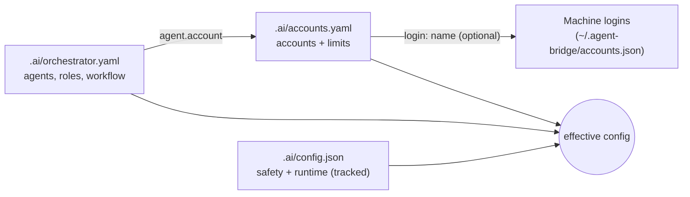

# Configuration guide

[README](../README.md) · Configuration guide · [Configuration reference](configuration.md) · [CLI and MCP reference](cli-reference.md)

This guide walks through setting up agent-bridge for a project, task by task. Every key and
default is listed in the [configuration reference](configuration.md); this page explains which
file to edit and which command to run for each common job.

## The three files

Each setting lives in exactly one file in the project's `.ai/` directory:

| File | What you put there | In git | Who edits it |
|---|---|---|---|
| `.ai/accounts.yaml` | The accounts this project uses, and their limits | No | You, or the `project-account-*` commands |
| `.ai/orchestrator.yaml` | Agents, roles (planner, executor, reviewer), routing, workflow stages | No | You |
| `.ai/config.json` | Safety and runtime: verification sandbox, timeouts, path rules, env rules, allowed check commands | Yes | You, through a reviewed commit |



- All three are optional. Without `orchestrator.yaml` the legacy setup applies: your Claude
  Code session plans and reviews, and Codex on its global login executes.
- Agents can never write `.ai/`: a task that changes it is blocked.
- `.ai/config.json` is shared through git. A commit that loosens it, such as
  `"verify_sandbox": "none"`, applies to everyone who pulls it. Review it like a security change.
- The same name in two files (an account in both `orchestrator.yaml` and `accounts.yaml`, or
  `verify_sandbox` in both `orchestrator.yaml` and `config.json`) is an error that names both
  files. Nothing silently overrides anything.

## After every change

```bash
agent-bridge config-check    # valid? what is still in an old location?
agent-bridge agents          # who plans, executes and reviews; who is available
agent-bridge health          # logins, quota, limits; exits 1 when something blocks work
```

`config-check` prints a readable summary in a terminal and JSON with `--json`.

The CLI, the terminal dashboard and the web dashboard read the files on each start. The MCP
server Claude Code talks to picks up edits to `.ai/config.json`, `.ai/orchestrator.yaml`,
`.ai/accounts.yaml` and the machine account registry on its next tool call, with no `/mcp`
reconnect. It defers the reload while one of its own tasks is running. An invalid edit keeps the
previous settings and shows as NOT OK in `health` (`config_reload_failed`) until you correct the
file. After upgrading the kit's code, reconnect `agent-bridge` with `/mcp`.

## Change one setting

Every key in `.ai/orchestrator.yaml`, `.ai/accounts.yaml` and `.ai/config.json` can be changed
from the terminal; the first part of the key picks the file. The command previews, and only
`--apply` backs the file up to `.ai/backup-<UTC stamp>/` and writes it:

```bash
agent-bridge config-set roles.executor.default codex-b           # preview
agent-bridge config-set roles.executor.default codex-b --apply
agent-bridge config-unset roles.executor.default --apply         # back to the default
```

The value is parsed as YAML: `5`, `true`, `null`, `[a, b]`, `{five_hour_pct: 80}` or plain text.
The whole configuration is checked before anything is written, and a change that would put a
setting in an outdated place is refused. Comments in a YAML file are not kept (they stay in the
backup). Keys named `token`, `secret` or `password` are refused; `token_env` is allowed. Both
commands need an interactive terminal. The YAML and JSON shown below stay the reference for what
each key means; the matching `config-set` command is next to each.

## Start a new project

```bash
agent-bridge init                       # install the kit (MCP server, rules, skill)
agent-bridge config-init                # list the example setups
agent-bridge config-init orchestrator   # write .ai/orchestrator.yaml and .ai/accounts.yaml
```

`config-init` refuses if either file already exists, and it needs an interactive terminal. The
examples:

| Example | Planner | Executor | Reviewer |
|---|---|---|---|
| `orchestrator` | Claude headless | Codex on two accounts, in fallback order | Claude headless |
| `claude-executor` | Codex | Claude headless with write access | Codex |
| `single-agent` | Codex | Codex | Codex |
| `gates-only` | none | Codex | none: the bridge's checks decide |
| `other-reviewers` | agy | Codex | opencode |
| `account-limits` | Claude Code session | Claude on two accounts, then Codex, with limits | Claude Code session |

Then edit the account homes in `.ai/accounts.yaml` (or `agent-bridge config-set
accounts.<name>.home <dir> --apply`), log each account in, and run `config-check`.

## Add an account

An account is one login with its own auth home. There are three ways to give a project one.

**A new login just for this project.**

```bash
agent-bridge project-account-add codex-work --provider openai
agent-bridge account-login codex-work
```

This writes the account to `.ai/accounts.yaml` with a new home under
`~/.agent-bridge/homes/codex-work`. It then prints the agent line to add under `agents:` in
`orchestrator.yaml`, for example:

```yaml
agent-codex-work: {"adapter": "codex-cli", "account": "codex-work", "allow_write": true}
```

Add that line, and the agent's name to a role (see [Choose who does what](#choose-who-does-what)).
`--home DIR` uses an existing home instead; `--agent NAME` and `--model M` change the printed
agent line.

**A login you already have on this machine.** Machine-wide logins are made once with
`agent-bridge account-add <name> --provider ...` and listed by `agent-bridge account-list`. A
project uses one only when it declares it:

```bash
agent-bridge project-account-add shared --login work
```

or by hand in `.ai/accounts.yaml`:

```yaml
accounts:
  shared: {login: work, limits: {weekly_pct: 90}}
```

Provider and home come from the machine login. A `login:` entry may not set `home`. If it sets
`provider`, that must match the login's. Limits are the project's own: the machine login's
limits never apply to it.

**By hand.** Write the entry in `.ai/accounts.yaml` yourself:

```yaml
accounts:
  codex-work:  {provider: openai, home: ~/.codex-accounts/homes/work}
  claude-main: {provider: anthropic, home: ~/.claude-accounts/main, max_concurrency: 1}
  codex-global: {provider: openai}   # no home: the CLI's own global login, used read-only
```

The same entries from the terminal:

```bash
agent-bridge config-set accounts.codex-work '{provider: openai, home: ~/.codex-accounts/homes/work}' --apply
agent-bridge config-set accounts.claude-main.max_concurrency 1 --apply
```

Homes must be absolute (or `~/...`), outside the project and outside `~/.codex` and
`~/.claude`. Two accounts never share a home. `max_concurrency` (1–8, default 1) caps how many
agents run on the account at once, across every bridge on the machine.

### Claude with a long-lived token or an API key

Instead of logging in inside the home, an `anthropic` account can take a token from the macOS
Keychain or an environment variable:

```bash
# claude setup-token token in the Keychain
agent-bridge project-account-add claude-ci --provider anthropic --credential keychain
agent-bridge account-set-token claude-ci        # prompts for the token; never on the command line

# Console API key in the Keychain
agent-bridge project-account-add claude-api --provider anthropic --credential keychain --credential-kind api_key
agent-bridge account-set-token claude-api

# token in an environment variable (Linux, or no Keychain)
agent-bridge project-account-add claude-env --provider anthropic --token-env AGENT_BRIDGE_CLAUDE_ENV_TOKEN
```

- The variable name must be `AGENT_BRIDGE_CLAUDE_<NAME>_TOKEN`. Export it in the shell that
  starts Claude Code.
- Never write a token into a `.ai/` file.
- `agent-bridge account-verify <name>` checks that the login or token is present, without
  printing it.

### Remove an account

```bash
agent-bridge project-account-remove codex-work
```

It asks you to type the name, removes the account and its Keychain token, and keeps the home.
First remove the agents in `orchestrator.yaml` that use the account; otherwise the command
refuses, because the config would no longer load.

## Limit how much an account is used

Limits stop an account from taking new work. They are set per account in `.ai/accounts.yaml`.

```bash
agent-bridge project-account-limits codex-work --five-hour-pct 80 --weekly-pct 90
agent-bridge project-account-limits codex-work --clear            # remove both
agent-bridge usage codex-work                                     # used, threshold, reset time
```

Each value is the percent of the provider's 5-hour or weekly window **used** at which the
account stops. Budgets in USD, cost estimates and the other keys go in the same `limits:` block
by hand:

```yaml
accounts:
  claude-main:
    provider: anthropic
    home: ~/.claude-accounts/main
    limits:
      five_hour_pct: 85
      weekly_pct: 90
      budget_usd: {day: 20, month: 300}
      reserve_usd: 2
```

The same from the terminal, for any limit key:

```bash
agent-bridge config-set accounts.claude-main.limits.weekly_pct 90 --apply
agent-bridge config-set accounts.claude-main.limits.budget_usd '{day: 20, month: 300}' --apply
agent-bridge config-unset accounts.claude-main.limits --apply
```

An account over a limit is skipped by routing, and a task pinned to it is refused with the
limit and its reset time. It takes work again after the reset. See
[Per-account limits](configuration.md#per-account-limits-opt-in) for budgets, pricing and how
cost is counted.

## Choose who does what

Roles are set in `.ai/orchestrator.yaml`:

```yaml
version: 1
agents:
  claude:   {adapter: client}                                    # your Claude Code session
  codex-a:  {adapter: codex-cli, account: codex-work}
  codex-b:  {adapter: codex-cli, account: shared}
  reviewer: {adapter: claude-cli, account: claude-main, model: sonnet}
roles:
  planner:  claude
  executor: {agents: [codex-a, codex-b], default: codex-b, strategy: ordered}
  reviewer: reviewer
workflow:
  stages: [execute, test, review]
  max_rework: 2
```

The same changes with `config-set`:

```bash
agent-bridge config-set roles.executor.agents '[codex-a, codex-b]' --apply
agent-bridge config-set roles.executor.default codex-b --apply
agent-bridge config-set agents.reviewer.model sonnet --apply
agent-bridge config-set workflow.max_rework 2 --apply
agent-bridge config-set routing.quota_fallback.enabled true --apply
```

A role written as a bare agent name (`reviewer: reviewer`) becomes `{agents: [reviewer]}` when you
set a key under it.

- **Executor order.** An unpinned task goes to `default` first, then to the first eligible agent
  in `agents` order: enabled, CLI installed, logged in, under its limits and its
  `max_concurrency`.
- **`strategy`.** `ordered` is the order above. `quota` picks the agent whose account has the
  most quota left. `explicit` requires every task to name its agent.
- **Write access.** Only `codex-cli` and `claude-cli` can execute. `codex-cli` writes by
  default; `claude-cli` needs `allow_write: true`. `opencode-cli` and `agy-cli` only plan and
  review.
- **Stages.** `plan` (planner agent), `execute`, `test` (the bridge re-runs the checks) and
  `review`. Without `review`, the bridge approves work that passed every check. High-risk work
  still waits for a human.
- **Quota fallback.** `routing.quota_fallback.enabled: true` lets the bridge move a task to
  another agent when its account runs out of quota or hits a limit. It is off by default.

## Verification checks and their sandbox

The bridge re-runs each task's verification commands itself and confines them. Set this in
`.ai/config.json`:

```json
{
  "verify_sandbox": "auto",
  "verify_writable": ["~/.cache/uv"],
  "verify_timeout_s": 900
}
```

| `verify_sandbox` | Effect |
|---|---|
| `auto` (default) | Checks may write only to the worktree, a private temp dir and `verify_writable`. |
| `strict` | As `auto`, and network connections are denied. Checks are refused where no sandbox exists. |
| `none` | No confinement. `health` keeps warning. |

```bash
agent-bridge config-set verify_sandbox strict --apply
agent-bridge config-set verify_writable '[~/.cache/uv]' --apply
agent-bridge config-set verify_timeout_s 900 --apply
```

These keys change what the bridge allows and `.ai/config.json` is tracked, so the command prints
"security setting: .ai/config.json is tracked, so this applies to every clone". Do not use
`workflow.verify_sandbox`: it is refused, because the key belongs in `config.json`.

If a check fails with `Permission denied` on a cache directory outside the project, add that
directory to `verify_writable` (absolute or `~/...`). Commands a check may start are listed in
`verify_allowlist`. Copy only the keys you change: anything you leave out keeps its default.
The full list with defaults is `.ai/config.example.json`.

## Move an older project to this layout

Older setups still load unchanged. `config-check` lists what is in an old place under **Move**:
accounts in `orchestrator.yaml`, agents in `accounts.yaml`, machine logins used without a
declaration, and `workflow.verify_*` in `orchestrator.yaml`.

```bash
agent-bridge config-migrate            # preview: the moves and both new files
agent-bridge config-migrate --apply    # write them; originals go to .ai/backup-<UTC stamp>/
agent-bridge config-check
```

- `config-migrate` refuses if the result would behave differently from what you have now.
- It copies each machine login's limits into the project, so no cap is lost.
- Comments in `orchestrator.yaml` are not kept; they stay in the backup.
- It does not move `workflow.verify_*`. Move those keys to `.ai/config.json` by hand, and delete
  them from `orchestrator.yaml` in the same edit: having them in both files is an error.

## Troubleshooting

| Message | Cause | Fix |
|---|---|---|
| `account 'x' is declared in both .../orchestrator.yaml and .../accounts.yaml; keep it in one file` | The same account (or `agent 'x'`) in two files | Delete one; accounts belong in `accounts.yaml`, agents in `orchestrator.yaml` |
| `account x: unknown login 'y'; registry logins: [...]` | `login:` names a machine login that does not exist | Use a listed name, or create it with `agent-bridge account-add` |
| `account x: login 'y' supplies the home; remove 'home'` | A `login:` entry also sets `home` | Remove `home` |
| `agent x: unknown account 'y'` | An agent points at an account no file declares | Declare it in `accounts.yaml` |
| `adapter codex-cli needs an account` | An agent without `account:` | Add `account:` (only `client` agents have none) |
| `verify_sandbox is set in both .ai/config.json and ...` | The key is in both files | Keep it only in `.ai/config.json` |
| `verify_writable needs absolute paths (or ~/...)` | A relative path | Use an absolute path or `~/...` |
| `account x over its configured limit: weekly_pct: ...` | The account reached a limit | Wait for the reset shown, or raise it with `project-account-limits` |
| Claude still reports an old limit or old roles after you edited `.ai/` | The MCP server reloads on its next tool call, but defers while one of its own tasks runs; an invalid edit keeps the previous settings and shows as NOT OK in `health` | Wait for the task to finish, or fix the file (`agent-bridge config-check`); `/mcp` reconnect is only needed after upgrading the kit's code |
| `refused: <command> needs an interactive terminal (human only)` | A human-only command run from a script, a pipe or by Claude | Run it yourself in a terminal |

## What only a human does

These commands need an interactive terminal, and Claude Code is told not to run them:
- `config-init`, `config-migrate`, `config-set` and `config-unset`;
- `project-account-add`, `project-account-limits` and `project-account-remove`;
- `account-add`, `account-login`, `account-remove` and `account-set-token`;
- `approve` and `reassign`.

Agents never get `.ai/`, credentials or account homes. See the security section of the
[README](../README.md) for what is and is not enforced.
