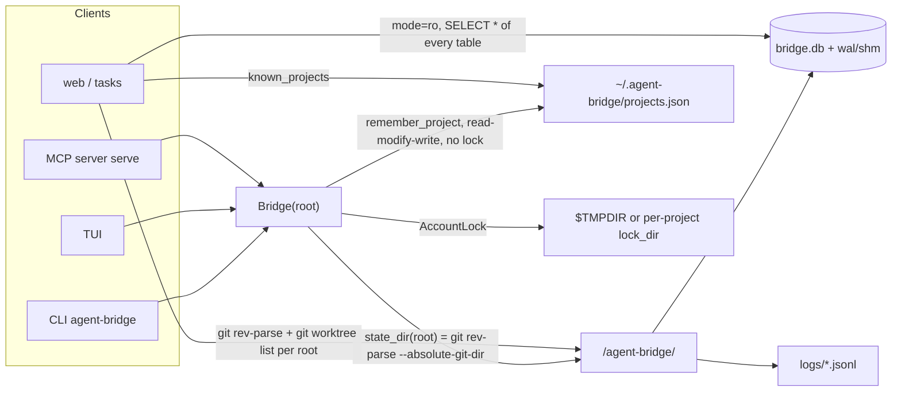
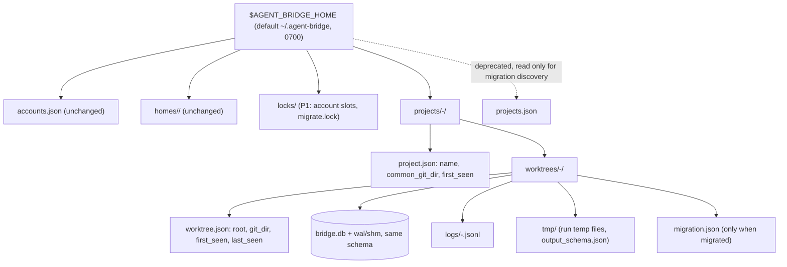
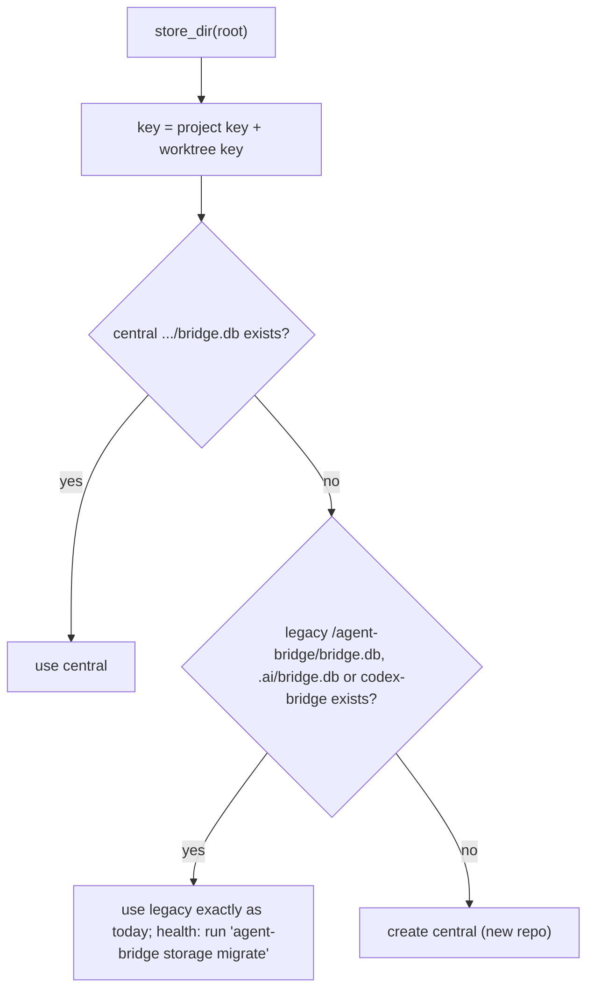
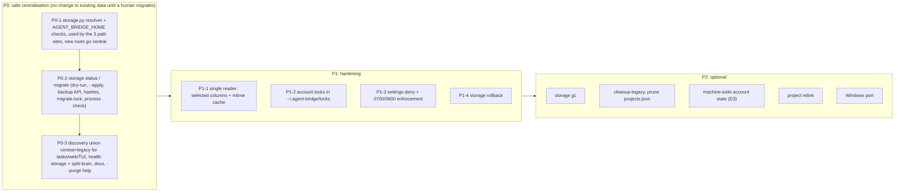

# Audit & thiết kế: lưu trữ tập trung cho agent-bridge

Ngày: 2026-11-02 · Nhánh: `tuanvm/web-progress-dashboard` (HEAD `6dfae7d`) · Trạng thái: **chỉ audit và thiết kế, chưa sửa code, chưa migrate dữ liệu**.

Phạm vi đã đọc: `bridge/{config,state,install,accounts,service,executor,progress,review,server,tui,cli,webui}.py`, `.claude/settings.json`, `.mcp.json`, `README.md` (mục "State and files"), `tests/conftest.py`, `tests/integration/test_state_location.py`, `docs/plans/parallel-worktrees.md`. Dữ liệu thật được kiểm tra bằng `ls`, `du` và một script Python chỉ đọc metadata file, không mở DB.

---

## 1. Tóm tắt

- Dữ liệu hiện nằm ở **4 nơi**:
  - một `bridge.db` cùng thư mục `logs/` trong **git dir của từng worktree**;
  - registry dạng JSON ở `~/.agent-bridge/`;
  - lock của account ở `$TMPDIR`;
  - config ở `.ai/` trong repo.
- Rủi ro lớn nhất là **mất lịch sử**. Vòng đời của state bị gắn vào vòng đời của checkout: xóa worktree hoặc clone lại repo là mất toàn bộ task, attempt, event và log. Trên máy này, **59 trong 67 root đã đăng ký không còn tồn tại**, nên lịch sử của chúng không thể khôi phục.
- Đề xuất: **một root duy nhất** (`AGENT_BRIDGE_HOME`, mặc định `~/.agent-bridge`). Mỗi worktree giữ một DB riêng, xếp theo `projects/<project>/worktrees/<worktree>/`.
  - Không đổi schema, không đánh lại ID, không đổi nghiệp vụ orchestration.
  - Registry chính là cấu trúc thư mục, nên bỏ được file `projects.json` (hiện đang có race).
- Migration là lệnh **tường minh** do người chạy: dry-run mặc định, rồi `--apply`.
  - Dữ liệu được copy bằng SQLite backup API và kiểm tra bằng hash từng bảng.
  - **Nguồn cũ không bị sửa hay xóa.** Rollback chỉ là đọc lại từ nguồn cũ.
- 4 quyết định ở §9 đã được chốt; trạng thái triển khai ở §11.

---

## 2. Kiến trúc hiện tại (theo code)

### 2.1 Bản đồ đọc/ghi

| Dữ liệu | Vị trí | Ghi bởi | Đọc bởi | Bằng chứng |
|---|---|---|---|---|
| Task, attempt (patch, verification, final, usage), event (audit), workflow, account state, quota | `<git dir>/agent-bridge/bridge.db` (+`-wal`, `-shm`) | `Store` (WAL, `BEGIN IMMEDIATE`) | CLI, TUI, MCP qua `Bridge`; web/`tasks` mở `mode=ro` | `state.py:20-75,115-132`, `config.py:112-116`, `service.py:84-94` |
| Log từng lần chạy agent | `<git dir>/agent-bridge/logs/<task>-<n>.jsonl` (0600) | `Bridge._run_inner` | `bridge_task_result` (đường dẫn tính lúc đọc) | `service.py:54-59,582-589,818-834` |
| File tạm của run, `output_schema.json` | `<git dir>/agent-bridge/` (TemporaryDirectory) | adapter | adapter | `executor.py:198,241-242,338` |
| Install manifest | `<git dir>/agent-bridge/install-manifest.json` | `install` | `uninstall` | `install.py:98-103` |
| Account toàn máy | `~/.agent-bridge/accounts.json`, `homes/<name>/` | `register` (tmp + `os.replace`) | `load_registry` | `accounts.py:187-205,231-271` |
| Danh sách project | `~/.agent-bridge/projects.json` | `remember_project` mỗi lần `Bridge()` khởi tạo | `known_projects` → `progress.discover_roots` | `accounts.py:209-228`, `service.py:98`, `progress.py:28-40` |
| Lock slot của account | `$TMPDIR/agent-bridge-acct-<hash>.lock` (hoặc `lock_dir`) | `AccountLock` (`fcntl.flock`) | như bên trái | `accounts.py:404-448`, `config.py:39` |
| Config | `.ai/config.json`, `.ai/orchestrator.yaml` | người dùng | `load_config`, `load_orchestrator` | `config.py:105-109` |
| Session của agent | trong account home (rollout của Codex) | CLI của agent | `quota.py` chỉ đọc `rate_limits` | `.claude/rules/security.md`; DB chỉ lưu `session_id` |

"Artifact" ở đây không phải file riêng. Patch, kết quả verification và ghi chú cuối của agent đều là cột JSON trong bảng `attempts`. Log là file JSONL. Không có store artifact nào khác.

### 2.2 Luồng dữ liệu hiện tại



### 2.3 Vì sao dữ liệu bị phân tán

1. State được đặt trong `.git/` vì sandbox `workspace-write` của Codex ghi được mọi nơi trong worktree, kể cả file bị ignore, nhưng không ghi được `.git/` (`README.md:432`). Ý đồ bảo mật này đúng. Hệ quả ngoài ý muốn là dữ liệu chết theo checkout. Với linked worktree, `--absolute-git-dir` trỏ vào `.git/worktrees/<name>/`, thư mục mà `git worktree remove/prune` sẽ xóa.
2. Khi cần nhìn mọi project (lệnh `tasks`, web), registry `projects.json` được vá thêm vào sau, cộng một lời gọi `git` cho mỗi root. Lúc đó đã không còn nơi nào biết đầy đủ về "toàn bộ dữ liệu".
3. Lock nằm trong `$TMPDIR` để đơn giản. Kết quả là phạm vi của lock phụ thuộc vào môi trường của từng process.

### 2.4 Điểm mạnh nên giữ

- WAL + `BEGIN IMMEDIATE`: nhiều process dùng chung một DB an toàn (`state.py:121,134-142`).
- Bảng `events` chỉ ghi thêm, state transition và event nằm trong cùng một transaction (`state.py:285-322`).
- Redact trước khi lưu (`state.py:150`, `service.py:57-59`).
- Reader mở `mode=ro` không bao giờ chạy migration (`state.py:99-112`, `progress.py:83`).
- `recover()` xử lý runner chết và PID bị tái sử dụng (`service.py:958-985`).

---

## 3. Phát hiện (có bằng chứng)

| # | Mức | Phát hiện | Bằng chứng |
|---|---|---|---|
| F1 | **Cao** | Lịch sử mất khi xóa worktree hoặc repo. State của linked worktree nằm trong `.git/worktrees/<name>/agent-bridge/`. | `install.py:43-53`. Thực tế: 67 root trong `projects.json`, 59 không còn tồn tại (khoảng 50 là worktree `harness-vibecode-wt.noindex/*`, phần còn lại là thư mục tạm). Chỉ 8 root còn DB, tổng 13,9 MB. |
| F2 | Cao | Không có nguồn sự thật chung: N DB, N thư mục log, một registry JSON, và lock theo `$TMPDIR`. Muốn có cái nhìn toàn cục phải gọi git cho từng root. | §2.1, `progress.py:28-40,78-85` |
| F3 | TB | `projects.json` có thể mất cập nhật: đọc, sửa, ghi mà không có lock. Lỗi `OSError` bị nuốt. Danh sách không bao giờ được dọn: 12 entry là thư mục probe hoặc scratchpad trong `/var/folders` và `/private/tmp`. | `accounts.py:218-228`, nội dung `~/.agent-bridge/projects.json` |
| F4 | TB | `Bridge()` có side effect ngay cả với lệnh chỉ đọc (`health`, `list`, TUI): tạo `.ai/`, state dir, DB và ghi vào registry. | `service.py:82-98` |
| F5 | TB | Đường dẫn DB được tính ở 3 nơi, và có 2 reader chỉ đọc khác nhau. Đổi vị trí lưu thì phải sửa đồng bộ cả 5 chỗ. | `service.py:84-85`, `service.py:1000`, `progress.py:79-85`; `state.overview` (`state.py:99`) và `progress._read` (`progress.py:78`) |
| F6 | TB | Lock của account có phạm vi theo `lock_dir`, mà `lock_dir` là config **của từng project**, mặc định lấy `tempfile.gettempdir()`. Hai process có `TMPDIR` hoặc `lock_dir` khác nhau sẽ không thấy lock của nhau, nên `max_concurrency` không được thực thi trên toàn máy. Mới là rủi ro có điều kiện: trên máy này `TMPDIR` là mặc định nên chưa tái hiện. | `config.py:39`, `accounts.py:413`, `service.py:530,688` |
| F7 | TB | Trạng thái account (`accounts`, `account_quota`) lưu theo từng DB, trong khi account là tài nguyên toàn máy. Project A biết account hết quota, nhưng project B vẫn route vào account đó. | `state.py:36-37,157-188` |
| F8 | TB | Web đọc **toàn bộ** các bảng (gồm patch trong `attempts.changes` và mọi `events`) cho mỗi root, mỗi 3 giây, cộng 2 lời gọi git cho mỗi root. Lần đo trước: khoảng 2 giây cho mỗi overview với 11 project. | `progress.py:89-93,28-40` |
| F9 | Thấp–TB | Không có retention. Log (tối đa 100 KB mỗi dòng), patch và event tăng mãi; không có gc hay VACUUM. Hiện mới 13,9 MB nên chưa gấp. | `service.py:59` |
| F10 | Thấp | `mkdir(mode=0o700, exist_ok=True)` không siết lại quyền của thư mục đã có sẵn. File DB có quyền 0644; hiện vẫn an toàn nhờ thư mục cha 0700. | `config.py:115`, `ls -la .git/agent-bridge` |
| F11 | Thấp | Tài liệu lỗi thời: help của `uninstall --purge` ghi "also delete .ai/ (task history)", nhưng lịch sử đã nằm trong git dir từ lâu. Purge không xóa state. | `cli.py:240`, `install.py:343-344`, `README.md:430` |
| F12 | Thấp | ID được sinh bằng `COUNT(*)+1`. Đúng chừng nào chưa có dòng nào bị xóa; một cơ chế dọn dẹp xóa dòng sẽ khiến ID bị trùng. Đây là ràng buộc cho mọi thiết kế gc. | `state.py:199,252` |
| F13 | Thông tin | Windows hiện chưa chạy được: `import fcntl` ở cấp module, `os.killpg`, `start_new_session`. Thay đổi cách lưu trữ không sửa được điểm này. | `accounts.py:6`, `executor.py:250,618,632`, `review.py:149,158` |
| F14 | Thông tin | Repo nằm dưới `~/Desktop`/`~/Documents` (như repo này) kéo theo DB WAL nằm trong thư mục mà macOS có thể đồng bộ iCloud. SQLite WAL không an toàn trên filesystem đồng bộ hoặc mạng. Chưa kiểm tra máy này có bật iCloud Desktop hay không. | đường dẫn root |
| F15 | Thông tin | Trên repo này `bridge.db-wal` là 3,9 MB còn `bridge.db` là 984 KB, tức phần lớn dữ liệu đã commit vẫn nằm trong WAL. Copy riêng `bridge.db` sẽ **mất dữ liệu**. Migration phải dùng backup API. | `ls -la .git/agent-bridge` |
| F16 | Ràng buộc | Phải giữ tính chất "agent không ghi được state". Thư mục `~` nằm ngoài các root ghi được của Codex `workspace-write`, nhưng **phải kiểm chứng bằng probe thật**. | `README.md:432`, `.claude/rules/security.md` |

---

## 4. Kiến trúc đề xuất

### 4.1 Các phương án đã cân nhắc

| Phương án | Ưu | Nhược | Kết luận |
|---|---|---|---|
| A. Một DB toàn cục | Một truy vấn cho dashboard; account state chung | `T0001` có ở mọi DB, nên phải namespace ID và viết lại `events.task_id`, `spec.depends_on`, `workflow_id` (rủi ro migration cao). Mọi project tranh nhau một write lock. Một file hỏng là hỏng tất cả. | Loại |
| B. Một DB cho mỗi project, gộp các worktree | Gọn hơn A | Vẫn trùng ID giữa các worktree. Quy tắc "một writer cho mỗi worktree" (`state.py:307-313`) phải thêm cột và logic mới, tức đổi nghiệp vụ. | Loại |
| **C. Một DB cho mỗi worktree, xếp dưới root trung tâm theo project** | Schema và ID giữ nguyên. Migration là copy DB nguyên vẹn rồi kiểm hash. Giữ nguyên quy tắc writer. Lỗi bị cô lập trong từng DB. Xóa hoặc export theo project rất đơn giản. | Dashboard vẫn phải đọc N DB (N nhỏ, có cache ở P1) | **Chọn** |

Phương án C vẫn tương thích với `docs/plans/parallel-worktrees.md`: các worktree do bridge tạo cho từng task dùng chung store của worktree đã khởi chạy chúng. Sau này nếu thật sự cần, có thể nâng C lên B.

### 4.2 Bố cục



- Key được tạo từ slug cộng hash của đường dẫn đã `realpath`, nên không bị path traversal và ổn định với khoảng trắng hay ký tự unicode. Repo bị di chuyển sẽ thành project mới; project cũ hiển thị là "missing" và vẫn đọc được. Lệnh `relink` để nối lại thuộc P2.
- `install-manifest.json` **giữ nguyên trong git dir**. Nó mô tả các file đã cài vào chính checkout đó và `uninstall` cần nó; nó không phải lịch sử.
- Vì sao một root chứ không hai: `~/.agent-bridge` đã chứa `accounts.json` và `homes/`. Đường dẫn home được lưu dạng tuyệt đối trong `accounts.json` và có thể cả trong `.ai/orchestrator.yaml` (file chỉ người được sửa). Các rule deny trong `.claude/settings.json` và `security.md` cũng đã tham chiếu `~/.agent-bridge`. Tạo thêm `~/agents-bridge` song song sẽ quay lại đúng vấn đề phân tán. Xem D1.

### 4.3 Resolver: một hàm cho mọi client (sửa F5)

Thêm một module `bridge/storage.py`, chứa layout, resolver và migrator. Ba chỗ đang tự tính đường dẫn sẽ gọi `storage.store_dir(root, create=...)`; hai reader chỉ đọc gộp làm một.



- Root mới dùng central ngay. Root cũ giữ **nguyên hành vi hiện tại** cho đến khi người dùng chạy migrate, nên phát hành P0 không làm thay đổi gì với dữ liệu sẵn có.
- `create=False` dùng cho mọi đường chỉ đọc (web, `tasks`, `list`). Đường này không tạo DB và không đăng ký project, sửa được F4 cho reader.
- `AGENT_BRIDGE_HOME` phải là đường dẫn tuyệt đối, **không nằm trong bất kỳ worktree nào** (nếu không, Codex `workspace-write` sẽ ghi được), không nằm trong account home, và không phải symlink. Nếu chủ sở hữu khác uid hiện tại thì từ chối. Quyền được siết lại thành 0700 cho thư mục và 0600 cho file.

### 4.4 Discovery (sửa F2, F3; giảm F8)

Danh sách project là kết quả `os.scandir(projects/*/worktrees/*)`, đọc `worktree.json`, không cần gọi git và không cần file chỉ mục dùng chung. Trong giai đoạn chuyển tiếp, kết quả là **hợp** của central với các root legacy chưa migrate lấy từ `projects.json`, khử trùng theo worktree key (central được ưu tiên). Nhờ vậy CLI `tasks`, TUI, MCP và web đều thấy đủ dữ liệu cả trước lẫn sau migration. Root đã mất vẫn hiện với nhãn "root missing", vì lịch sử của nó giờ nằm ở central.

---

## 5. Migration dữ liệu cũ

### 5.1 Nguyên tắc

- **Không ghi gì vào vị trí nguồn.** Không đổi tên, không thêm marker. Nguồn chính là bản backup.
- Lệnh do **người chạy**: `agent-bridge storage migrate` mặc định là dry-run; `--apply` mới ghi. Không tự migrate khi khởi động (D2), vì MCP server cũ chạy lâu vẫn giữ kết nối tới DB cũ và sẽ gây split-brain.
- Copy bằng `sqlite3.Connection.backup()` từ kết nối `mode=ro`, nên snapshot nhất quán và gồm cả WAL (F15). Log được copy kèm sha256.
- Toàn bộ thao tác ghi đi vào thư mục `.partial-<pid>`, cuối cùng mới `os.replace` sang tên thật (atomic trong cùng filesystem).

### 5.2 Trình tự

```mermaid
sequenceDiagram
  actor H as Human
  participant M as storage migrate
  participant S as Legacy source (read-only)
  participant C as Central store
  H->>M: storage migrate (dry-run)
  M->>M: discover = projects.json + git worktree list + cwd
  M-->>H: plan per source: ok / missing / not git / corrupt / already migrated, size, active tasks
  H->>M: storage migrate --apply
  M->>M: take locks/migrate.lock; refuse if any agent-bridge process is running (ps)
  loop each source
    M->>S: open mode=ro, record max(events.id), max(tasks.updated_at)
    M->>C: backup() into worktrees/<key>.partial-<pid>/bridge.db
    M->>C: copy logs/*.jsonl + sha256
    M->>C: PRAGMA integrity_check, per-table COUNT + sha256 of rows ordered by PK
    M->>S: same COUNT + sha256, re-read max(events.id)
    alt anything differs or the source changed
      M->>C: keep .partial dir, mark source FAILED, legacy untouched
    else equal
      M->>C: write worktree.json, migration.json (source, counts, hashes, source_max_event_id), fsync
      M->>C: os.replace(.partial -> final)
    end
  end
  M-->>H: report per source + exit code (non-zero if any FAILED)
```

### 5.3 Toàn vẹn và quan hệ dữ liệu

- DB được copy nguyên vẹn, nên mọi ID (`T0001`, `W0001`), `depends_on`, `workflow_id`, `events.task_id`, `session_id`, patch và review history đều giữ y hệt.
- Không có đường dẫn tuyệt đối nào được lưu trong các bảng nghiệp vụ. Đường dẫn log được tính lúc đọc (`service.py:818-834`), nên sau migration tự trỏ sang bản central. Event `state_migrated` cũ có ghi đường dẫn, nhưng đó chỉ là thông tin lịch sử.
- Các bảng được kiểm tra: `tasks`, `attempts`, `events`, `workflows`, `accounts`, `account_quota`. DB đời cũ thiếu bảng hay cột vẫn được copy y nguyên; `Store` tự nâng cấp schema ở lần mở đầu tiên như hiện nay (`state.py:124-131`).
- Root đã mất (F1) **không thể khôi phục**. Báo cáo dry-run liệt kê các root này để người dùng biết.

### 5.4 Rollback, phát hiện split-brain, dọn dẹp

- **Rollback**: hạ kit về bản cũ là xong, vì code cũ đọc nguồn legacy còn nguyên. Hoặc dùng `storage rollback <root>` (P1): chuyển thư mục central sang `~/.agent-bridge/rollback/<ts>/` (không xóa), sau đó resolver quay về legacy. Lệnh này cảnh báo số event được ghi ở central sau thời điểm migrate, vì các event đó sẽ không còn hiển thị.
- **Split-brain**: `health` so `max(events.id)` của nguồn legacy với `source_max_event_id` trong `migration.json`. Nếu legacy lớn hơn, nghĩa là có process bản cũ vẫn đang ghi, và health cảnh báo kèm số event.
- **Dọn legacy** (P2, chỉ người chạy): `storage cleanup-legacy` kiểm hash lại một lần nữa, xác nhận không có ghi mới vào legacy, rồi mới chuyển legacy vào `backups/`. Không bao giờ tự động.

---

## 6. Tác động đến từng thành phần

| Thành phần | Thay đổi | Hành vi nhìn thấy |
|---|---|---|
| `Bridge` (CLI, TUI, MCP) | `state_dir(root)` → `storage.store_dir(root)`; `_attempt_log_path` dùng chung | Không đổi. `health` thêm `storage: central/legacy`, đường dẫn và cảnh báo nếu có |
| MCP server | Không đổi API. Phải khởi động lại sau migrate (migrate từ chối chạy khi server đang chạy) | Không đổi |
| CLI `tasks`, web (`progress`) | Discovery theo §4.4; một reader chung; không gọi git | Thấy root đã mất; nhanh hơn; có nhãn "legacy" trước khi migrate |
| TUI | Như `Bridge` | Không đổi |
| `install`/`uninstall` | Manifest giữ nguyên chỗ cũ; sửa help của `--purge` (F11). P1: thêm deny `Edit/Write(~/.agent-bridge/**)` vào settings được cài | Không đổi |
| Lệnh mới | `storage status`, `storage migrate [--apply]`, (P1) `storage rollback`, (P2) `storage gc`, `storage cleanup-legacy` | Mới |
| Schema | **Không đổi** | — |

---

## 7. Đánh giá phi chức năng

**Concurrency.** Mỗi worktree vẫn có một DB WAL như hiện nay, nên tình huống MCP + CLI + TUI + web (chỉ đọc) không thay đổi. Thư mục project được tạo bằng `mkdir(exist_ok=True)`; `project.json` được ghi qua file tmp có tên riêng rồi `os.replace`, nên không mất cập nhật như F3. Migration giữ `locks/migrate.lock`, từ chối khi có process agent-bridge đang chạy, và hủy source nếu snapshot thay đổi. P1: lock của account mặc định chuyển về `~/.agent-bridge/locks/` (vẫn cho ghi đè bằng `lock_dir`) để thực thi `max_concurrency` trên toàn máy (F6). Đây là làm đúng quy tắc sẵn có, không phải đổi nghiệp vụ.

**Crash recovery.** Nếu migrate bị kill giữa chừng, chỉ còn lại `.partial-*`; resolver bỏ qua thư mục này và lần chạy sau dọn đi. Legacy luôn nguyên vẹn. `recover()` cho runner không đổi, vì vẫn làm việc trên một DB.

**Security.** Giữ F16. Codex: `~` nằm ngoài vùng ghi, cần một probe thật trong real smoke do người chạy. Claude adapter: Edit/Write chỉ trong `allowed_paths`, nên không chạm được central; `allow_bash` thì như hiện nay, không bị giới hạn (đã có trong tài liệu). Client Claude Code: bổ sung deny. Mức lộ dữ liệu khi đọc chéo project giữ như hiện nay, vì git dir của project khác vốn cũng đọc được. Migrator không bao giờ đọc account home hay file auth.

**Performance.** Discovery bằng `scandir` thay cho 2 lần gọi git mỗi root. P1: reader chỉ `SELECT` các cột cần, bỏ `attempts.changes` khỏi overview, và cache theo `(mtime_ns, size)` của DB và WAL. Mục tiêu đo: dưới 500 ms cho 10 project × 1000 task.

**Storage cleanup.** P2 `storage gc --logs-older-than N`: chỉ xóa log của task đã ở trạng thái kết thúc, tùy chọn chạy `VACUUM`. **Không bao giờ xóa dòng** trong `tasks`/`workflows` (F12). Patch được giữ vì là bằng chứng review.

**macOS/Windows.** Đường dẫn dùng `Path.home()` nên trung lập với OS. Trên macOS, root nằm ngoài vùng iCloud, sửa được F14. Windows vẫn bị chặn bởi F13; port là một dự án riêng ở P2. Thiết kế này không làm việc port khó hơn.

---

## 8. Kịch bản kiểm thử (QA)

PASS = mọi kết quả mong đợi đều đúng và có bằng chứng (test tự động, trừ những mục ghi "người chạy").

| ID | Loại | Kịch bản | Kết quả mong đợi |
|---|---|---|---|
| N1 | Normal | Repo mới, bản mới, `execute` lần đầu | DB nằm ở central; không có `.git/agent-bridge/bridge.db`; `health` báo `central` |
| N2 | Normal | Repo cũ chưa migrate | Vẫn dùng legacy; CLI/TUI/MCP/web thấy đủ task; `health` gợi ý migrate |
| N3 | Normal | `storage migrate` (dry-run) | Hash và mtime của toàn bộ nguồn lẫn `$AGENT_BRIDGE_HOME` không đổi; plan đúng với từng source |
| N4 | Normal | `--apply` trên fixture có task, attempt, event, workflow, log | COUNT và hash từng bảng bằng nhau; `result` của task cũ trả cùng patch; đường dẫn log trỏ về central |
| N5 | Normal | Main + linked worktree | Hai thư mục worktree dưới cùng một project; dashboard gộp đúng |
| N6 | Normal | Migrate xong rồi `git worktree remove` | `tasks`/web vẫn hiện lịch sử, nhãn "root missing" |
| N7 | Normal | Đặt `AGENT_BRIDGE_HOME` | Mọi client dùng root đó |
| A1 | Abnormal | Root đã đăng ký nhưng bị xóa | Báo "missing", bỏ qua, các source khác vẫn chạy |
| A2 | Abnormal | Root không còn là git repo | Bỏ qua, có ghi lý do |
| A3 | Abnormal | DB legacy hỏng (`integrity_check` thất bại) | Source đó FAILED, legacy nguyên vẹn, exit khác 0 |
| A4 | Abnormal | Lỗi `OSError` khi copy (giả lập đĩa đầy) | Không có thư mục final; chạy lại thì thành công |
| A5 | Abnormal | WAL lớn hơn DB (chưa checkpoint) | Bản central có đủ các dòng nằm trong WAL |
| A6 | Abnormal | DB schema cũ (thiếu cột `agent`, thiếu bảng `workflows`) | Migrate được; lần mở đầu tự nâng schema |
| A7 | Abnormal | Chạy migrate lần hai | Không làm gì (idempotent) |
| A8 | Abnormal | Chỉ có `.ai/bridge.db` hoặc `.git/codex-bridge/` | Được nhận ra và migrate |
| A9 | Abnormal | Có thư mục `.partial-*` sót lại | Resolver bỏ qua; migrate dọn đi |
| S1 | Security | `AGENT_BRIDGE_HOME` nằm trong worktree | Từ chối |
| S2 | Security | Root là symlink, thuộc uid khác, hoặc quyền 0755 | Từ chối, hoặc siết về 0700/0600 |
| S3 | Security | Real smoke Codex (người chạy): agent cố ghi vào `~/.agent-bridge` | Sandbox chặn; DB không đổi |
| S4 | Security | Settings được cài có deny `Edit/Write(~/.agent-bridge/**)` | Packaging test pass |
| S5 | Security | Tên project chứa `..`, khoảng trắng, unicode | Key nằm trong root, ổn định |
| S6 | Security | Migrator không mở file nào trong account home | Test chặn `open` vào homes, vẫn pass |
| C1 | Concurrent | Migrate khi `serve` hoặc `web` đang chạy | Từ chối, liệt kê pid |
| C2 | Concurrent | Nguồn bị ghi giữa lúc backup và verify | Source đó bị hủy |
| C3 | Concurrent | Hai lệnh migrate chạy cùng lúc | Lệnh thứ hai thất bại vì `migrate.lock` |
| C4 | Concurrent | Hai project khởi tạo cùng lúc | Cả hai đều có trong discovery |
| C5 | Concurrent | (P1) Hai process khác `TMPDIR`, cùng account, slot = 1 | Process thứ hai bị chặn |
| C6 | Concurrent | CLI và MCP cùng ghi một DB central | Hành vi như hiện nay, không lỗi |
| R1 | Recovery | `kill -9` migrate giữa chừng | Chạy lại hoàn tất, không có thư mục trùng |
| R2 | Recovery | Runner chết sau khi đã migrate | `recover()` chuyển task sang PAUSED `INTERRUPTED` trong DB central |
| R3 | Recovery | (P1) `storage rollback` | Legacy được dùng lại; central chuyển sang `rollback/`; cảnh báo số event được ghi sau migrate |
| R4 | Recovery | Process bản cũ ghi legacy sau khi migrate | `health` cảnh báo split-brain kèm số event |
| G1 | Regression | Toàn bộ suite | Không ít hơn baseline (224 passed, 5 skipped) |
| G2 | Regression | `test_state_location` | Cập nhật kỳ vọng sang central; giữ test cho nhánh legacy |
| G3 | Regression | JSON của `list`, `result`, `tasks`, `progress.snapshot` trước và sau migrate trên fixture | Giống hệt (bỏ qua trường đường dẫn) |
| G4 | Regression | (P1) Hiệu năng snapshot | Đạt mục tiêu ở §7 |
| G5 | Regression | `init`/`uninstall` | Không đổi; manifest vẫn ở git dir |

---

## 9. Quyết định cần bạn

| # | Câu hỏi | Khuyến nghị |
|---|---|---|
| D1 | Root: `~/.agent-bridge` (hiện có) hay `~/agents-bridge` | **`~/.agent-bridge`** kèm biến `AGENT_BRIDGE_HOME`. Đổi sang `~/agents-bridge` kéo theo việc di chuyển `homes/`, tức sửa đường dẫn trong `accounts.json`, `.ai/orchestrator.yaml` (chỉ người sửa) và các rule deny. Nhiều rủi ro, không thêm lợi ích. Nếu bạn vẫn muốn tên đó, đặt `AGENT_BRIDGE_HOME=~/agents-bridge` chỉ cho data là được, nhưng khi đó sẽ có 2 root. |
| D2 | Migrate tường minh hay tự động khi khởi động | **Tường minh** (lý do ở §5.1) |
| D3 | Có chuyển trạng thái account/quota thành toàn máy không (F7) | Để P2. Việc này đổi hành vi routing nên cần quyết định riêng |
| D4 | Mặc định retention cho log | Tắt; chỉ chạy khi gọi `storage gc` |

Đã chốt (2026-11-02):
- D1: chọn `~/.agent-bridge`.
- D2: migrate tường minh.
- D3: có, áp dụng toàn máy. Khóa là danh tính account (provider + home, cùng seed với `AccountLock`), không dùng tên, vì hai project có thể đặt cùng một tên cho hai home khác nhau.
- D4: tắt.
- Thêm hai điểm:
  - Windows: hỗ trợ theo kiểu best effort, chỉ kiểm thử bằng mô phỏng.
  - Web dashboard: mỗi lần chạy sinh một token ngẫu nhiên, gửi qua header `X-Bridge-Token`. Không dùng cookie, vì cookie không tách biệt theo port.

---

## 10. Lộ trình và tiêu chí nghiệm thu



Mỗi mục P0/P1 là một task cho executor, dưới 400 dòng thay đổi, chạy theo đúng quy trình agent-bridge hiện tại.

| Giai đoạn | PASS khi | FAIL khi |
|---|---|---|
| P0-1 | N1, N2, N7, S1, S2, S5, A9, G1, G2 pass; không còn chỗ nào tự tính đường dẫn DB ngoài `storage.py` (kiểm bằng grep) | Có bất kỳ thay đổi nào với file legacy trên root chưa migrate |
| P0-2 | N3–N5, A1–A8, C1–C3, R1, S6 pass; chạy dry-run trên dữ liệu thật của máy này mà không ghi gì (hash trước và sau bằng nhau) | Hash lệch mà vẫn đánh dấu OK, hoặc nguồn bị ghi |
| P0-3 | N6, R4, G3 pass; web và `tasks` hiển thị đủ 8 root còn sống trước và sau migrate thật (người chạy `--apply`) | Có task biến mất khỏi bất kỳ client nào |
| P1 | C5, R3, S4, G4 pass | Hiệu năng không đạt mục tiêu |
| Migrate dữ liệu thật | Người chạy `--apply` sau khi đóng các session Claude; báo cáo 8/8 OK; health không có cảnh báo; legacy giữ nguyên ít nhất một chu kỳ dùng trước khi tính đến `cleanup-legacy` | Có source FAILED mà không có chẩn đoán |

---

## 11. Trạng thái triển khai (2026-11-02)

| Mục | Trạng thái |
|---|---|
| P0-1, P0-2, P0-3 | Xong (PR #32). Đã migrate dữ liệu thật: người dùng chạy `--apply`, 11/11 store khớp fingerprint, legacy giữ nguyên. |
| P1-1 reader, P1-2 lock, P1-4 rollback | Xong (PR #33) |
| P1-3 | Xong. Quyền 0700/0600; `.claude/settings.json` chặn `storage ... --apply`, `storage rollback` và việc sửa `~/.agent-bridge/**`. |
| P2 gc, cleanup-legacy, prune, relink | Xong (PR #33). `gc` chỉ xóa log, không xóa dòng nào, nên ràng buộc ID của F12 vẫn đúng. |
| P2 D3 | Xong. `$AGENT_BRIDGE_HOME/accounts.db` (0600) dùng khóa `account_key`; account không resolve được thì chỉ lưu cục bộ. |
| P2 Windows | Xong ở mức code: `bridge/osutil.py` (msvcrt, taskkill, OpenProcess, CIM). Chưa chạy trên máy Windows thật. |
| Web token | Xong: `/api/*` trả 401 khi thiếu token. |
| S3 probe | Đã chạy: sandbox Codex chặn ghi vào `~/.agent-bridge` (codex-cli 0.166). |
| F3 | Xong: ghi `projects.json` (cả `storage prune --apply`) giữ `projects.lock`; 32 writer đồng thời không mất entry. |
| F4 | Xong: `health`, `status`, `result`, `list`, `agents`, `workflow-status`, `account-list` dùng `Bridge(create=False)`, không tạo `.ai/`, state, DB hay entry registry; adapter chỉ tạo state dir khi chạy. |
| F14 | Không còn áp dụng cho state đã migrate: `~/.agent-bridge` nằm ngoài `~/Desktop`/`~/Documents`. |

Giới hạn còn lại (cần môi trường mà máy này không có): đường Windows chỉ được kiểm bằng mô phỏng; `accounts.db` dùng chung được kiểm bằng test tích hợp với hai repo git và hai `Bridge` thật, chưa quan sát trên hai project thật vì việc đó cần một account thật hết quota.
